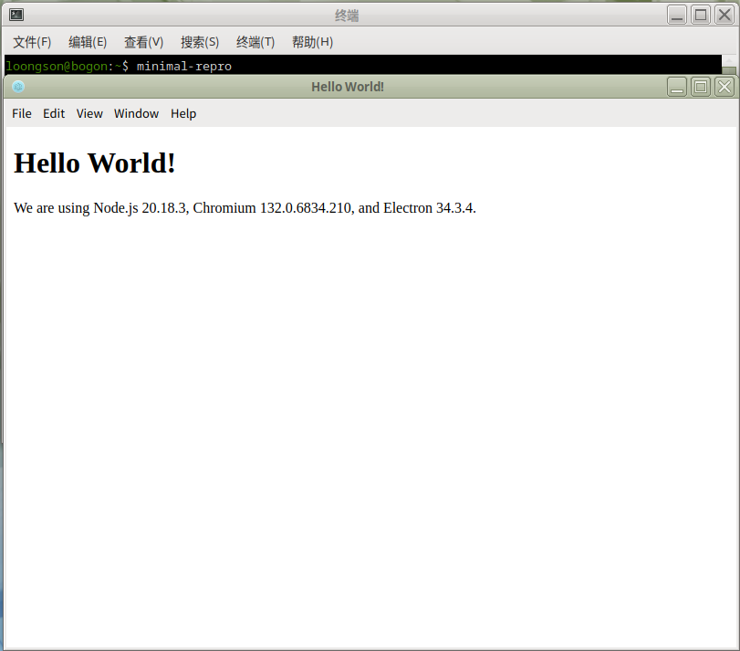

# Electron-Packager 使用教程

> 适用架构：LoongArch（龙芯）ABI1.0 | ABI2.0

`@electron/packager` 是Electron官方社区维护的应用打包工具，它的核心作用是把Electron 网页前端代码、项目资源，和对应平台架构的Electron二进制运行时合并，输出一个无需额外依赖、可以直接运行的应用程序目录，不会直接输出deb /rpm安装包。

本文档介绍在LoongArch平台下，使用 `@electron/packager` 打包Electron 应用，再生成`deb`、`rpm`安装包操作流程。

相关工具项目地址：

- 生成 deb 包：[electron-installer-debian](https://github.com/electron-userland/electron-installer-debian)
- 生成 rpm 包：[electron-installer-redhat](https://github.com/electron-userland/electron-installer-redhat)

## 1. 配置龙芯 npm 软件源
LoongArch分为 **ABI1.0 / ABI2.0** 两套ABI，两套仓库互相不兼容，对应独立的npm镜像源，请先确认系统 ABI 版本，再配置匹配的源。ABI 查看方式详见：[设置 npm 镜像源方法](../README.md)。

### ABI1.0 环境配置
```
npm set registry https://registry.loongnix.cn:4873
```
### ABI2.0 环境配置
```
npm set registry https://registry.loongnix.cn:5873
```
## 2. 安装依赖软件包
安装 @electron/packager 打包工具（支持列表可见[ABI1.0 已移植包统计列表](../stats/abi1.0_packages_stats.md) / [ABI2.0 已移植包统计列表](../stats/abi2.0_packages_stats.md))
```bash
$ npm install @electron/packager@19.0.2
```
安装deb打包工具，用于生成`.deb`安装包
```bash
$ npm install electron-installer-debian
```
安装rpm打包工具，用于生成`.rpm`安装包
```
$ npm install electron-installer-redhat
```
## 3. 项目打包流程
### 3.1 获取示例代码并安装Electron
拉取官方示例代码，进入项目目录
```
$ git clone https://github.com/electron/electron-quick-start.git
$ cd electron-quick-start
```
#### 3.1.1 ABI1.0 环境安装 Electron
设置龙芯LoongArch架构Electron镜像下载地址，安装ABI1.0的Electron（示例版本v20.0.3）
```
# 设置 LoongArch Electron 镜像地址
$ export ELECTRON_MIRROR=https://ftp.loongnix.cn/electron/LoongArch/
$ export electron_use_remote_checksums=1

# 安装指定版本 Electron（此处以 v20.0.3 为例）
$ npm install electron@20.0.3
```

#### 3.1.2 ABI2.0 环境安装 Electron
设置龙芯LoongArch架构Electron镜像下载地址，安装ABI2.0的Electron（示例版本v34.3.4）

```
# 设置 LoongArch Electron 镜像地址
export ELECTRON_MIRROR=https://github.com/loongson/electron/releases/download/
export electron_use_remote_checksums=1

# 安装指定版本 Electron（此处以 v34.3.4 为例）
$ npm install electron@34.3.4
```

### 3.2 生成可执行程序目录
执行electron-packager命令，输出应用可执行文件目录：
```bash
$ ../node_modules/@electron/packager/bin/electron-packager.mjs  . electron-quick-start --platform linux --arch loong64 --out dist/
```
参数说明：
- `--platform linux`：目标平台为 Linux
- `--arch loong64`：CPU 架构为 loongarch64
- `--out dist/`：输出产物存放目录

执行成功后，`dist`目录内会生成完整的、可直接运行的Electron应用程序目录。

#### 3.2.1 打包生成 deb 安装包
调用 `electron-installer-debian`，将上面打包好的程序目录，构建deb安装包：
```
$ ../node_modules/electron-installer-debian/src/cli.js \
  --src dist/electron-quick-start-linux-loong64/ \
  --dest dist/installers/ \
  --arch loongarch64 \
  --bin electron-quick-start
```
查看生成结果：
```
$ tree dist/installers/

dist/installers/
└── minimal-repro_1.0.0_loongarch64.deb
```
#### 3.2.2 打包生成 rpm 安装包
调用`electron-installer-redhat`，将上面打包好的程序目录，构建rpm安装包：

```
$ ../node_modules/electron-installer-redhat/src/cli.js \
  --src dist/electron-quick-start-linux-loong64/ \
  --dest dist/installers/ \
  --arch loongarch64 \
  --bin electron-quick-start
```
查看生成结果：
```
$ tree dist/installers/

dist/installers/
└── minimal-repro-1.0.0-1.loongarch64.rpm
```

## 3.3 安装与运行应用
进入安装包输出目录，安装`deb/rpm`包：
```bash
$ cd dist/installers
# dpkg安装deb包
$ sudo dpkg -i ./minimal-repro_1.0.0_loongarch64.deb
# rpm系统安装rpm包
$ sudo dnf install ./minimal-repro-1.0.0-1.loongarch64.rpm
```
安装完成后，直接在终端输入应用程序名即可启动软件：

```bash
$ minimal-repro
```

