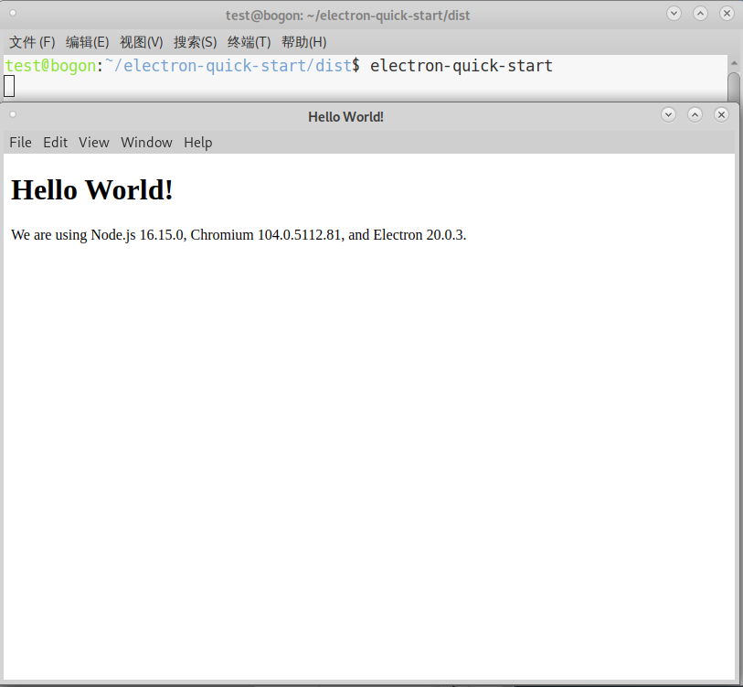

# Electron‑Builder 使用教程

Electron‑Builder是Electron生态常用的应用打包工具，能够将Electron项目编译生成各操作系统的可分发安装包，支持自动更新、代码签名、平台专属安装程序构建等能力。

> 
> 注意：在**LoongArch 平台**下，electron‑builder支持输出`deb`、`rpm`两种安装包格式。

## 1. 配置龙芯 npm 软件源
LoongArch分为 **ABI1.0 / ABI2.0** 两套ABI，两套仓库互相不兼容，对应独立的npm镜像源，请务必确认系统ABI版本后配置对应npm源。
### 1.1 查看系统 ABI 版本
执行以下终端命令，快速识别当前系统的 LoongArch ABI 版本：
```bash
$ LC_ALL=C readelf -h /bin/bash  | grep Flags: | awk -F' ' '{ print $2 }'
```
结果对应说明：
- 输出 0x3, → 当前系统为 ABI 1.0
- 输出 0x43, → 当前系统为 ABI 2.0

### 1.2 ABI1.0 环境配置源
```bash
$ npm set registry https://registry.loongnix.cn:4873
```
### 1.3 ABI2.0 环境配置源
```bash
$ npm set registry https://registry.loongnix.cn:5873
```
## 2. 安装依赖软件包
龙芯 npm 仓库已提供适配版本的`builder‑util`，版本号需要和`electron‑builder`保持一致。
可查阅[ABI1.0 已移植包统计列表](../stats/abi1.0_packages_stats.md)、[ABI2.0 已移植包统计列表](../stats/abi2.0_packages_stats.md)，查看版本信息。

### 2.1 deb 系列系统配置
以 `electron‑builder@24.13.3` 为例，可根据实际项目调整版本
```
# 安装electron‑builder
$ npm install electron-builder@24.13.3

# 安装fpm编译运行依赖环境
$ sudo apt-get install ruby ruby-dev rubygems build-essential

# 安装fpm打包工具
$ sudo gem install --no-document fpm

# 设置环境变量，强制使用系统安装的fpm
$ export USE_SYSTEM_FPM="true"
```
### 2.2 rpm 系列系统配置
```
# 安装electron‑builder
$ npm install electron-builder@24.13.3

# 安装fpm编译运行依赖环境
$ sudo dnf install ruby-devel gcc make rpm-build libffi-devel

# 安装fpm打包工具
$ sudo gem install --no-document fpm

# 设置环境变量，强制使用系统安装的fpm
$ export USE_SYSTEM_FPM="true"
```

## 3. 项目打包操作
### 3.1 获取示例代码并安装 Electron
```
# 拉取示例代码
$ git clone https://github.com/electron/electron-quick-start.git
$ cd electron-quick-start
```
#### 3.1.1 ABI1.0 环境安装 Electron
```
# 设置 LoongArch Electron 镜像地址
$ export ELECTRON_MIRROR=https://ftp.loongnix.cn/electron/LoongArch/
$ export electron_use_remote_checksums=1

# 安装指定版本 Electron（此处以 v20.0.3 为例）
$ npm install electron@20.0.3
```

#### 3.1.2 ABI2.0 环境安装 Electron

```
# 设置 LoongArch Electron 镜像地址
export ELECTRON_MIRROR=https://github.com/loongson/electron/releases/download/
export electron_use_remote_checksums=1

# 安装指定版本 Electron（此处以 v34.3.4 为例）
$ npm install electron@34.3.4
```

### 3.2 修改 package.json 打包配置
```
{
  "name": "electron-quick-start",
  "version": "1.0.0",
  "description": "A minimal Electron application",
  "main": "main.js",
  "scripts": {
    "start": "electron .",
    "build": "electron-builder"
  },
  "repository": "https://github.com/electron/electron-quick-start",
  "keywords": [
    "Electron",
    "quick",
    "start",
    "tutorial",
    "demo"
  ],
  "build": {
    "linux": {
      "target": [
        "deb",
        "rpm"
      ],
      "icon": "build/icons"
    },
    "electronDownload": {
      "mirror": "https://github.com/loongson/electron/releases/download/",
      "customDir": "v34.3.4"
    }
  },
  "author": {
    "name": "xxx",
    "email": "xxx"
  },
  "license": "CC0-1.0",
  "devDependencies": {
    "electron": "^34.3.4"
  }
}

```
配置说明：

1. `scripts.build`：定义打包执行命令，运行 `npm run build` 触发 electron‑builder；
2. `build.linux.target`：Linux 平台输出包类型，填写`deb`、`rpm`；
3. `build.linux.icon`：应用图标目录相对路径，根据项目实际路径修改；
4. `electronDownload.mirror`：LoongArch Electron 二进制镜像地址；ABI1.0 使用 `https://ftp.loongnix.cn/electron/LoongArch/`，ABI2.0 使用 `https://github.com/loongson/electron/releases/download/`；
5. `electronDownload.customDir`：指定 Electron 版本目录，必须与项目安装的 Electron 版本保持一致；
6. `author.name/uthor.email`：应用作者信息，按需修改；
7. `devDependencies.electron`：声明依赖的 Electron，版本和实际使用版本保持一致；

> 更多配置可参考官方文档：[https://www.electron.build/](https://www.electron.build/#/)

### 3.3 执行打包

项目根目录执行打包命令：

```
$ npm run build
```

打包完成后产物输出至项目 `dist` 目录，`deb`、`rpm` 安装包保存在该目录下。

## 4. 安装与运行应用

演示安装过程：

```
# 进入产物输出目录
$ cd dist

# dpkg安装deb包
$ sudo dpkg -i ./electron-quick-start_1.0.0_loong64.deb

# rpm系统安装rpm包
$ sudo dnf install ./electron-quick-start-1.0.0.loongarch64.rpm
```

安装完成后，终端直接输入应用名启动程序：

```
$ electron-quick-start
```
