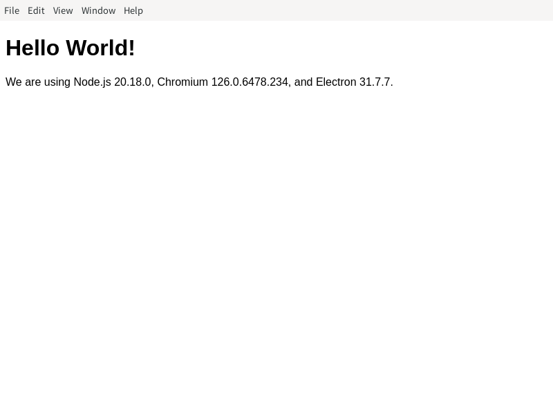

# Electron 安装使用教程

> 适用架构：LoongArch（龙芯）ABI1.0 | ABI2.0

Electron是使用JavaScript、HTML和CSS构建跨平台的桌面应用程序。Electron基于Chromium和Node.js，可以使用HTML、CSS和JavaScript构建应用，是一个由GitHub及众多贡献者组成的活跃社区共同维护的开源项目, 兼容Mac、Windows和Linux，可以构建出三个平台的应用程序。

参考文档：

- Electron 官方文档：https://www.electronjs.org/docs/latest/
- 龙芯 Electron 仓库：https://github.com/loongson/electron
- 可安装版本清单：[LoongArch Electron 版本清单](../stats/electron_supported_versions.md)

## 目录

- [一、配置龙芯 npm 软件源](#sec-1)
- [二、安装 Electron](#sec-2)
  - [2.1 ABI1.0 安装](#sec-2-1)
  - [2.2 ABI2.0 安装](#sec-2-2)
  - [2.3 验证安装结果](#sec-2-3)
- [三、运行 Hello World 程序](#sec-3)

<a id="sec-1"></a>

## 一、配置龙芯 npm 软件源

LoongArch 分为 **ABI1.0 / ABI2.0** 两套 ABI，两套仓库互相不兼容，对应独立的 npm 镜像源，请先确认系统 ABI 版本，再配置匹配的源。ABI 查看方式详见：[设置 npm 镜像源方法](../README.md)。

### 1.1 ABI1.0 环境配置

```bash
$ npm set registry https://registry.loongnix.cn:4873
```

### 1.2 ABI2.0 环境配置

```bash
$ npm set registry https://registry.loongnix.cn:5873
```

<a id="sec-2"></a>

## 二、安装 Electron

> Electron 从 **v15.0.0** 起需要额外设置环境变量 `electron_use_remote_checksums=1`，用于从镜像地址获取校验文件（`SHASUMS256.txt`）。

<a id="sec-2-1"></a>

### 2.1 ABI1.0 安装

镜像地址：`https://ftp.loongnix.cn/electron/LoongArch/`，以下命令以 **v31.7.7** 为例：

- **全局安装**

```bash
$ sudo ELECTRON_MIRROR=https://ftp.loongnix.cn/electron/LoongArch/ electron_use_remote_checksums=1 npm install -g electron@31.7.7
```

- **本地安装**

```bash
$ ELECTRON_MIRROR=https://ftp.loongnix.cn/electron/LoongArch/ electron_use_remote_checksums=1 npm install electron@31.7.7
```

<a id="sec-2-2"></a>

### 2.2 ABI2.0 安装

镜像地址：`https://github.com/loongson/electron/releases/download/`，以下命令以 **v34.3.4** 为例：

- **全局安装**

```bash
$ sudo ELECTRON_MIRROR=https://github.com/loongson/electron/releases/download/ electron_use_remote_checksums=1 npm install -g electron@34.3.4
```

- **本地安装**

```bash
$ ELECTRON_MIRROR=https://github.com/loongson/electron/releases/download/ electron_use_remote_checksums=1 npm install electron@34.3.4
```

<a id="sec-2-3"></a>

### 2.3 验证安装结果

```bash
## 全局安装：直接使用 electron 命令
$ electron --version

## 本地安装：使用项目内的可执行文件
$ ./node_modules/.bin/electron --version
```

<a id="sec-3"></a>

## 三、运行 Hello World 程序

下面演示一个简单的 Hello World 程序从安装到运行的全过程：

### 3.1 克隆官方示例仓库

```bash
$ git clone https://github.com/electron/electron-quick-start.git
$ cd electron-quick-start
$ vim package.json
```

### 3.2 修改 package.json 中的 Electron 版本

```json
{
  "name": "electron-quick-start",
  "version": "1.0.0",
  "description": "A minimal Electron application",
  "main": "main.js",
  "scripts": {
    "start": "electron ."
  },
  "repository": "https://github.com/electron/electron-quick-start",
  "keywords": [
    "Electron",
    "quick",
    "start",
    "tutorial",
    "demo"
  ],
  "author": "GitHub",
  "license": "CC0-1.0",
  "devDependencies": {
    "electron": "31.7.7"
  }
}
```

将 `devDependencies` 中的 `"electron"` 改为要安装的版本号，本章示例使用 **31.7.7**。

### 3.3 安装依赖

由于是通过 `package.json` 安装，不是单独安装 Electron，所以先设置环境变量，再执行 `npm install`：

#### 3.3.1 ABI1.0

```bash
$ export ELECTRON_MIRROR=https://ftp.loongnix.cn/electron/LoongArch/
$ export electron_use_remote_checksums=1
$ npm install
```

#### 3.3.2 ABI2.0

```bash
$ export ELECTRON_MIRROR=https://github.com/loongson/electron/releases/download/
$ export electron_use_remote_checksums=1
$ npm install
```

### 3.4 运行程序

```bash
$ npm start
```

若窗口正常弹出并显示 “Hello World” 字样，则安装成功，如图所示：


