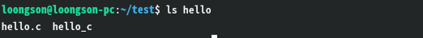

# LoongArch上deepseek-harness使用指南


## 1. LoongArch npm 仓库地址配置
LoongArch分为 **ABI1.0 / ABI2.0** 两套ABI，两套仓库互相不兼容，对应独立的npm镜像源，请务必确认系统ABI版本后配置对应npm源。

### 1.1 查看系统 ABI 版本
执行以下终端命令，快速识别当前系统的 LoongArch ABI 版本：
```bash
$ LC_ALL=C readelf -h /bin/bash  | grep Flags: | awk -F' ' '{ print $2 }'
```
结果对应说明：
- 输出 0x3, → 当前系统为 ABI 1.0
- 输出 0x43, → 当前系统为 ABI 2.0

### 1.2 ABI1.0 环境配置源
```bash
$ npm set registry https://registry.loongnix.cn:4873
```
### 1.3 ABI2.0 环境配置源
```bash
$ npm set registry https://registry.loongnix.cn:5873
```
## 2. 安装并运行deepseek-harness

软件包：@deepseek-ai/dsh

**版本说明:**

- **ABI1.0版本**：0.1.1-rc.2
- **ABI2.0版本**：0.1.1-rc.2 ~ 最新版本
- **Node.js 版本要求**：≥ v22.16.0

### 2.1 ABI1.0 安装 & 启动
```sh
# 安装指定版本
$ npm install @deepseek-ai/dsh@0.1.1-rc.2
# 启动Web服务
$ node --expose-internals ./node_modules/@deepseek-ai/dsh/lib/bin.js web
```
### 2.2 ABI2.0 快速启动
npx方式无需手动安装包，直接运行：
```sh
$ npx @deepseek/dsh web
```
## 3. Web 界面使用流程
1. 服务启动成功后，终端会输出日志（参考截图）:


2. 在浏览器打开终端给的链接 `http://127.0.0.1:3080`，进入 deepseek-harness Web 页面


3. 在弹窗的API Key输入框，填入DeepSeek 大模型API密钥，完成鉴权


4. 选择工作区，大模型将在此工作区进行相关操作，如执行文件读取、代码生成等操作


5. 输入指令调用大模型：


6. 模型生成的文件会保存在所选工作区目录



## 4. 扩展：接入其他大模型

本工具支持配置其他模型服务商。详细配置方法请查阅官方社区文档：

> [https://deepseek-harness.github.io/deepseek-harness/guide/providers](https://deepseek-harness.github.io/deepseek-harness/guide/providers)


