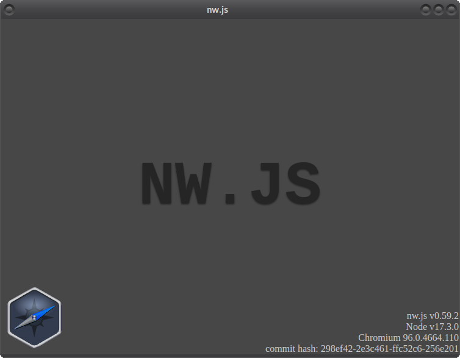
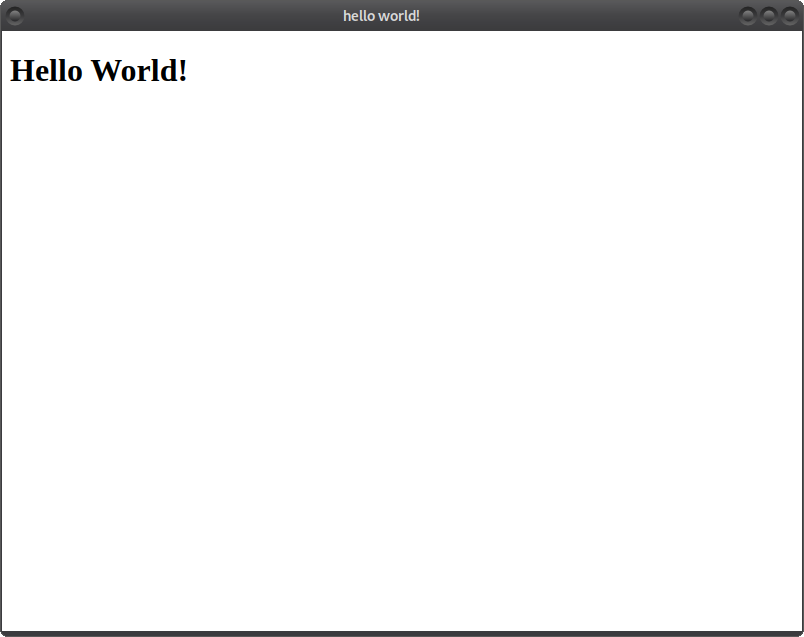

# NW.js LoongArch 安装使用教程

- LoongArch版本NW.js下载路径：http://ftp.loongnix.cn/nwjs/LoongArch/
- NW.js社区文档教程：https://nwjs.readthedocs.io/en/latest/

## 一、NW.js 安装
本文以 **v0.59.2** 版本为例，提供两种安装方式：二进制 SDK 包安装、npm 包管理器安装。
### 方式 1：二进制 SDK 包安装

1. 下载压缩包
```
$ wget -c http://ftp.loongnix.cn/nwjs/LoongArch/v0.59.2/nwjs-sdk-v0.59.2-linux-loong64.tar.gz
```
2. 解压文件
```
$ tar -xvf nwjs-sdk-v0.59.2-linux-loong64.tar.gz
```
3. 进入目录并运行验证
```
$ cd nwjs-sdk-v0.59.2-linux-loong64
$ ./nw
```
运行成功后会输出版本信息，效果如下图：



### 方式 2：npm 包管理器安装

#### 步骤 1：配置龙芯 npm 源

```
# 设置镜像源
$ sudo npm set registry https://registry.loongnix.cn:4873

# 校验源是否生效
$ sudo npm config get registry
```

输出 `https://registry.loongnix.cn:4873/` 即配置成功。

#### 步骤 2：执行安装
##### （1）全局安装
```
$ sudo npm install nw@0.59.2 -g
```
##### （2）项目本地安装
```
$ npm install nw@0.59.2
```
## 二、运行 Hello World 示例

### 步骤 1：创建项目目录
```
$ mkdir example
$ cd example
```
### 步骤 2：新建应用配置 package.json
```
$ vim package.json
```

写入以下内容：

```
{
  "name": "helloworld",
  "main": "index.html",
  "scripts": {
    "start": "nw"
  }
}
```
说明：

- `main`：指定 NW.js 启动打开的首页入口文件；
- `name`：应用唯一标识；
- `scripts.start`：配置启动命令。

### 步骤 3：新建页面文件 index.html

```
$ vim index.html
```

写入内容：

```
<!DOCTYPE html>
<html>
<head>
    <title>hello world!</title>
</head>
<body>
    <h1>Hello World!</h1>
</body>
</html>
```
这是标准 HTML 页面，您可以使用最新浏览器支持的任何网络技术。

### 步骤 4：在项目内安装 NW.js 依赖

```
$ npm install nw@0.59.2
```
> 也可以使用前面下载的 SDK 二进制包启动程序。

### 步骤 5：启动运行项目
```
$ ./node_modules/.bin/nw
```
弹出程序窗口、显示 Hello World 字样即为执行成功，效果如下图：


