# LoongArch上ZCode使用指南

ZCode 是智谱（Z.ai）推出的桌面版 AI 编程客户端，内置 Agent 能力：可以读写工程文件、执行命令、检索资料并分步完成复杂开发任务。支持智谱账号登录、API Key 登录，以及数十家第三方模型供应商（Kimi、DeepSeek、通义千问、火山方舟、OpenAI、Anthropic、OpenRouter、OpenCode 等），同时支持自定义 OpenAI/Anthropic 兼容接口。

上游仓库：[https://github.com/zai-org/ZCode](https://github.com/zai-org/ZCode)

插件仓库：[https://github.com/zai-org/zcode-plugins](https://github.com/zai-org/zcode-plugins)

下载地址：[https://github.com/Xiao-Tao/ZCode/releases/tag/v4.0.0](https://github.com/Xiao-Tao/ZCode/releases/tag/v4.0.0)

**版本说明：**

- **可用版本**：4.0.0
- **支持 ABI**：ABI1.0 | ABI2.0

## 一、安装

ZCode 4.0.0 在 GitHub 发布页上同时提供 **ABI1.0** 和 **ABI2.0** 两套安装包，**两套 ABI 互不兼容**，所以第一步必须先确认系统 ABI。

### 1. 确认系统 ABI

```sh
$ LC_ALL=C readelf -h /bin/bash | grep Flags: | awk -F' ' '{ print $2 }'
```
- 输出 0x3, → 当前系统为 ABI 1.0
- 输出 0x43, → 当前系统为 ABI 2.0

### 2. 下载安装包（按 ABI 和系统选择）

```sh
# ABI1.0（deb 系）
$ wget https://github.com/Xiao-Tao/ZCode/releases/download/v4.0.0/ZCode-4.0.0-linux-ABI1.0-loongarch64.deb

# ABI2.0（deb 系）
$ wget https://github.com/Xiao-Tao/ZCode/releases/download/v4.0.0/ZCode-4.0.0-linux-loong64.deb

# ABI2.0（rpm 系）
$ wget https://github.com/Xiao-Tao/ZCode/releases/download/v4.0.0/ZCode-4.0.0-linux-loongarch64.rpm
```

下载后建议核对 sha256 防止下错或包不完整：

```sh
$ sha256sum ZCode-4.0.0-linux-*.deb ZCode-4.0.0-linux-*.rpm

bf3e12b9c4aca617fcfe7d2ae27264bde74e3057ca3c053af6244cec1bd04d33  ZCode-4.0.0-linux-ABI1.0-loongarch64.deb
dc93717ac151c3b4d2cdfde5a81029eebcd1db460723fa6a20feb1efc3ef84e7  ZCode-4.0.0-linux-loong64.deb
64fa875217a4faad3dc3c790d6ea93e0b2bc1bed52a3a8634bb4f59bba57af03  ZCode-4.0.0-linux-loongarch64.rpm
```

### 3. 安装

deb 包：

```sh
$ sudo dpkg -i ZCode-4.0.0-linux-ABI1.0-loongarch64.deb    # ABI1.0
$ sudo dpkg -i ZCode-4.0.0-linux-loong64.deb               # ABI2.0
```

rpm 包：

```sh
$ sudo rpm -ivh ZCode-4.0.0-linux-loongarch64.rpm          # ABI2.0
```

### 4. 验证

```sh
$ dpkg -l zcode | tail -1      # deb：显示 4.0.0，架构 loongarch64 / loong64
$ rpm -q zcode                 # rpm：显示 zcode-4.0.0-1.loongarch64
```

## 二、启动登录

在桌面环境下点击图标，或在终端执行 `zcode`。首次启动会显示「全新登场」引导页，介绍设计、会话工具、工作树等功能，点「开始体验」继续：

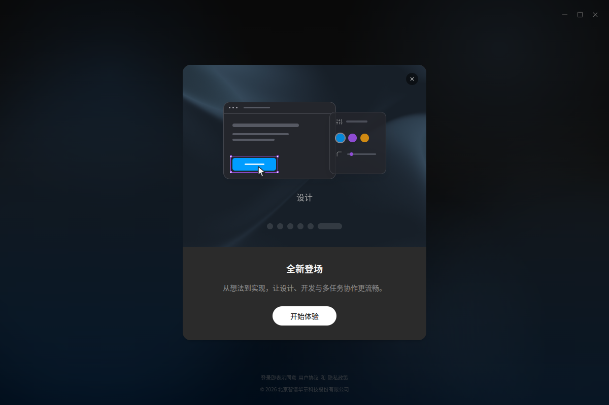

引导页之后进入登录界面，提供两种方式：**浏览器授权登录** 和 **使用 API key**。

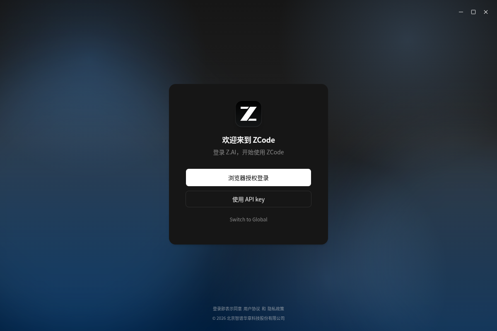

1. **浏览器授权登录**：点击后自动拉起系统浏览器打开 `zchat.z.ai` 的 OAuth 授权页，登录账号并完成人机验证即可回跳客户端。适合已有智谱 Coding Plan 的用户。

2. **使用 API key**：在表单里粘贴智谱系的 API Key 后点「继续」。注意下拉框只提供 **Z.ai** 和 **BigModel** 两个来源：

   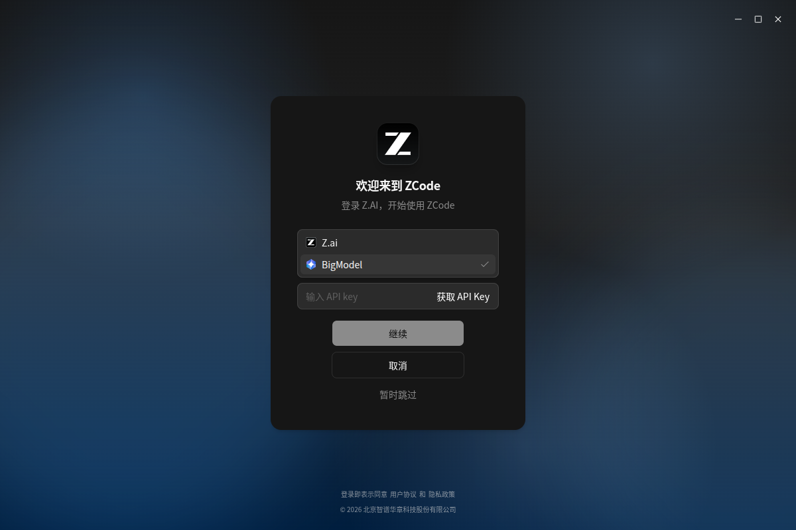

3. **暂时跳过**：如果手里是其它厂商的 Key（Kimi、DeepSeek、OpenCode 等），先点「暂时跳过」，进入客户端后在设置里添加供应商，跳过登录后会走三步使用引导（工作方向、UI 模式），每一步都可以直接跳过。

## 三、配置模型供应商

登录后如果还没有可用模型，主界面会提示「当前没有可用模型，请开通编程套餐或配置自定义模型」，点右侧「配置」进入模型设置：

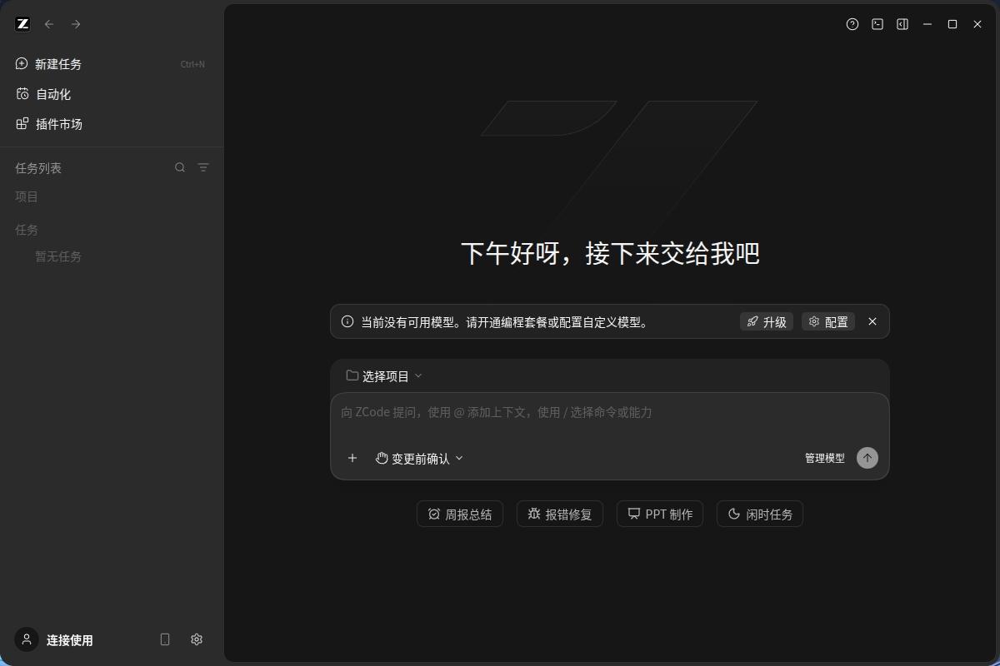

模型设置里可以看到已添加的供应商列表，右上角「+ 添加供应商」用于新增：

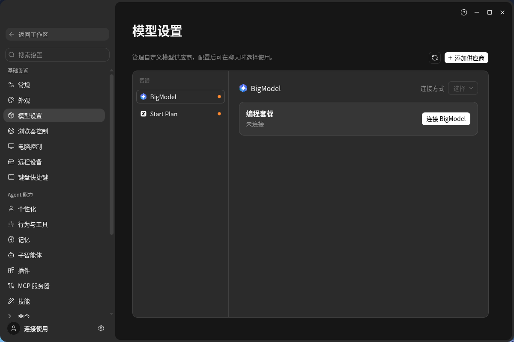

供应商列表分为「智谱」（BigModel / Z.ai 的 Coding Plan 与 API）和「其他」（Kimi、MiniMax、DeepSeek、阿里云百炼、腾讯 TokenHub、小米 MiMo、火山方舟、阶跃星辰、OpenAI、Anthropic、xAI、硅基流动、OpenRouter、OpenCode Go / Zen 等），最后一栏「创建自定义供应商」可以填任意 OpenAI Chat Completions、OpenAI Responses 或 Anthropic Messages 兼容端点：

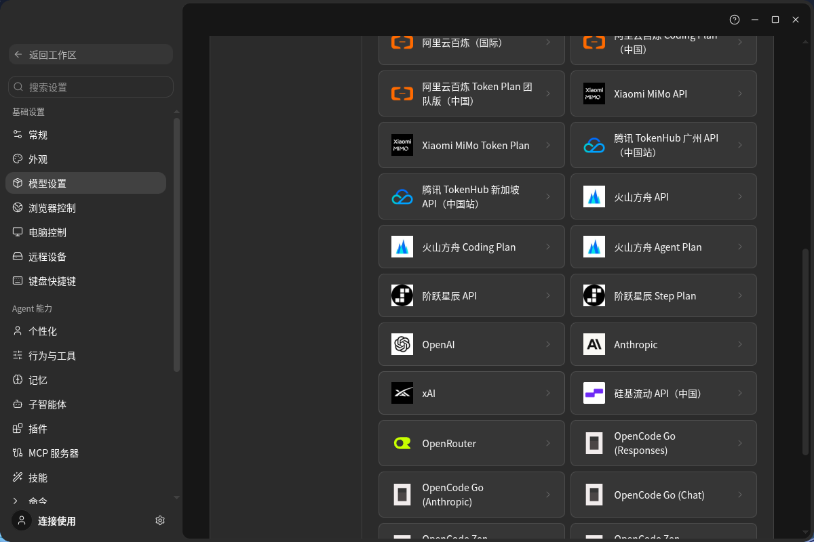

以 **OpenCode Go** 为例，选中 `OpenCode Go (Chat)` 模板后只需三件事：确认 Base URL 与 API 格式、填入 API Key、按需开关模型列表里的条目：

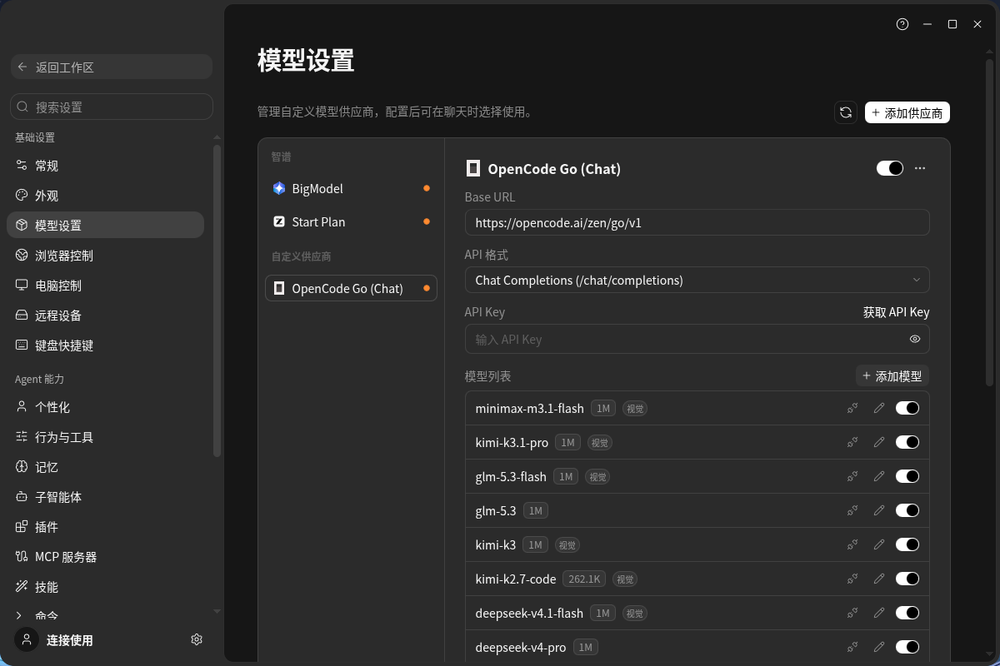

Key 填好即自动保存，界面左下角提示「保存成功」，左侧供应商前出现绿点表示已就绪：

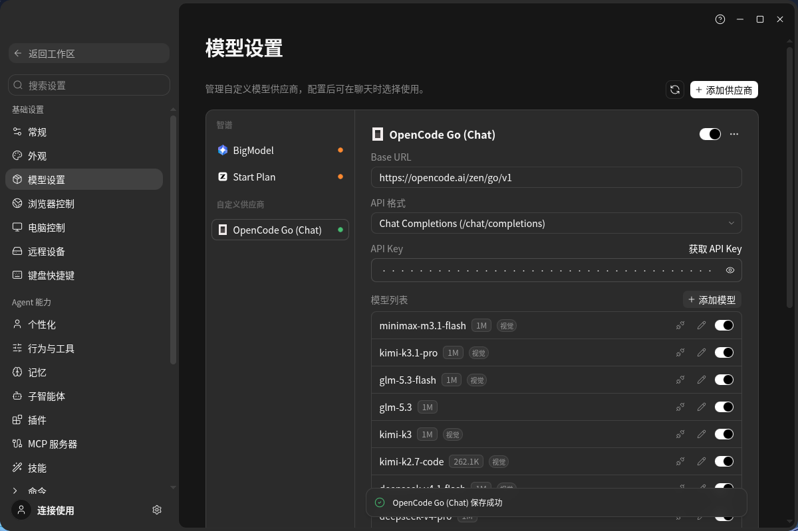

回到工作区，点击输入框右下角的模型名可以切换模型和思考强度（例如 `deepseek-v4.1-flash` + 最高）：

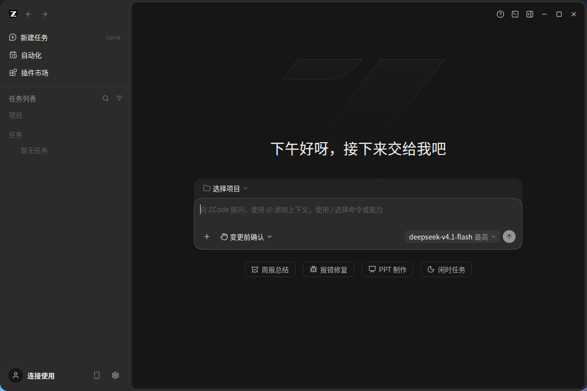

## 四、开始使用

在输入框描述任务即可，`Enter` 发送、`Shift+Enter` 换行，也可以用 `@` 添加文件、`/` 调出命令与技能。一个简单的问答示例：

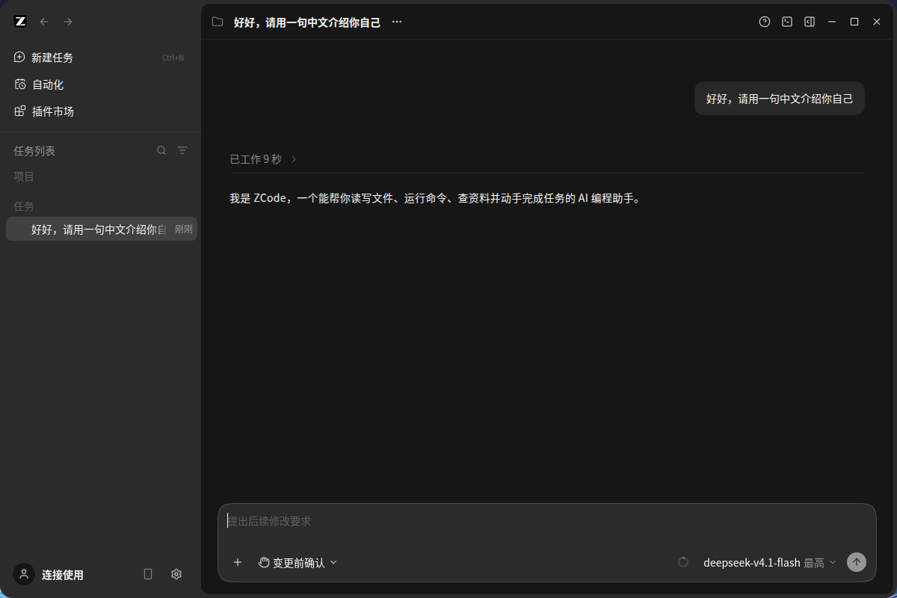

需要动文件或执行命令时，ZCode 会先展示工具调用，修改文件默认弹权限确认框，可选「允许（仅这次）」「始终允许本项目」「允许并切换到自主模式」「拒绝」，或直接告诉模型接下来怎么做：

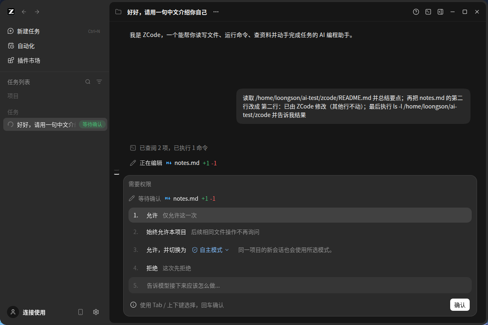

读取文件、执行命令、修改文件的结果都会回到对话里，并附上对输出的解读：

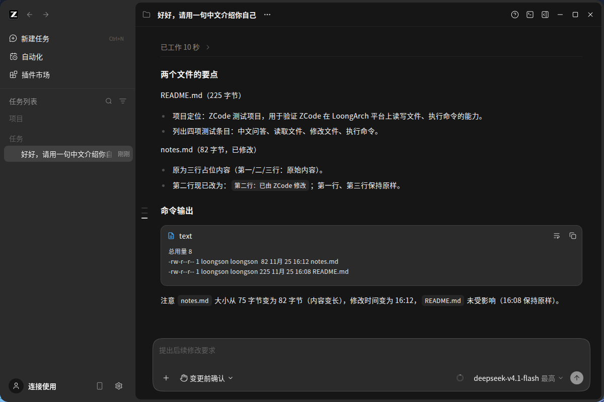

## 五、插件市场

ZCode 的插件由官方插件市场统一分发，在客户端左侧导航的「插件市场」入口即可浏览与安装。仓库里目前收录的插件示例：

| 插件 | 分类 | 说明 |
| --- | --- | --- |
| `cloudbase-skills` | developer-tools | 腾讯云 CloudBase 开发技能与 MCP 集成（Web、小程序、数据库、云函数等） |
| `blender` | productivity | Blender 官方 MCP 集成，可检查/编辑场景、执行 bpy、截图与渲染 |
| `mimosa` | developer-tools | 本地优先的安全护栏：写入前钩子、评审与 Git 门禁、可选深度扫描 |
| `github` / `gitlab` | developer-tools | GitHub CLI / GitLab CLI 工作流（提交、PR/MR、Issue、CI/CD、Release） |

