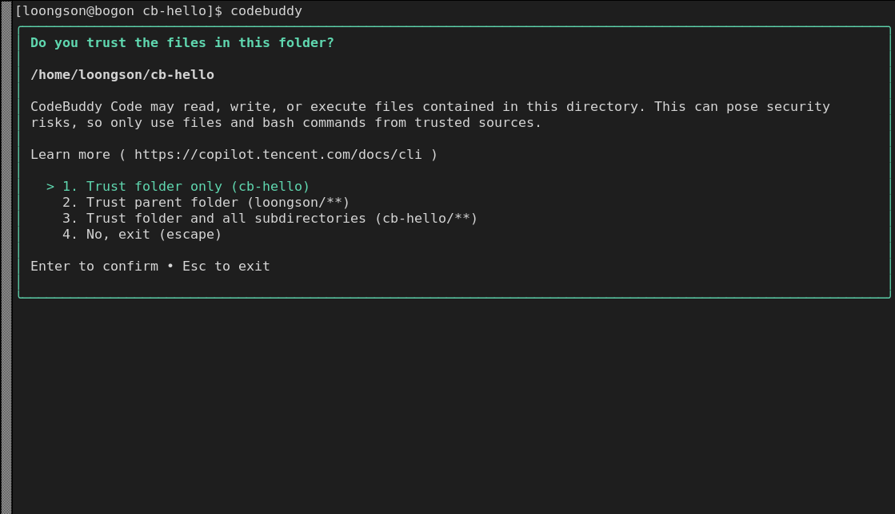
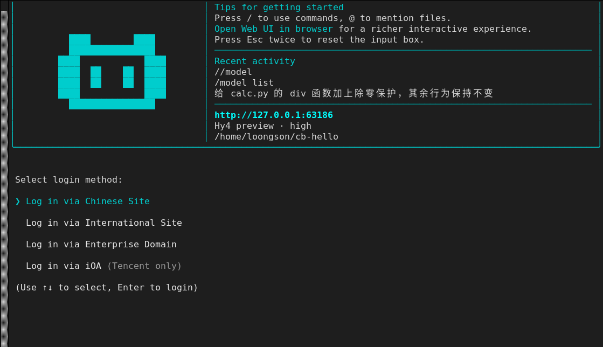
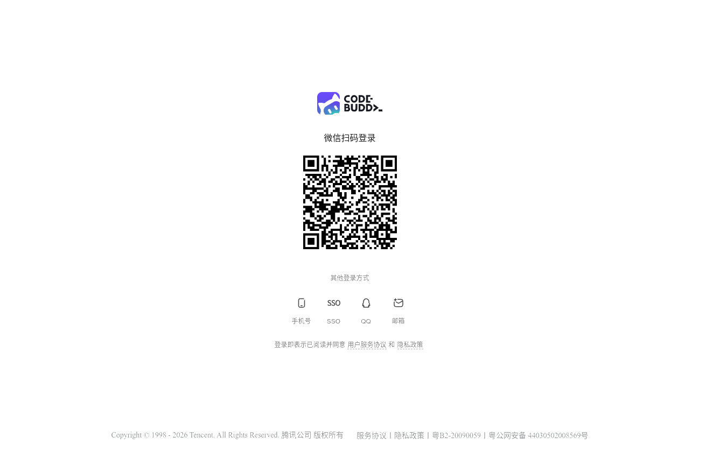
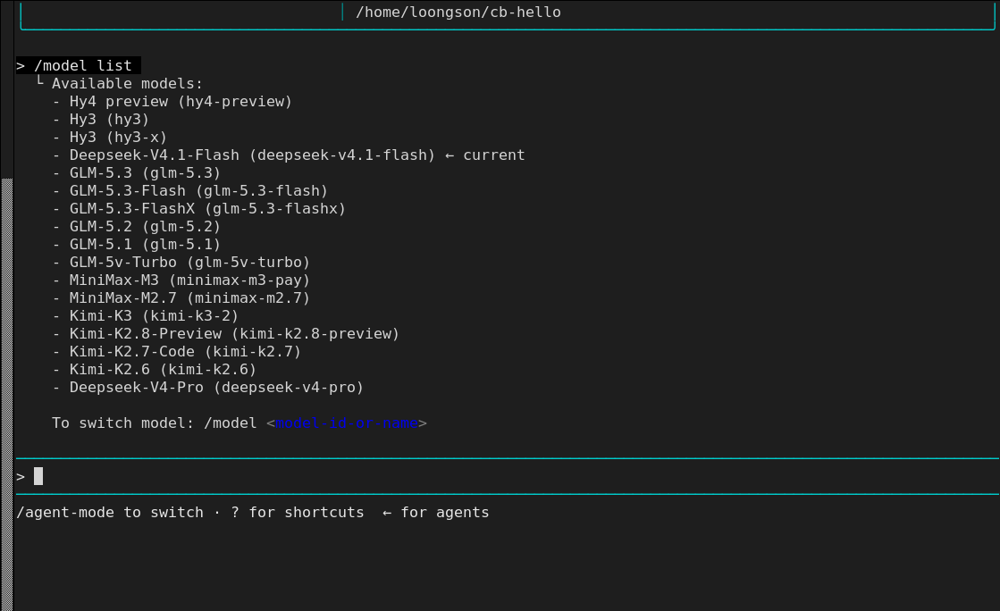
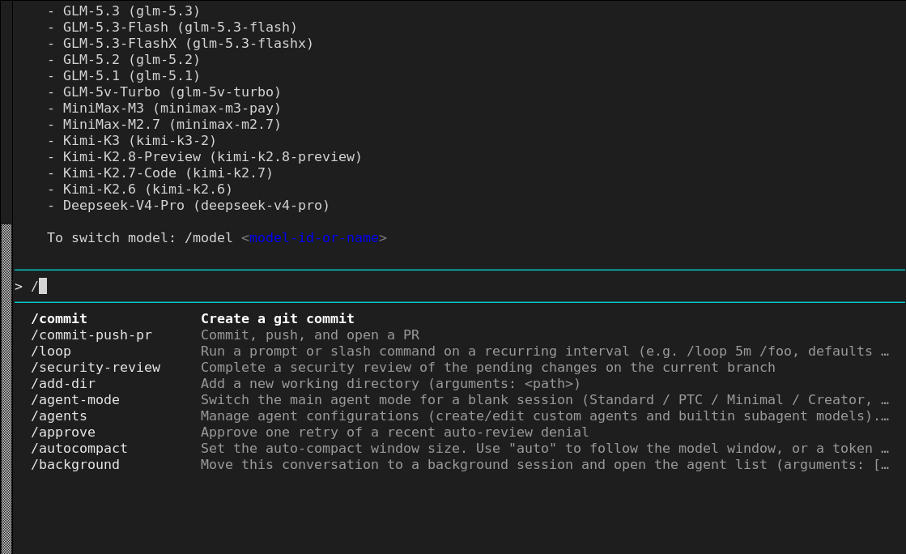
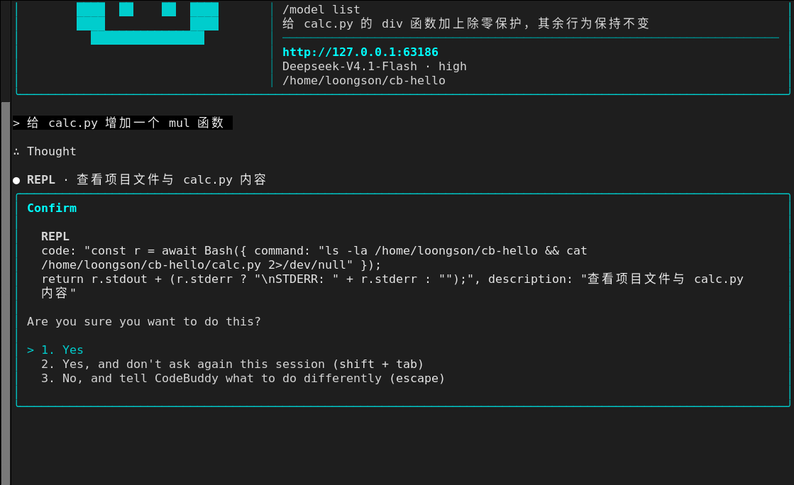
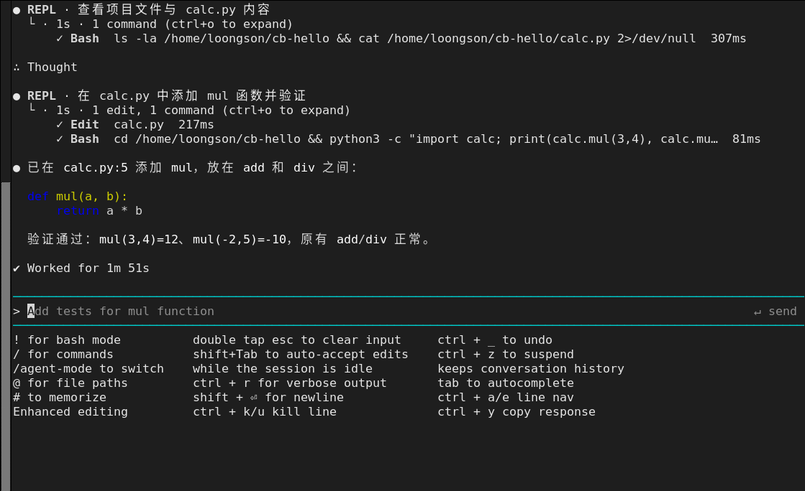

# LoongArch上codebuddy使用指南

CodeBuddy Code 是一个智能编程助手，终端命令为 `codebuddy`（简写 `cbc`），深度集成到您的开发环境中，精准理解您的项目结构，通过自然语言交互帮助您高效编程——自动化重复任务、深度解析代码逻辑、优化开发工作流程。支持终端、IDE 无缝使用，让编程更智能、更高效。

上游仓库：[https://cnb.cool/codebuddy/codebuddy-code](https://cnb.cool/codebuddy/codebuddy-code)

官方文档：[https://copilot.tencent.com/docs/cli](https://copilot.tencent.com/docs/cli)

**版本说明：**

- **可用版本**：2.179.3 ~ 最新版本
- **支持 ABI**：支持 ABI1.0 | ABI2.0

## 一、配置 LoongArch npm 仓库

LoongArch分为 **ABI1.0 / ABI2.0** 两套 ABI，两套仓库互相不兼容，对应独立的 npm 镜像源，请先确认系统 ABI 版本，再配置匹配的源。ABI 查看方式详见：[设置 npm 镜像源方法](../../README.md)。

### ABI1.0 环境配置

```sh
$ npm set registry https://registry.loongnix.cn:4873
```

### ABI2.0 环境配置

```sh
$ npm set registry https://registry.loongnix.cn:5873
```

## 二、安装 codebuddy

ABI1.0 与 ABI2.0 使用同一条安装命令，配置好对应源后全局安装：

```sh
$ npm install -g @tencent-ai/codebuddy-code
```

安装完成后用 `codebuddy --version` 确认版本：

```sh
$ codebuddy --version
2.179.3
```

## 三、首次启动：信任目录

在项目目录下执行：

```sh
$ codebuddy
```

首次在某个目录启动时，CodeBuddy 会先询问是否信任该目录。未信任之前，它不会读取、写入或执行该目录下的任何文件：



四个选项分别是：

- 1.Trust folder only (cb-hello)`：只信任当前目录
- 2.Trust parent folder (loongson/**)`：信任父目录及其下所有子目录
- 3.Trust folder and all subdirectories (cb-hello/**)`：信任当前目录及其下所有子目录
- 4.No, exit (escape)`：不信任，直接退出

选择后目录会写入 `~/.codebuddy/settings.json` 的 `trustedDirectories` 字段，下次在同一目录启动不再询问。

## 四、登录与配置大模型

信任目录后会进入登录方式选择，主界面下方浮出登录菜单：



共四种方式：中国站点（`codebuddy.cn`）、国际站点（`codebuddy.ai`）、企业域（Enterprise Domain）与 iOA（仅腾讯内网）。选中后按提示在浏览器完成授权即可。

以中国站点为例，选中后终端会给出登录链接，浏览器打开的就是下面这个登录页：支持微信扫码，也可以切到底部的手机号、SSO、QQ、邮箱登录：



如果使用中转或自建网关，也可以直接用环境变量提供凭据，跳过交互登录：

```sh
$ export CODEBUDDY_API_KEY="你的 API Key"
$ export CODEBUDDY_BASE_URL="https://你的中转地址"   # 可选，默认走官方端点
```

`/model list` 会列出当前账号可用的全部模型（带 `← current` 标记的是当前模型），`/model <model-id>` 直接切换：



## 五、开始使用

启动后的主界面：左侧是 logo 区，右侧是使用提示、最近会话（Recent activity）、Web UI 地址与当前模型/工作目录，底部是输入框和状态栏：


输入框里以 `/` 开头会唤出斜杠命令面板，常用命令有 `/model`（切换模型）、`/init`（生成 CODEBUDDY.md 或 AGENTS.md）、`/commit`（生成提交）、`/security-review`（安全评审）、`/add-dir`（追加工作目录）、`/agent-mode`（切换 Standard / PTC / Minimal 等模式）、`/clear` 等：



直接用自然语言描述任务即可，CodeBuddy 会调用工具（读文件、改文件、执行命令）。默认每次工具调用前都会弹确认框，选项为「仅本次同意」「本会话不再询问（shift + tab）」「拒绝并补充说明（escape）」：



确认后会依次执行，结束后给出结果：


输入框下方还提示了几种快捷输入方式：

- `!命令`：在会话中直接执行 shell 命令（切到 bash 模式）
- `@路径`：把指定文件或目录加入上下文
- `#内容`：写入记忆

## 六、常用快捷键

在空输入框按 `?` 会展开底部的快捷键与状态提示：



常用的几个：

| 快捷键 | 作用 |
| --- | --- |
| `Esc` | 打断当前输出、关闭弹窗 |
| `Esc` `Esc` | 清空输入框 |
| `Ctrl+C` | 清空当前输入（连按两次退出） |
| `Shift+Tab` | 会话内自动接受编辑，不再逐个确认 |
| `Tab` | 补全命令、文件路径 |
| `Ctrl+O` | 展开工具调用详情（`ctrl+o to expand`） |
| `Ctrl+R` | 切换详细（verbose）输出 |
| `Ctrl+_` | 撤销输入 |
| `Ctrl+K` / `Ctrl+U` | 删除光标之后 / 之前的内容 |
| `Ctrl+A` / `Ctrl+E` | 跳到行首 / 行尾 |
| `Ctrl+Y` | 复制上一次回复 |
| `Ctrl+Z` | 挂起（`fg` 恢复） |
| `Shift+Enter` | 输入换行 |

