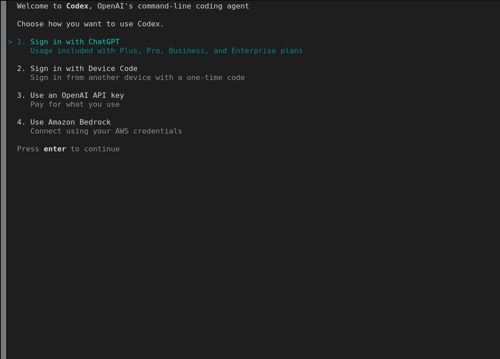
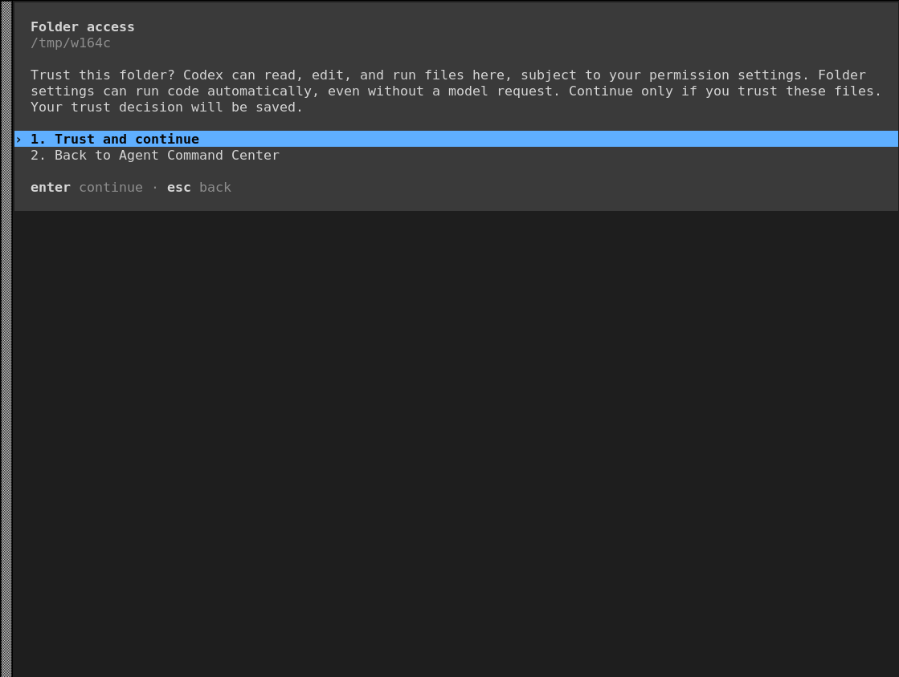
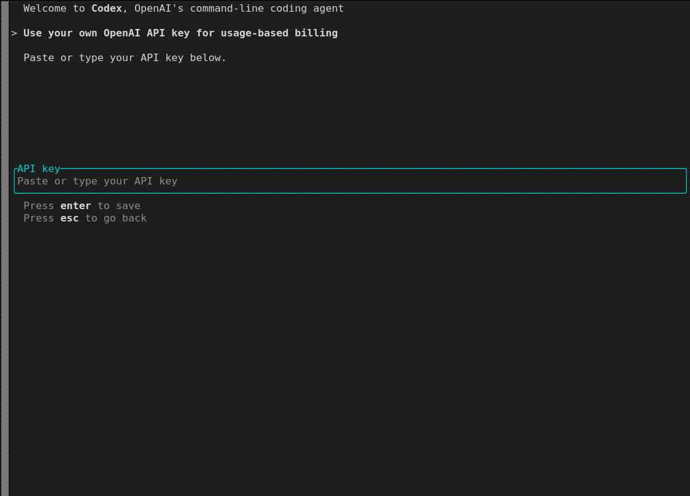
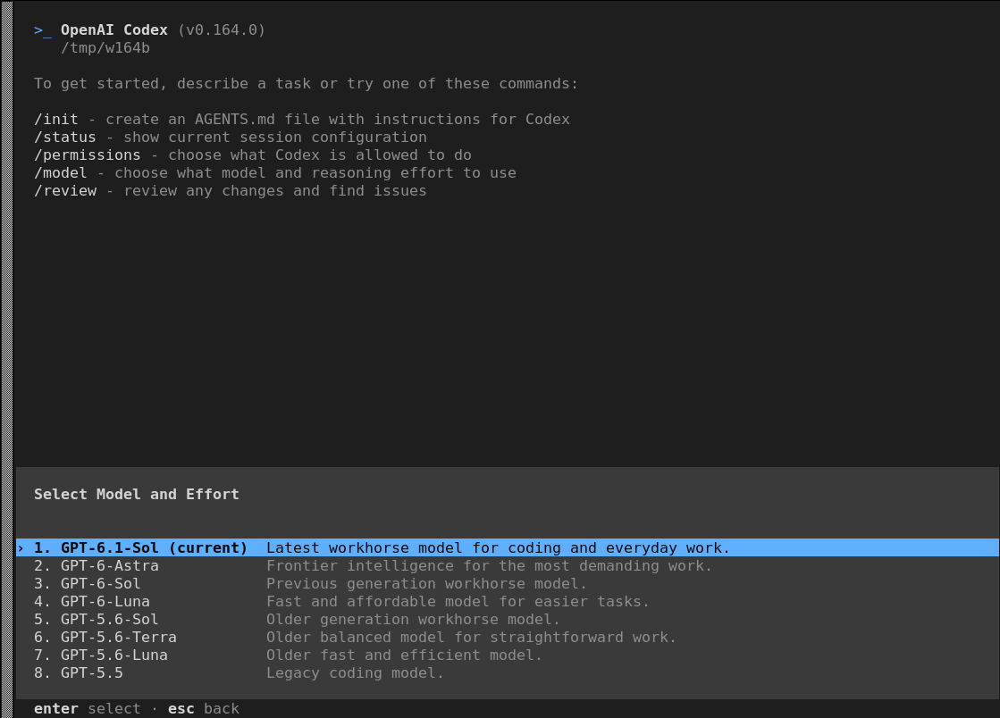
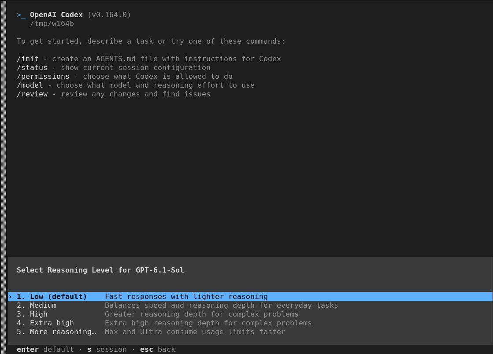
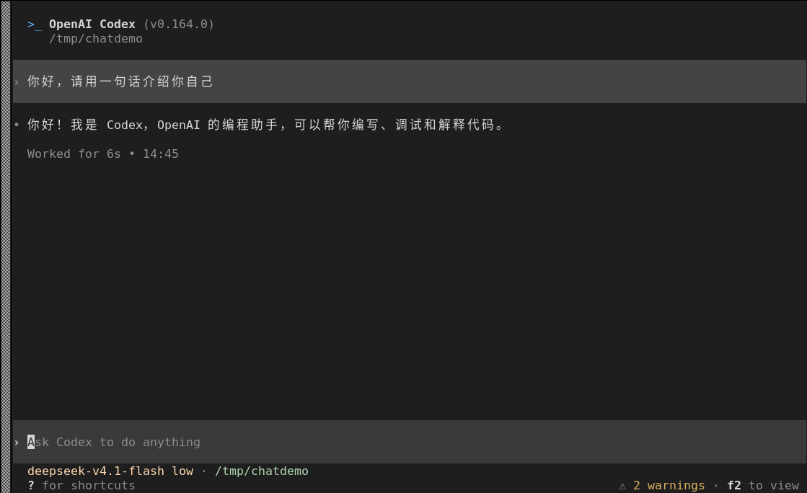

# LoongArch 上 codex 使用指南

Codex 是 OpenAI 官方的编码智能体（Codex CLI），以终端 TUI 交互为主。直接运行在你的电脑上：在终端中阅读、修改代码，执行命令、跑测试，并完成代码评审、对接 MCP 工具；原生支持 OpenAI、Azure 等服务，也可接入兼容 Responses 协议的第三方模型网关。Codex 包含 CLI、VSCode 插件、网页端等多种形态，本文档仅介绍 LoongArch 平台下的 CLI 使用方式。

上游仓库：[https://github.com/openai/codex](https://github.com/openai/codex)

官方文档：[https://developers.openai.com/codex](https://developers.openai.com/codex)

**版本说明：**

- **可用版本**：0.148.0、0.154.0、0.164.0
- **支持 ABI**：仅 ABI2.0

## 一、配置 LoongArch npm 仓库

Codex 目前仅提供 ABI2.0 版本，请在 ABI2.0 系统上配置对应的 npm 仓库：

```sh
$ npm set registry https://registry.loongnix.cn:5873
```

## 二、安装 codex

配置好对应源后全局安装：

```sh
$ npm install -g @openai/codex@0.164.0
```

安装完成后用 `codex --version` 确认版本：

```sh
$ codex --version
codex-cli 0.164.0
```

## 三、启动 codex

在任意项目目录下执行：

```sh
$ codex
```
首次启动进入登录方式选择界面：



四种方式任选：

- **Sign in with ChatGPT**：使用 Plus / Pro / Business / Enterprise 套餐额度。
- **Sign in with Device Code**：在另一台设备上输入一次性代码完成登录。
- **Use an OpenAI API key**：使用 OpenAI 的 API Key 来认证登录。
- **Use Amazon Bedrock**：用 AWS 凭据接入 Bedrock。

登录完成后，首次在某个目录里启动时还会询问是否信任该目录：



## 四、登录与配置

### 1. 用 API Key 登录

在菜单中选择 `3. Use an OpenAI API key`，粘贴 Key 后回车保存：



### 2. 选择模型与推理等级

首次启动后，默认就是 `GPT-6.1-Sol` + `Low`，可直接开始对话。想换的话在输入框输入 `/model`，先选模型（列表来自 Codex 内置模型目录）：



选定模型后再选推理等级（默认 `Low`，往上依次是 Medium / High / Extra high / More reasoning）：



### 3. 配置文件

全局配置在 `~/.codex/config.toml`，命令行可用 `-c key=value` 临时覆盖（例：`codex -c model="gpt-5-codex"`）。还可以把某套配置拆到 `~/.codex/<名字>.config.toml`，用 `codex --profile <名字>` 叠加到默认配置之上，常用配置项：

| 配置项 | 说明 |
| --- | --- |
| `model` | 使用的模型 |
| `model_provider` | 使用 `model_providers` 里的哪个供应商 |
| `model_reasoning_effort` | 推理强度 |
| `approval_policy` | 命令执行前的审批策略 |
| `sandbox_mode` | 沙箱模式：`read-only` / `workspace-write` / `danger-full-access` |
| `check_for_update_on_startup` | 是否在启动时检查更新 |

## 五、接入第三方端点

接入第三方端点时，若不想修改默认主配置，可以将提供商与模型配置写入独立的 profile 文件 `~/.codex/<名字>.config.toml`，保留默认 `~/.codex/config.toml` 不变；启动 Codex 时加上 `--profile <名字>` 参数，该配置才会叠加生效。下面以 OpenCode Go 为例：

**① profile 文件** `~/.codex/go.config.toml`：

```toml
model = "deepseek-v4.1-flash"
model_provider = "opencode-go"
check_for_update_on_startup = false                         # 避免启动时的升级提示

[model_providers.opencode-go]
name = "OpenCode Go"
base_url = "https://opencode.ai/inference/go/openai/v1"
env_key = "OPENCODE_API_KEY"
wire_api = "responses"
supports_websockets = false        
```

**② 导出 Key 并使用**：

```sh
$ export OPENCODE_API_KEY="你的 OpenCode Go Key"    # 建议写进 ~/.bashrc
$ codex --profile go                                # 对话
$ codex --profile go -m glm-5.3                     # 临时换模型
```

对话示例（底部状态栏显示模型与目录）：



首次用 Go 的模型时，状态栏右侧会出现 `⚠ 2 warnings · f2 to view`，其中一条是 `Model metadata for deepseek-v4.1-flash not found`——Codex 不认识目录外的模型，**不影响使用，忽略即可**。此时 TUI 里的 `/model` 仍只列 Codex 内置模型，要换 Go 的其他模型请改 `go.config.toml` 的 `model`，或临时 `codex --profile go -m glm-5.3`。

## 六、常用快捷键

### 1. TUI 内的斜杠命令

在输入框输入 `/` 可唤出命令面板，常用命令：

| 命令 | 作用 |
| --- | --- |
| `/model` | 选择模型与推理强度 |
| `/permissions` | 选择 Codex 被允许做什么（沙箱/审批） |
| `/init` | 生成 `AGENTS.md` 项目说明文件 |
| `/review` | 评审当前改动并给出问题 |
| `/diff` | 查看 `git diff`（含未跟踪文件） |
| `/new` | 当前会话中开新会话 |
| `/resume` | 恢复历史会话 |
| `/compact` | 压缩会话避免超出上下文 |
| `/status` | 查看当前会话配置与 token 用量 |
| `/mcp` | 查看 MCP 工具（`/mcp verbose` 详查） |
| `/skills` | 使用技能 |
| `/theme` | 切换高亮主题 |
| `/quit` | 退出 |

### 2. 会话管理

```sh
$ codex resume --last            # 继续最近一次交互会话
$ codex fork --last              # 从最近一次会话分叉
$ codex archive <id|名称>        # 归档会话
$ codex delete <id|名称>         # 删除会话
```
## 七、卸载

```sh
$ npm uninstall -g @openai/codex
$ rm -rf ~/.codex                # 如需一并清除配置与登录凭据
```


