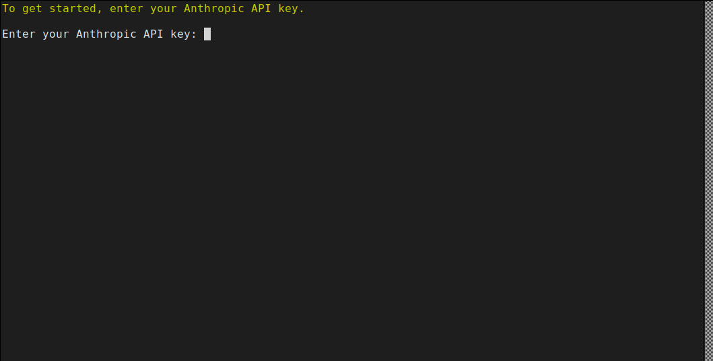
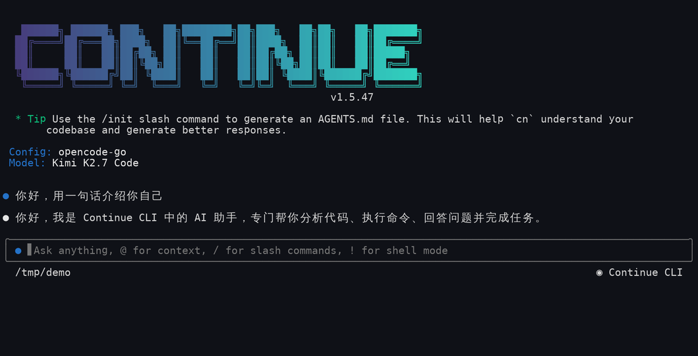
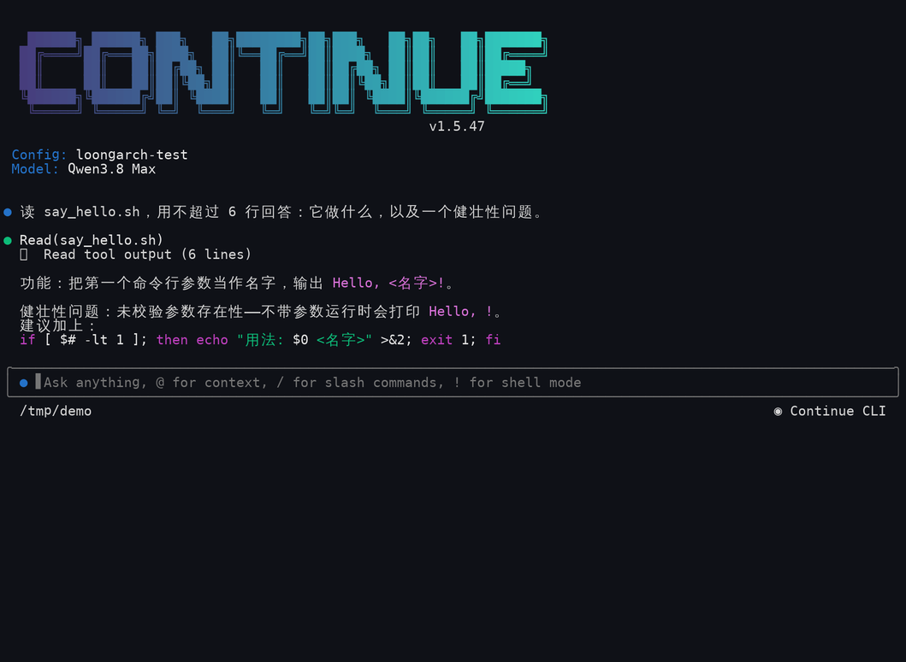
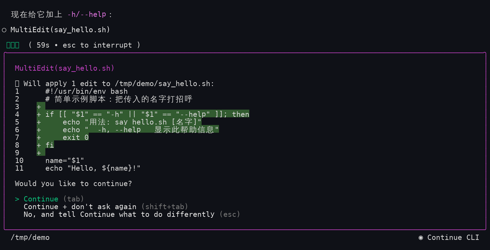

# LoongArch上continue-cli使用指南

Continue CLI（命令 `cn`）是 Continue 的终端编码智能体，与 IDE 插件、Continue Hub 共享配置，支持终端与 IDE 配置互通；默认采用 Anthropic 接口，兼容 OpenAI 协议，可接入国内大模型，无原生依赖，LoongArch 平台开箱可用。

上游仓库：[https://github.com/continuedev/continue](https://github.com/continuedev/continue)

官方文档：[https://docs.continue.dev/cli/quickstart](https://docs.continue.dev/cli/quickstart)

**版本说明：**

- **可用版本**：1.5.47
- **Node.js 版本要求**：≥ 20
- **支持 ABI**：支持 ABI1.0 | ABI2.0

## 一、配置 LoongArch npm 仓库

LoongArch 分为 **ABI1.0 / ABI2.0** 两套 ABI，两套仓库互相不兼容，对应独立的 npm 镜像源，请先确认系统 ABI 版本，再配置匹配的源。ABI 查看方式详见：[设置 npm 镜像源方法](../../README.md)。

### ABI1.0 环境配置

```sh
$ npm set registry https://registry.loongnix.cn:4873
```

### ABI2.0 环境配置

```sh
$ npm set registry https://registry.loongnix.cn:5873
```

## 二、安装 continue-cli

配置好对应源后，全局安装即可：

```sh
$ npm install -g @continuedev/cli
```

安装完成后确认版本：

```sh
$ cn --version
1.5.47
```

## 三、启动 cn

`cn` 支持两种接入模型的方式，按自己的情况二选一即可。

### 3.1 Anthropic API Key 接入方式

在项目目录下执行 `cn` 启动：

```sh
$ cn
```

Continue 默认使用 Anthropic 官方接口，首次启动会直接要求输入 Anthropic API Key：



在这里粘贴 Key 并回车即可开始对话，之后 `cn` 会记住它，不再询问。

不想交互输入时，也可以用环境变量预先注入：

```sh
$ export ANTHROPIC_API_KEY="sk-ant-你的key"
```

如果用的是 Anthropic 兼容的中转/代理地址，再额外指定接口地址即可：

```sh
$ export ANTHROPIC_BASE_URL="https://你的中转地址"
```

### 3.2 配置其他模型（OpenAI 兼容接口）

国内厂商只要提供 **OpenAI 兼容接口**，就能用同一套写法接入：配置文件为 `~/.continue/config.yaml`，`provider` 固定写 `openai`，`model` 写厂商的模型 ID，`apiBase` 写接口根地址，启动时指定配置文件运行：

```sh
$ cn --config ~/.continue/config.yaml
```
下面以两个平台为例展示配置：

1. 通义千问（阿里云百炼 DashScope）

   接口地址 `https://dashscope.aliyuncs.com/compatible-mode/v1`，模型 ID 如 `qwen3.8-max`、`qwen3.8-flash`：

   ```yaml
   name: loongarch-qwen
   version: 1.0.0
   schema: v1

   models:
     - name: Qwen3.8 Max
       provider: openai
       model: qwen3.8-max
       apiBase: https://dashscope.aliyuncs.com/compatible-mode/v1
       apiKey: sk-你的key
       roles: [chat, edit, apply]

     - name: Qwen3.8 Flash
       provider: openai
       model: qwen3.8-flash
       apiBase: https://dashscope.aliyuncs.com/compatible-mode/v1
       apiKey: sk-你的key
       roles: [chat, edit, apply]
   ```

2. OpenCode Go

   接口地址 `https://opencode.ai/zen/go/v1`，模型 ID 如 `qwen3.8-max`、`kimi-k2.7-code`。该网关必须附带 `x-opencode-session` 请求头：

   ```yaml
   name: opencode-go
   version: 1.0.0
   schema: v1

   models:
     - name: Qwen3.8 Max
       provider: openai
       model: qwen3.8-max
       apiBase: https://opencode.ai/zen/go/v1
       apiKey: sk-你的key
       requestOptions:
         headers:
           x-opencode-session: cn-cli-session
       roles: [chat, edit, apply]

     - name: Kimi K2.7 Code
       provider: openai
       model: kimi-k2.7-code
       apiBase: https://opencode.ai/zen/go/v1
       apiKey: sk-你的key
       requestOptions:
         headers:
           x-opencode-session: cn-cli-session
       roles: [chat]
   ```

> 注意：`roles` 里带 `edit`、`apply` 的模型才能改代码，只写 `[chat]` 的模型只能对话；同一份配置里写多个模型时，启动后输入 `/model` 即可切换。


## 四、开始使用

配置生效后，界面顶部会依次显示 `Config:`（配置文件）与 `Model:`（当前模型），在输入框中直接描述任务即可，`cn` 会自行调用工具（读文件、执行命令、改代码）完成任务：



### 4.1 读文件与工具调用

提问「读 say_hello.sh，用不超过 6 行回答：它做什么，以及一个健壮性问题。」时，会先调用 `Read` 工具读取文件，再给出结论：



### 4.2 修改代码需要确认

要求它改代码时，`cn` 不会直接执行，而是先给出 diff 并弹出确认菜单（`tab` 允许、`shift+tab` 允许且不再询问、`esc` 拒绝并补充说明）：



### 4.3 输入方式

- `@` 引用上下文（文件、目录、终端输出）
- `/` 调出斜杠命令，常用有 `/init`（生成 AGENTS.md）、`/model`（切换模型）、`/compact`（压缩上下文）、`/resume`（恢复会话）、`/login`、`/help`、`/exit`
- `!` 进入 shell 模式

### 4.4 常用快捷键

| 按键 | 作用 |
| --- | --- |
| `Esc` | 打断正在生成的回答（界面底部提示 `esc to interrupt`） |
| `Ctrl+B` | 把正在跑的任务转到后台，继续输入 |
| `Tab` / `Shift+Tab` / `Esc` | 工具确认菜单：允许 / 允许且不再询问 / 拒绝并补充说明 |
| `Ctrl+C` | 中断当前操作；输入框为空时退出 `cn` |

### 4.5 非交互模式

`cn` 会把历史会话存在本地，可随时恢复：

```sh
$ cn ls                    # 列出历史会话并选择恢复
$ cn --resume              # 直接继续上一次会话
$ cn --fork <sessionId>    # 从某个会话分叉出新分支
```

一次性执行：

```sh
$ cn -p "解释这个仓库的构建流程"
$ cn -p "给这个模块补测试" --format json     # 输出 {"reply": "..."}
$ cn -p "总结这次提交" --silent              # 去掉思考过程与多余空行
```
