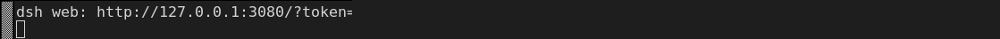
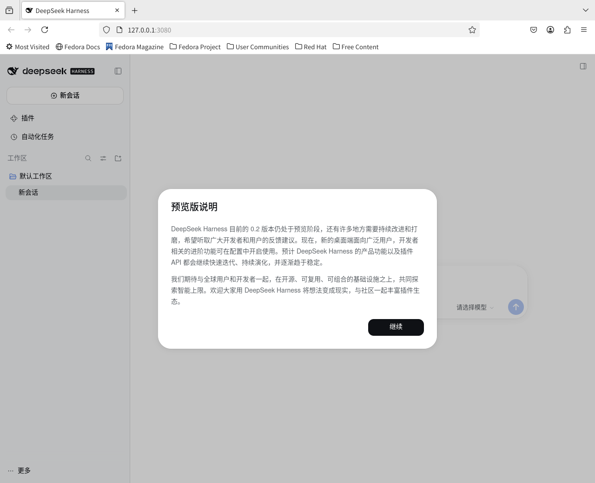
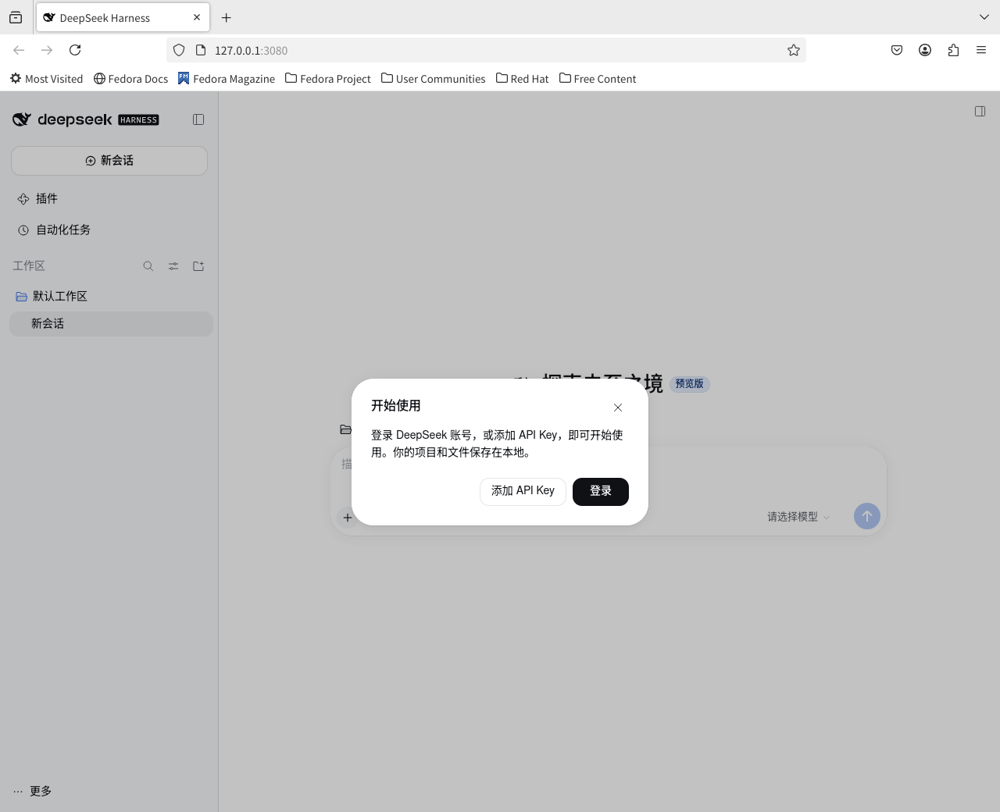
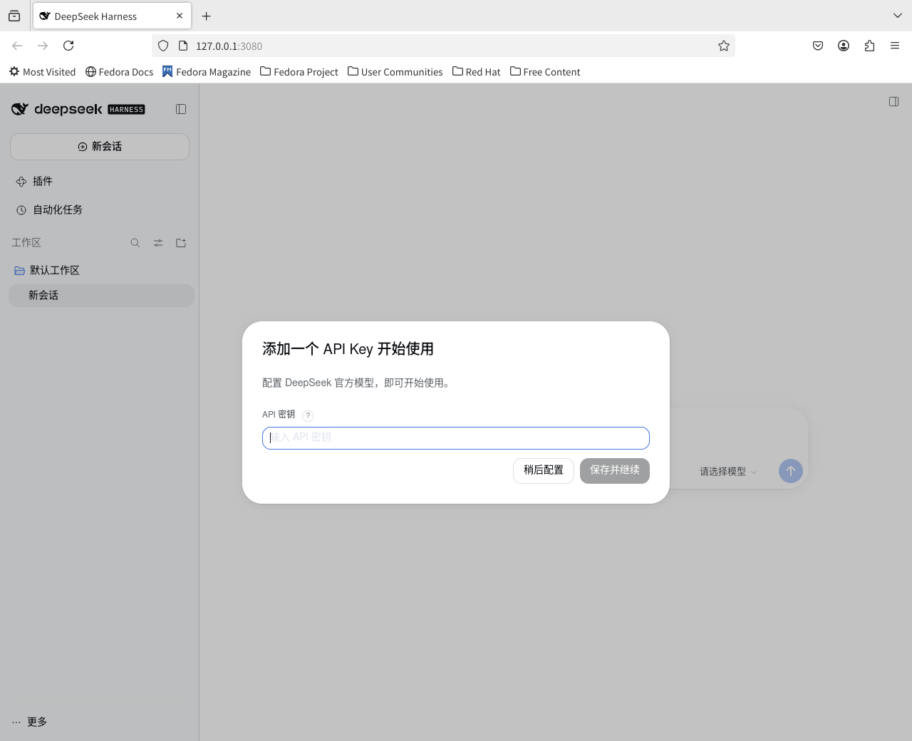
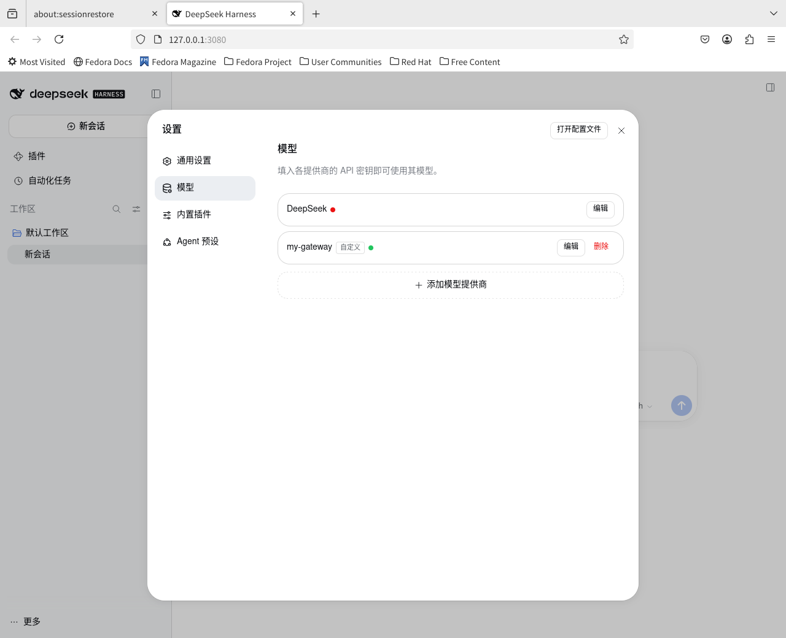
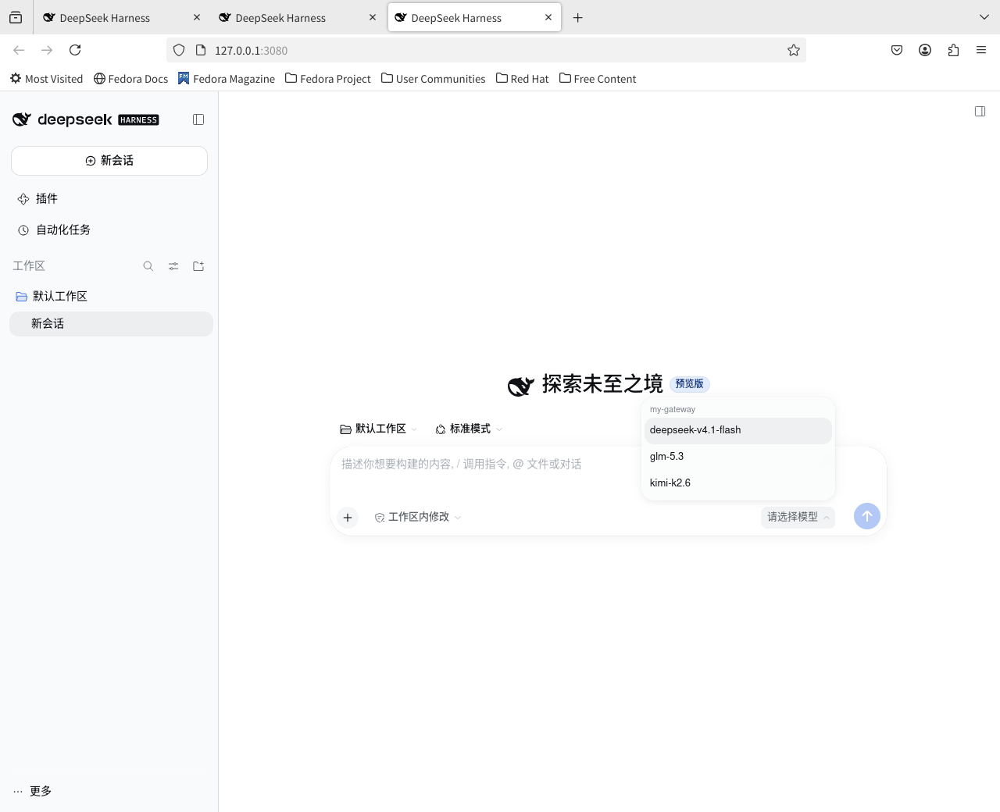
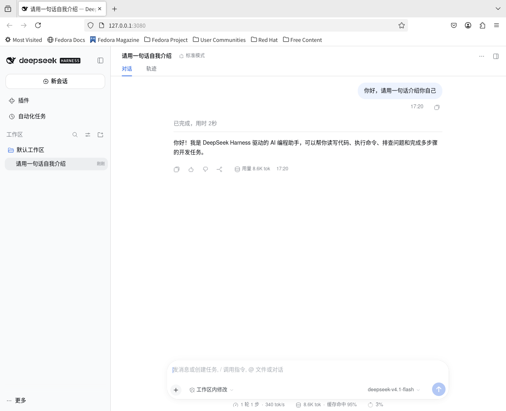
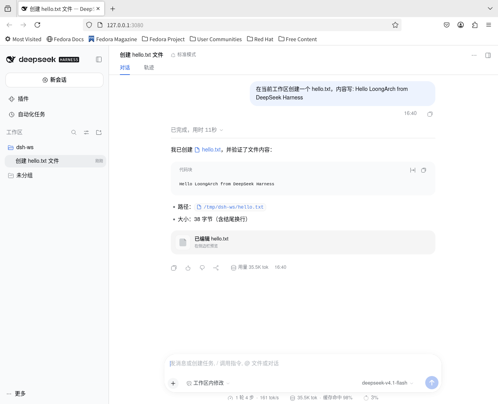
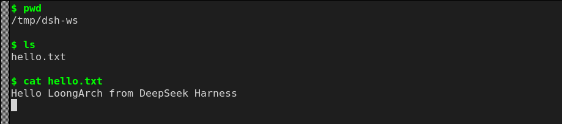

# LoongArch上deepseek-harness使用指南

DeepSeek Harness（`dsh`）是 DeepSeek 开源的 agent harness，基于 Cordis 插件框架、采用「一切皆插件」的架构搭建智能体运行环境；提供 Web UI、TUI、后台服务三种运行形态，可接入 DeepSeek 官方模型，也兼容 OpenAI、Anthropic 协议网关，并支持 MCP、技能扩展、自动化任务与会话分享。

上游仓库：[https://github.com/deepseek-ai/deepseek-harness](https://github.com/deepseek-ai/deepseek-harness)

官方文档：[https://deepseek-harness.github.io/deepseek-harness/](https://deepseek-harness.github.io/deepseek-harness/)

**版本说明：**

- **ABI1.0 版本**：0.1.1-rc.2
- **ABI2.0 版本**：0.1.1-rc.2 ~ 0.2.2-rc.1
- **Node.js 版本要求**：≥ v22.16.0
- **支持 ABI**：支持 ABI1.0 | ABI2.0

## 一、配置 LoongArch npm 仓库

LoongArch 分为 **ABI1.0 / ABI2.0** 两套 ABI，两套仓库互相不兼容，请先确认系统 ABI 版本，再配置匹配的源。ABI 查看方式详见：[设置 npm 镜像源方法](../../README.md)。

### ABI1.0 环境配置

```sh
$ npm set registry https://registry.loongnix.cn:4873
```

### ABI2.0 环境配置

```sh
$ npm set registry https://registry.loongnix.cn:5873
```

## 二、安装并启动 Web UI

### ABI1.0：本地安装后启动

配置好对应源后本地安装（以 0.1.1-rc.2 为例）：

```sh
$ npm install @deepseek-ai/dsh@0.1.1-rc.2
```
安装完成后，确认版本：
```
$ ./node_modules/.bin/dsh --version
0.1.1-rc.2
```
启动Web服务
```
$ node --expose-internals ./node_modules/@deepseek-ai/dsh/lib/bin.js web
dsh web: http://127.0.0.1:3080
```

### ABI2.0：npx 直接运行

无需手动安装，直接拉起 Web UI：

```sh
$ npx @deepseek-ai/dsh web
```

## 三、打开 Web 界面

启动成功后终端会打印访问地址：



用浏览器打开该地址（默认 `http://127.0.0.1:3080`），首次进入会弹出「预览版说明」，点「继续」即可：



接着会提示「开始使用」，提供**登录 DeepSeek 账号**或**添加 API Key** 两种方式，项目与文件都保存在本地：



## 四、配置模型

选择「添加 API Key」后，填入 DeepSeek 官方 API Key 并点「保存并继续」即可开始使用；暂时不想配置就点「稍后配置」，之后随时在「设置 → 模型」里补配：



除了首次引导，打开左下角「更多 → 设置 → 模型」还可以配置两类提供商：

- **DeepSeek**：填入 DeepSeek 官方 API Key；
- **添加模型提供商**：选择内置的第三方提供商（`anthropic`、`openai`、`moonshotai`、`zai` 等），或切到「自定义模型 API」，填 Provider ID、基础 URL、协议（OpenAI Chat Completions / OpenAI Responses / Anthropic Messages）和至少一个模型 ID。



## 五、选择模型并开始对话

配置完成后，点输入框右下角的模型名即可切换（列表按提供商分组）：



一个简单的对话示例如下：




### 生成的文件保存在所选工作区

让 Agent 新建或修改文件时，改动会直接落到所选的工作区目录。例如让它「在当前工作区创建一个 hello.txt」，回答里会给出文件路径、大小与 diff 卡片：



工作区目录中可以看到实际生成的文件：


