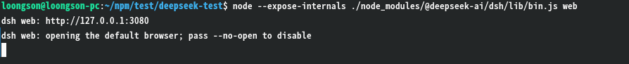
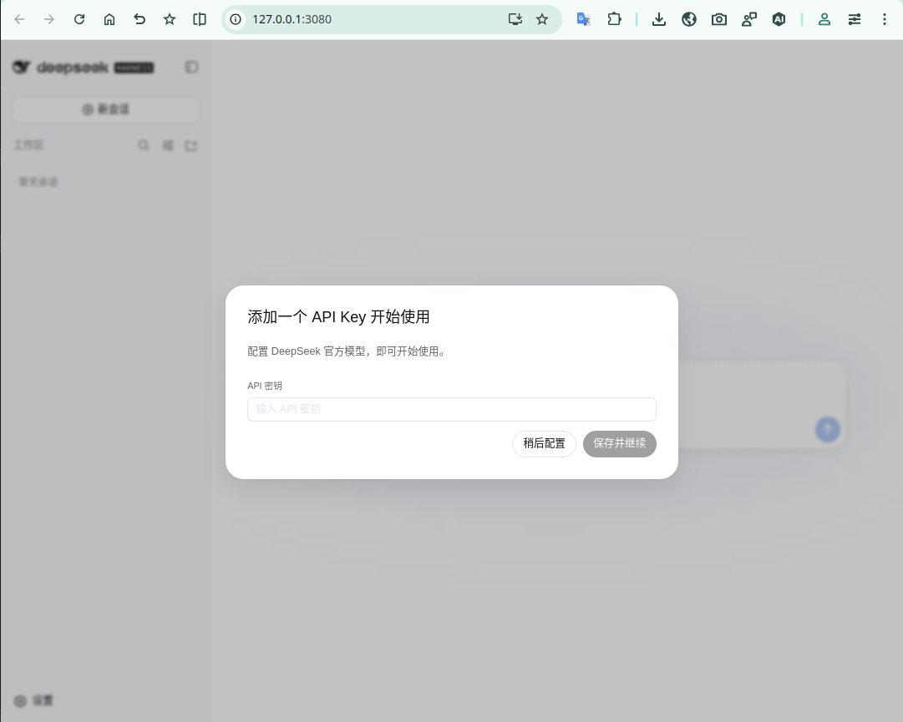
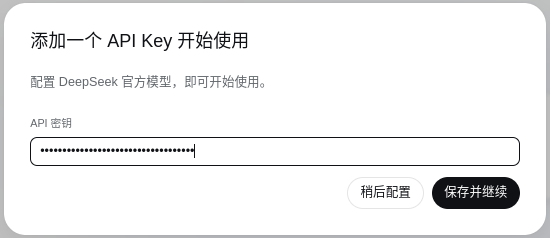
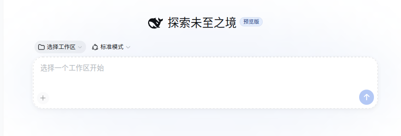
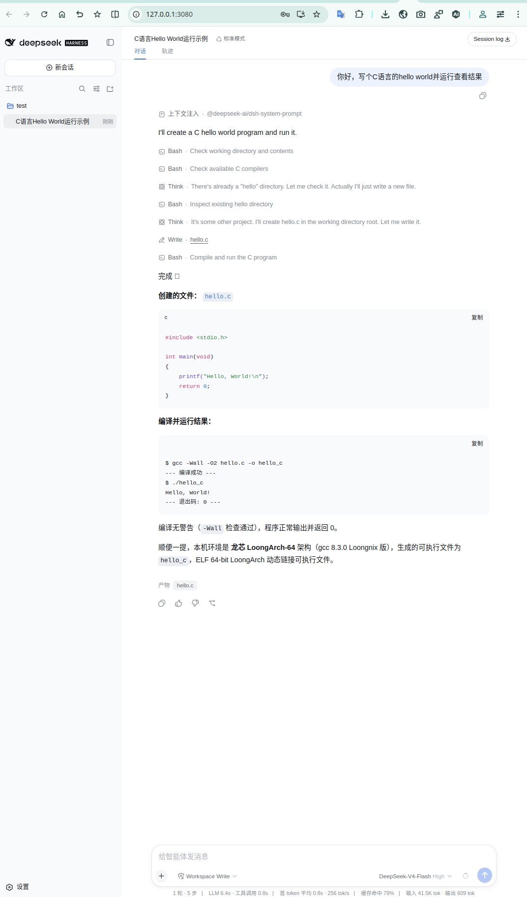

# LoongArch上deepseek-harness使用指南

DeepSeek-Harness 是 DeepSeek 推出的 AI 工具套件，用于本地部署、调用模型并提供配套调试与 Web 服务能力。

上游仓库：[https://github.com/deepseek-ai/deepseek-harness](https://github.com/deepseek-ai/deepseek-harness)

官方配置指南：[https://deepseek-harness.github.io/deepseek-harness/guide/providers](https://deepseek-harness.github.io/deepseek-harness/guide/providers)

**版本说明:**

- **ABI1.0版本**：0.1.1-rc.2
- **ABI2.0版本**：0.1.1-rc.2 ~ 最新版本
- **Node.js 版本要求**：≥ v22.16.0
- **支持 ABI**：支持 ABI1.0 | ABI2.0

## 一、LoongArch npm 仓库地址配置
LoongArch分为 **ABI1.0 / ABI2.0** 两套ABI，两套仓库互相不兼容，对应独立的npm镜像源，请先确认系统 ABI 版本，再配置匹配的源。ABI 查看方式详见：[设置 npm 镜像源方法](../../README.md)。

### ABI1.0 环境配置
```
npm set registry https://registry.loongnix.cn:4873
```
### ABI2.0 环境配置
```
npm set registry https://registry.loongnix.cn:5873
```
## 二、安装并运行deepseek-harness
### 2.1 ABI1.0 安装 & 启动
```sh
# 安装指定版本
$ npm install @deepseek-ai/dsh@0.1.1-rc.2
# 启动Web服务
$ node --expose-internals ./node_modules/@deepseek-ai/dsh/lib/bin.js web
```
### 2.2 ABI2.0 快速启动
npx方式无需手动安装包，直接运行：
```sh
$ npx @deepseek-ai/dsh web
```
## 三、Web 界面使用流程
1. 服务启动成功后，终端会输出日志（参考截图）:



2. 在浏览器打开终端给的链接 `http://127.0.0.1:3080`，进入 deepseek-harness Web 页面



3. 在弹窗的API Key输入框，填入DeepSeek 大模型API密钥，完成鉴权



4. 选择工作区，大模型将在此工作区进行相关操作，如执行文件读取、代码生成等操作



5. 输入指令调用大模型：



6. 模型生成的文件会保存在所选工作区目录


