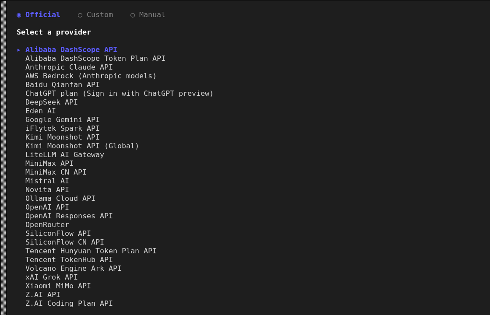
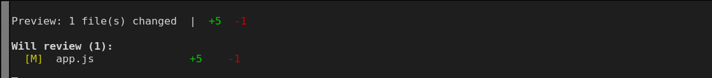

# LoongArch 上 open-code-review 使用指南

Open Code Review（OCR）是阿里开源的 AI 代码评审 CLI 工具，读取 git diff，通过可配置 LLM Agent 生成行级结构化评审意见，内置多语言安全与质量规则，兼容多家大模型接口。支持 `ocr scan` 全仓扫描；`ocr delegate` 委托模式可让 OCR 只负责规则与文件筛选，由外部 Agent 完成评审。

上游仓库：[https://github.com/alibaba/open-code-review](https://github.com/alibaba/open-code-review)

官方文档：[https://open-codereview.ai/docs/quickstart](https://open-codereview.ai/docs/quickstart)

**版本说明：**

- **可用版本**：v1.13.3
- **Git版本要求**： ≥ 2.41
- **Node.js版本要求**： ≥ 18
- **支持 ABI**：仅 ABI2.0

## 一、配置 LoongArch npm 仓库

Open Code Review 目前仅提供 ABI2.0 版本，请在 ABI2.0 系统上配置对应的 npm 仓库：

```sh
$ npm set registry https://registry.loongnix.cn:5873
```

## 二、安装 open-code-review

执行以下命令全局安装（以 1.13.3 版本为例）：
```sh
$ npm install -g @alibaba-group/open-code-review
```

安装完成后 `ocr` 命令即可全局使用：

```sh
$ ocr version
open-code-review v1.13.3 (375f64c) linux/loong64
built at: 2026-10-27T07:34:05Z
https://github.com/alibaba/open-code-review
```

## 三、配置大模型

评审必须配置一个 LLM。交互式配置会引导完成「选供应商 → 填 API Key → 选模型」：

```sh
$ ocr config provider      # 选择供应商
$ ocr config model         # 为该供应商选择模型
```

内置供应商覆盖主流服务：阿里云百炼 / DashScope（含 Token Plan）、Anthropic Claude、AWS Bedrock、百度千帆、ChatGPT plan、DeepSeek、Google Gemini、讯飞星火、Kimi、MiniMax、OpenAI、OpenRouter、腾讯混元、火山方舟、xAI Grok、小米 MiMo、智谱 Z.AI 等；界面顶部还有 `Custom`（自定义端点）与 `Manual`（手工填写）两个页签：



也可以完全非交互配置（适合脚本/批量部署）：

```sh
$ ocr config set provider deepseek
$ ocr config set model deepseek-chat
$ ocr config set providers.deepseek.api_key "$DEEPSEEK_API_KEY"
$ ocr config unset provider            # 删除某项配置
```

配置结果保存在 `~/.opencodereview/config.json`：

```json
{
    "provider": "deepseek",
    "providers": { "deepseek": { "model": "deepseek-chat" } },
    "llm": {}
}
```

## 四、开始使用

### 1. 评审工作区改动

在 git 仓库里执行，默认评审「已暂存 + 未暂存 + 未跟踪」的改动：

```sh
$ cd /tmp/ocr-test-repo
$ ocr review
```

只想看会评审哪些文件、不调用 LLM：

```sh
$ ocr review --preview
```



常见用法：

```sh
$ ocr review --from main --to feature-branch     # 按分支评审
$ ocr review -c abc1234                          # 评审单个提交
$ ocr review -f json -o result.json              # 输出 json / sarif（默认 text）
$ ocr review --effort high                       # 评审力度：low / medium / high
$ ocr review --exclude "**/*_test.go,docs/**"    # 排除文件
$ ocr review --max-tokens-budget 200000          # 限制本次 token 用量
$ ocr review --background "本次改动是为了…"        # 补充业务上下文
$ ocr review --resume <session-id>               # 恢复中断的评审
```

### 2. 全量扫描（不依赖 diff）

```sh
$ ocr scan                         # 扫描整个仓库
$ ocr scan --path internal/agent   # 指定目录或文件（逗号分隔）
$ ocr scan --batch by-language     # 分批策略：none / by-language / by-directory
$ ocr scan --no-plan               # 跳过逐文件 PLAN 预处理，更快
$ ocr scan --resume <session-id>   # 恢复中断的扫描
```

### 3. 会话与结果

```sh
$ ocr session list                 # 当前仓库的历史评审
$ ocr session show <id>            # 会话元信息与文件级结果
$ ocr session comments <id>        # 具体评审意见
$ ocr session export <id>          # 导出为可独立打开的 HTML
$ ocr session compare <id1> <id2>  # 对比两次评审的发现
$ ocr session rm <id>              # 删除某个会话
$ ocr viewer                       # 启动 WebUI 查看会话历史
```

## 五、命令一览

| 命令 | 作用 |
| --- | --- |
| `ocr review` | 基于 git diff 的代码评审（别名 `r`） |
| `ocr scan` | 全仓/指定目录的全量扫描（别名 `s`） |
| `ocr session` | 管理历史评审会话（list / show / comments / export / compare / rm） |
| `ocr delegate` | 输出评审规格给宿主 agent，不消耗 token（别名 `d`） |
| `ocr rules` | 查看与调试评审规则（`rules check <file>`） |
| `ocr config` | 配置管理（provider / model / set / unset） |
| `ocr viewer` | 启动 WebUI 查看会话历史 |
| `ocr auth` | 使用 ChatGPT 账号登录 |
| `ocr version` | 显示版本 |
