# LoongArch上openclaw使用指南

OpenClaw 是开源本地 AI 智能体框架，遵循 Lobster 理念，可跨系统、跨平台落地执行实际任务。区别于普通对话 AI，它能够接入微信、Telegram、日程、GitHub 等应用，全天候在后台运行，接收自然语言指令，完成整理文件、编码、邮件管理、网页浏览等本机操作。

上游仓库：[https://github.com/openclaw/openclaw](https://github.com/openclaw/openclaw)

官方文档：[https://docs.openclaw.ai](https://docs.openclaw.ai)

**版本说明：**

- **可用版本**：2026.5.7 ~ 最新版本
- **Node.js 版本要求**：推荐 Node.js 24+（2026.10.x 起要求 Node.js ≥ 24.22.1 或 ≥ 26.12.1）
- **支持 ABI**：仅 ABI2.0

## 一、使用 nvm 安装 Node.js

ABI2.0 可安装版本清单参考：[ABI2.0 支持的 Node.js 版本清单](../stats/abi2.0_nodejs_supported_versions.md)

1. 安装 nvm：

```sh
$ wget -qO- https://ftp.loongnix.cn/nodejs/npm-registry/LoongArch/abi-v1.0/nvm/v0.39.2/install.sh | bash
```

2. 配置镜像并安装 Node.js：

```sh
$ export NVM_NODEJS_ORG_MIRROR="https://unofficial-builds.nodejs.org/download/release/"
$ nvm install 26
```

3. 验证安装，能打印出 Node.js  版本即成功：

```sh
$ node -v
v26.13.0
```

## 二、安装 openclaw

1. 配置 npm 仓库为 ABI2.0 的仓库：

```sh
$ npm set registry https://registry.loongnix.cn:5873
```

2. 全局安装 openclaw：

```sh
$ npm install -g openclaw
```

安装完成后能打印出版本号即成功：
```
$ openclaw --version 
OpenClaw 2026.10.9 (8b18b55)
```

3. 执行 `openclaw --help` 可查看全部子命令与常用示例：

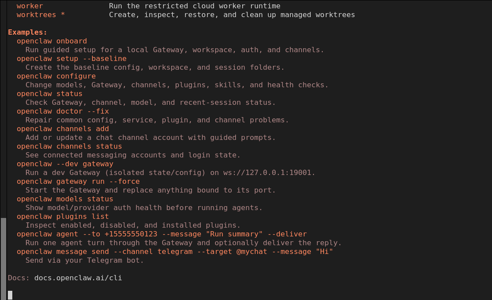

## 三、openclaw 初始化部署

执行初始化命令，进入交互式部署流程：

```sh
$ openclaw onboard --install-daemon
```

按下面顺序完成配置：

1. 首先显示安全免责声明（OpenClaw 默认是「单人使用」的安全边界），选 `Yes` 继续：

   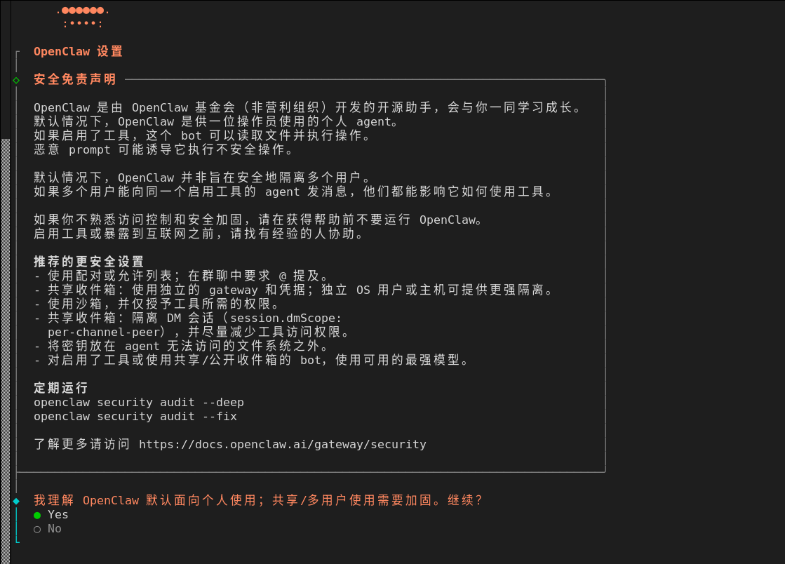

2. 询问是否分享功能使用统计，默认 `不用，谢谢`；随后进入设置模式，保持默认的 `QuickStart（推荐）` 即可：

   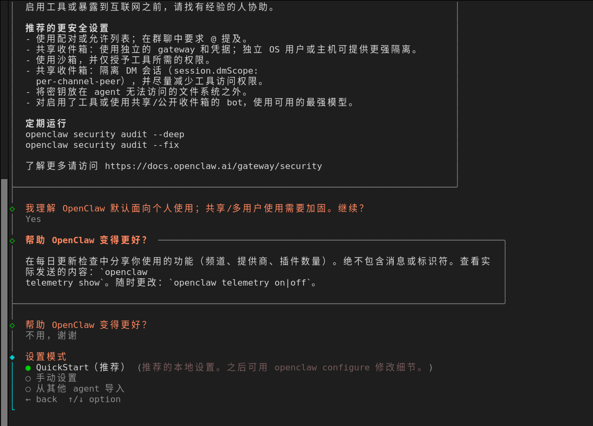

3. QuickStart 会显示将要使用的参数：Gateway 端口 18789、绑定 Loopback、网关密钥自动生成、Tailscale 关闭；接着填写第一个 agent 的名称，默认 `main`：

   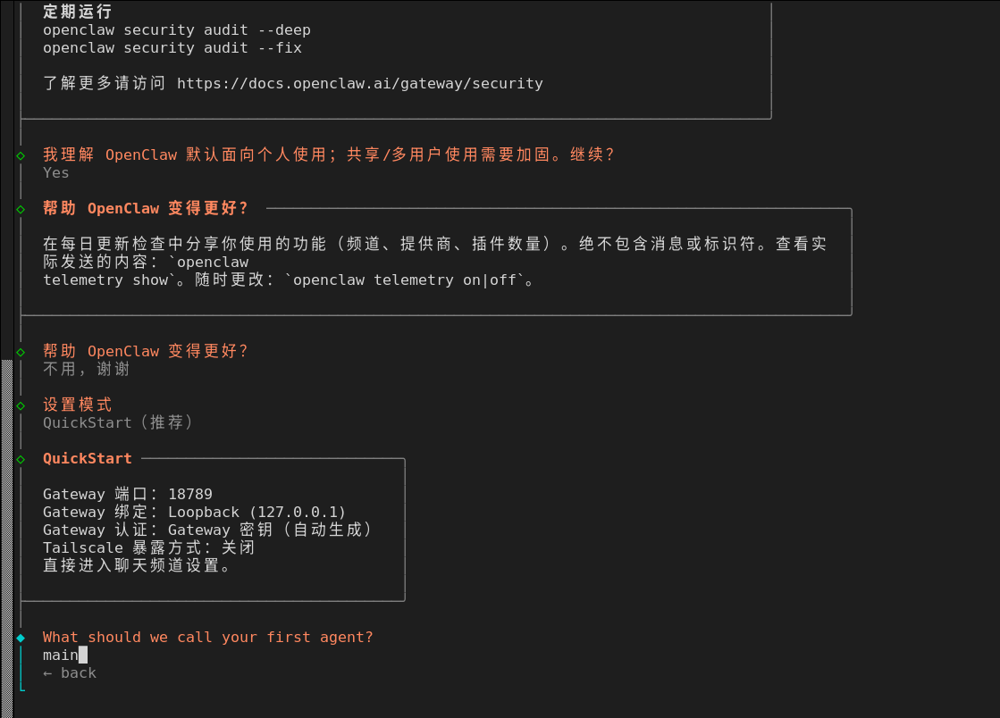

4. 选择模型提供商。列表支持输入关键字搜索，这里以 OpenAI 兼容的自定义提供商（`Custom Provider`）为例，接自建或第三方网关时都用它：

   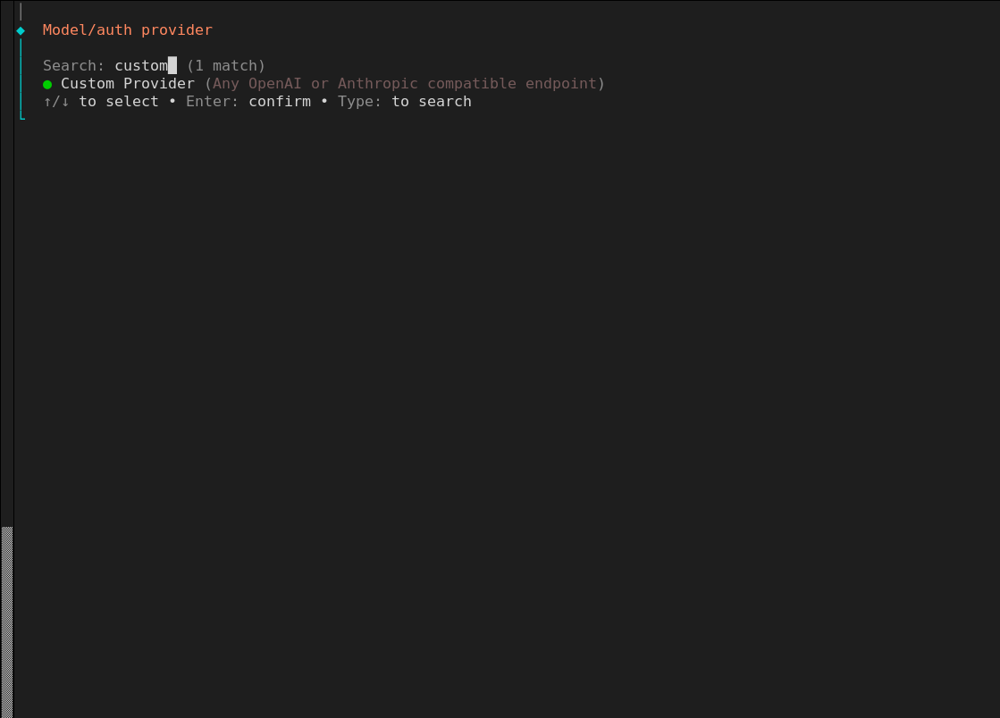

5. 填写 API 基础 URL（OpenAI 兼容地址，形如 `http://主机:端口/v1`），并选择 API Key 的提供方式，一般选 `Paste API key now`：

   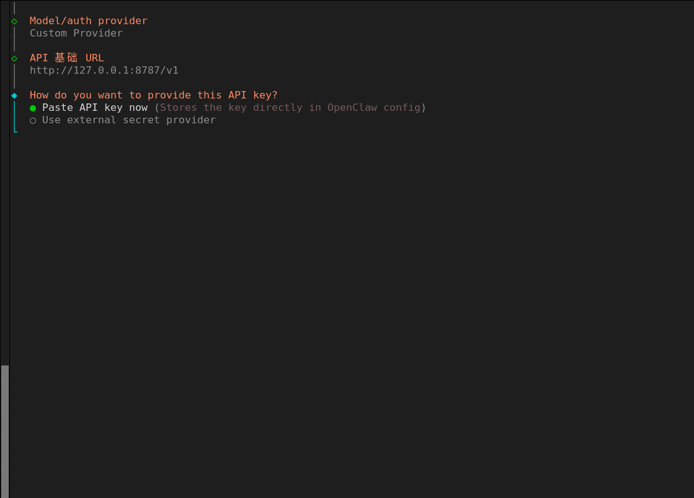

6. 粘贴 API Key（输入时会以圆点掩码显示），并选择端点兼容性，选 `兼容 OpenAI`：

   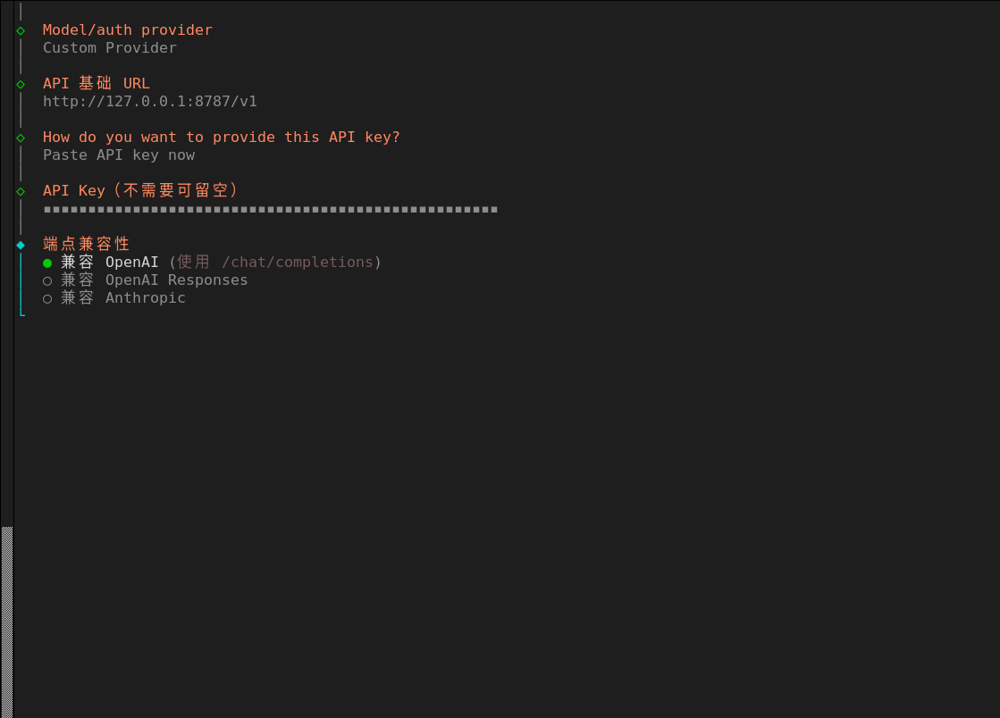

7. 填写模型 ID（例如 `deepseek-v4.1-flash`）与端点 ID，端点 ID 会按 URL 自动生成，直接回车即可：

   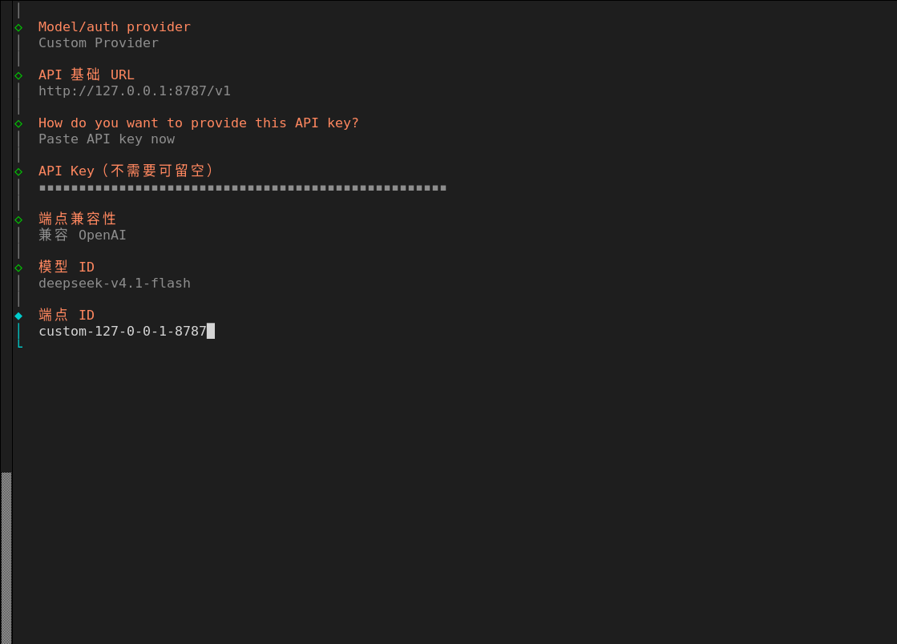

8. 询问是否用一次真实 completion 测试 AI 访问，选 `Yes`，能收到回复说明模型配置正确：

   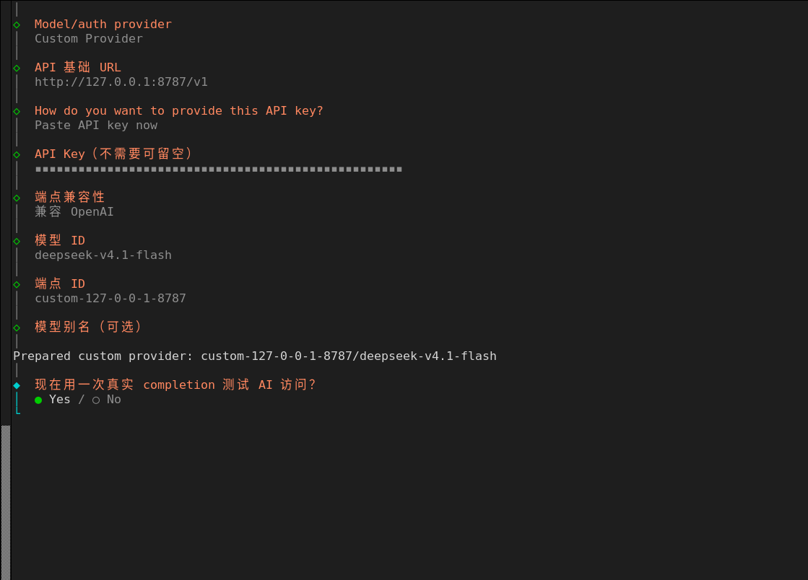

9. 选择频道（对接微信、飞书、Telegram、Slack 等聊天工具的通道）。先选 `暂时跳过`，后续可在 Web UI 里配置：

   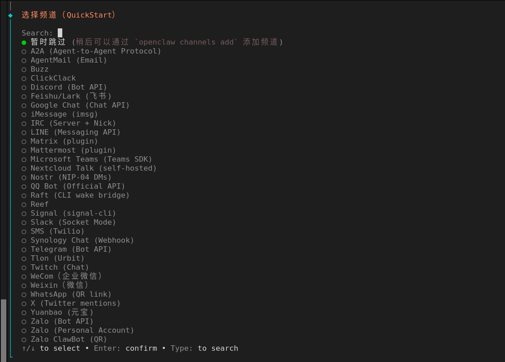

10. 选择网页搜索提供商（agent 联网查询时使用）。同样可以先 `暂时跳过`：

    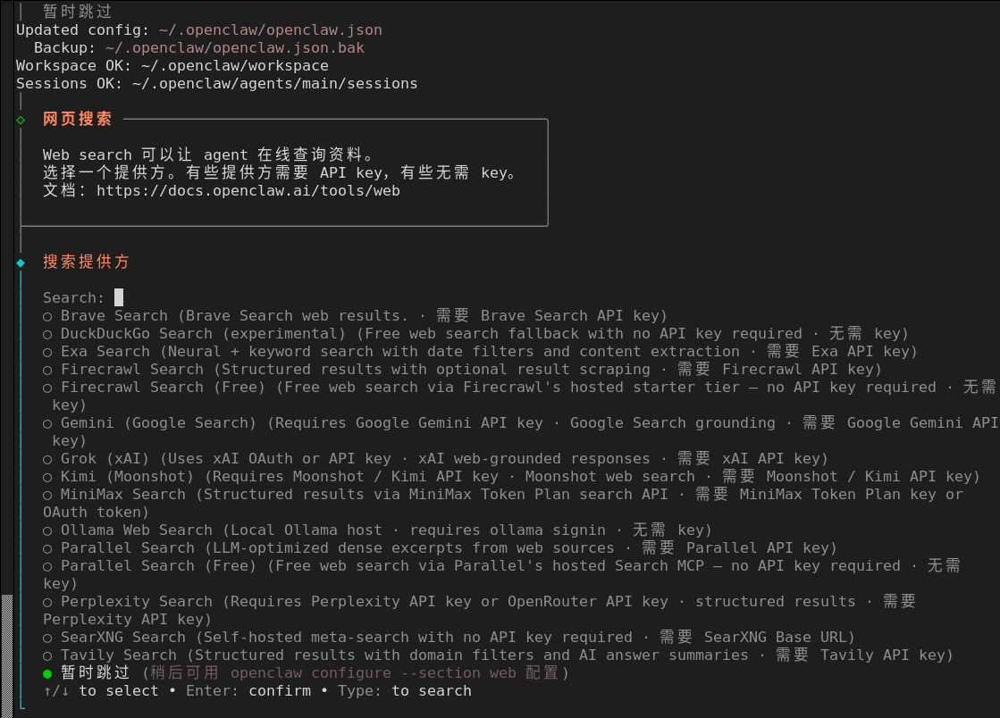

11. 配置技能依赖，会先列出技能状态，勾选 `暂时跳过` 后回车继续：

    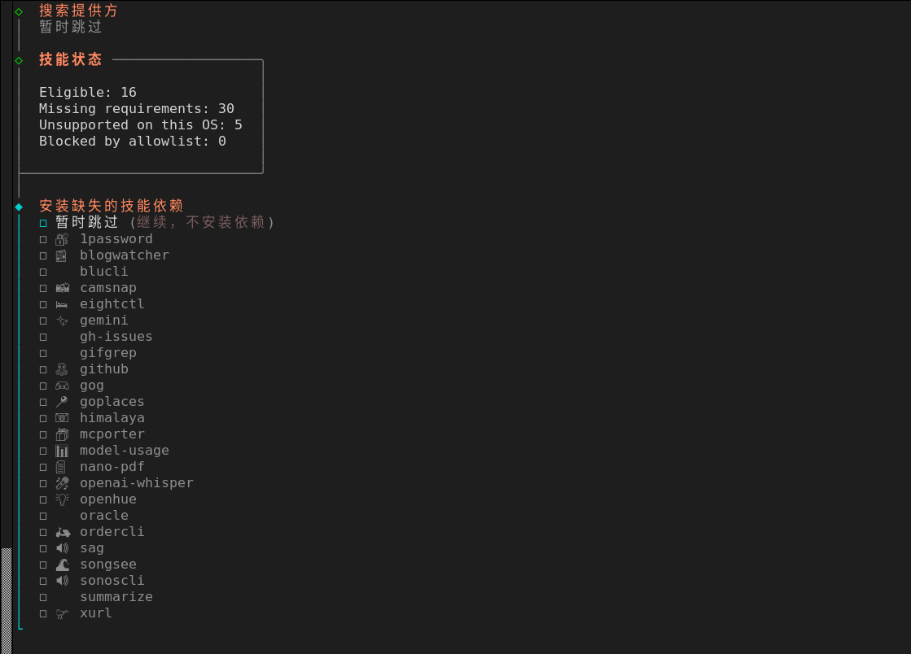

12. 最后自动安装 Gateway 服务，安装完成后打印 systemd 用户服务路径并自动拉起服务：

    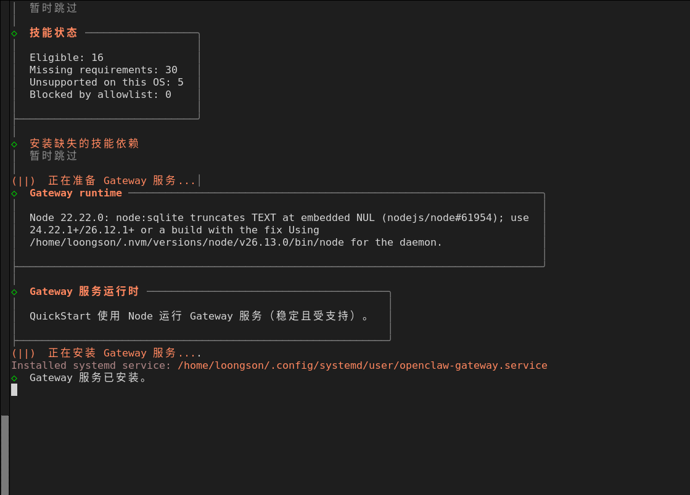

## 四、交互使用方式

网关部署完成后，有两种交互界面：TUI 终端界面与 Web UI 网页界面。

1. **TUI 终端界面**：直接在当前终端里对话，顶部显示连接的 Gateway、agent 与 session，底部状态栏显示连接状态与所用模型：

   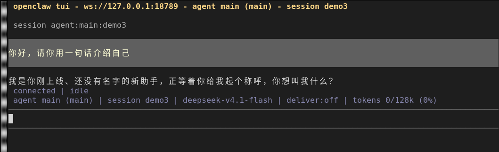

2. **Web UI 网页界面**：用浏览器打开 `http://127.0.0.1:18789/`，首次访问需要在地址后追加 `#token=<gateway token>` 完成认证（token 见 `~/.openclaw/openclaw.json` 的 `gateway.auth.token`）。左侧是功能栏（首页、智能体、仪表盘、系统、自动化、插件），右侧是会话区，可以切换会话、选择模型、查看 token 用量：

   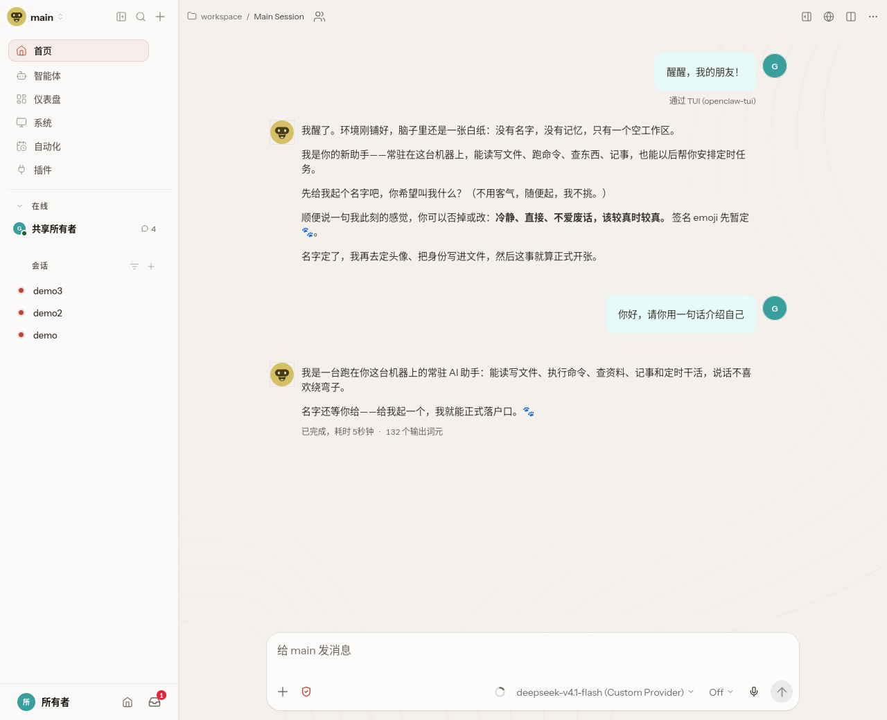

之后随时可以用下面的命令回到这两个界面：

```sh
$ openclaw tui                 # 打开 TUI
$ openclaw dashboard           # 打开 Web UI（自动完成本次浏览器配对）
$ openclaw dashboard --no-open # 只打印地址，不打开浏览器
```
