# LoongArch上openclaw使用指南

OpenClaw 是开源本地 AI 智能体框架，遵循 Lobster 理念，可跨系统、跨平台落地执行实际任务。区别于普通对话 AI，它能够接入微信、Telegram、日程、GitHub 等应用，全天候在后台运行，接收自然语言指令，完成整理文件、编码、邮件管理、网页浏览等本机操作。

上游仓库：[https://github.com/openclaw/openclaw](https://github.com/openclaw/openclaw)

**版本说明:**

- **可用版本**：2026.5.7 ~ 最新版本
- **Node.js 版本要求**：推荐 Node.js 24+
- **支持 ABI**：仅 ABI2.0

## 一、使用 nvm 安装 Node.js
1. 安装 nvm 命令
```
$ wget -qO- https://ftp.loongnix.cn/nodejs/npm-registry/LoongArch/abi-v1.0/nvm/v0.39.2/install.sh | bash
```
2. 配置镜像并安装 Node.js
```
$ export NVM_NODEJS_ORG_MIRROR="https://unofficial-builds.nodejs.org/download/release/"
$ nvm install v24.8.0
```
3. 验证安装，输出版本号即成功
```
$ node -v
v24.8.0
```
## 二、安装 openclaw
### 2.1 使用 npm 安装 openclaw 软件

1. 配置 npm 仓库为 ABI2.0 的仓库
```
$ npm set registry https://registry.loongnix.cn:5873
```

2. 使用 npm 全局安装 openclaw
```
$ npm install -g openclaw
```
3. 验证安装
执行以下命令，正常输出版本及配置项，说明安装成功。
```
$ openclaw -h
```

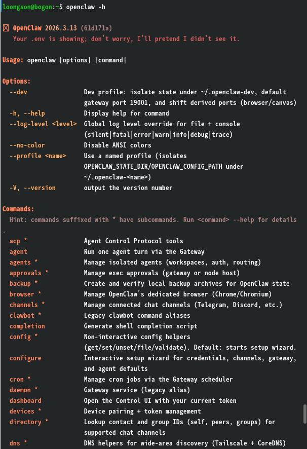

## 三、openclaw 初始化部署

执行初始化命令，进入交互式部署流程：
```
$ openclaw onboard --install-daemon
```
按下面顺序完成配置：

1. 输出如下所示，选择 yes 进行部署配置

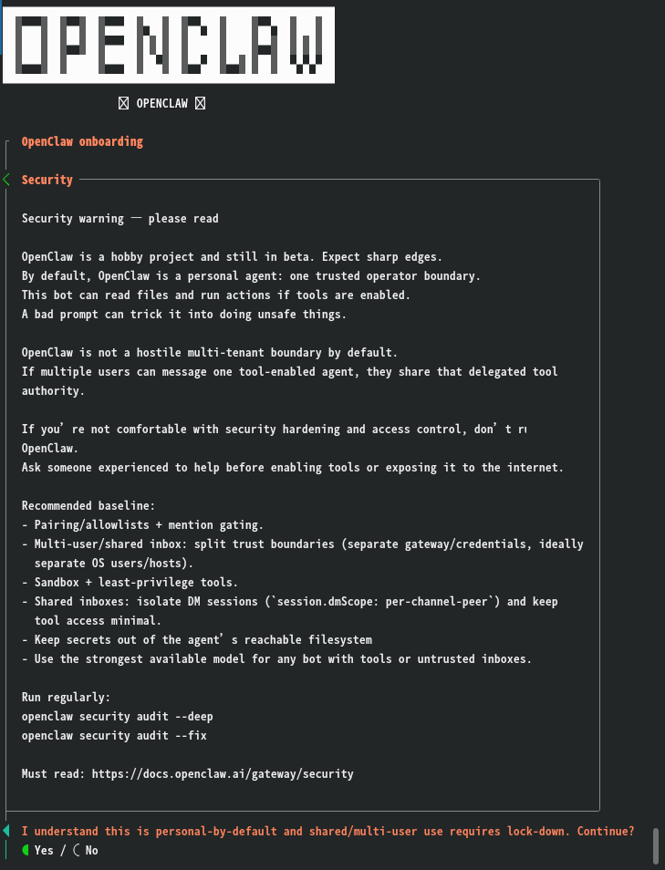

2. 选择yes后到 Onboarding mode 选择模式为快速开始 QuickStart

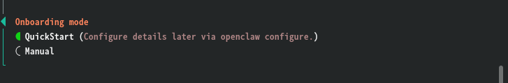

3. 选择快速开始后，出现的界面上面小方框是 openclaw 网关的基础信息，下面列表是挑选AI大模型的供应商，以常用的大模型 MiniMax 为例，选项移到 MiniMax ,输入回车

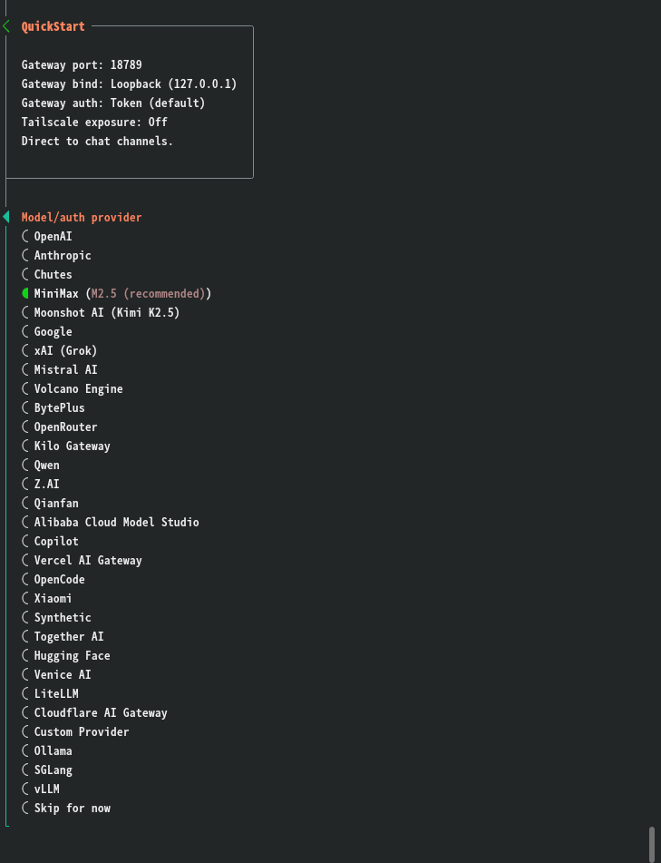

4. 回车后，是选择大模型的验证方式界面，选择带 CN 后缀的 API Key 方式，带 CN 后缀是国内使用的大模型网址，Global 后缀是国外使用的大模型网址

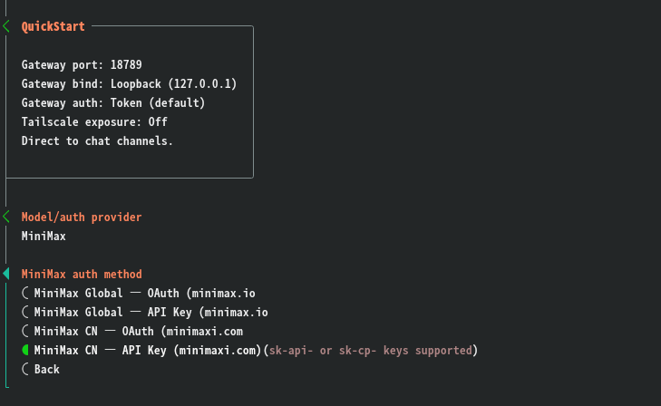

5. 选择 API Key 的验证方式后，是选择提供 API key 的方式，第一个选项是立即粘贴提供，第二个方式是外部提供，通过环境变量或其他配置项提供，这里选择第一个

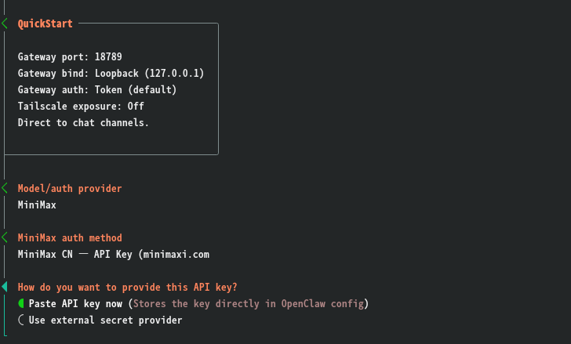

6. 选择后就是粘贴大模型提供的 API key 到输入光标位置，输入后回车

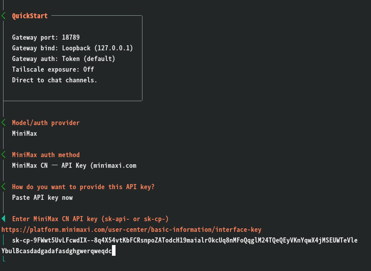

7. 回车后是选择大模型的版本，这里选择的是 MiniMax-M2.5 的大模型版本，输入回车

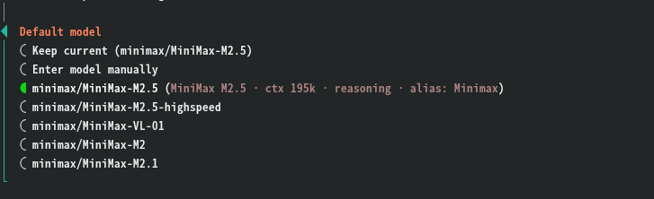

8. 回车后是选择 channel, 这是对接聊天工具的通道，这里先跳过，后续有需要可以在webui界面自行配置

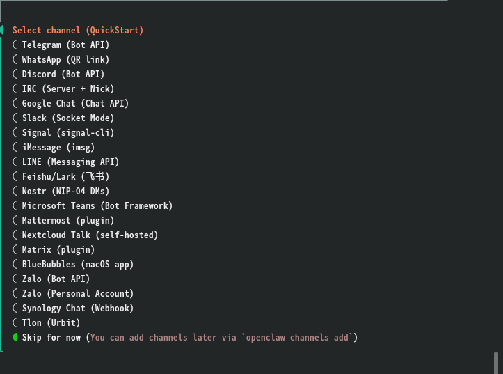

9. 接下来是搜索提供商，当 AI 需要进行网络搜索以获取实时信息时所使用的搜索引擎服务。它决定了 OpenClaw 在执行 web\_search 工具时调用哪个后端搜索服务，这里可以选择跳过

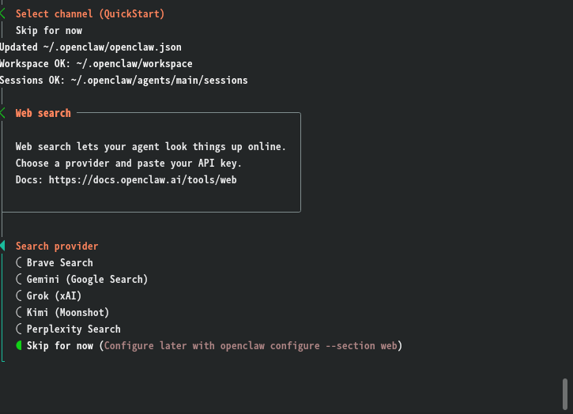

10. 跳过后是配置 skills 界面，这个可以选择 No 跳过，后续有需要可以在 openclaw 的 webui 界面配置

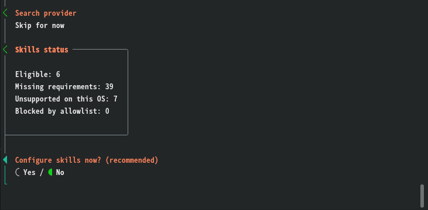

11. 跳过后是 hooks 的配置，这个配置是在发出代理命令时可以自动执行的操作，可以根据需求进行配置，也可以后续在 webui 界面进行配置，这里先跳过，通过空格键选择，回车执行

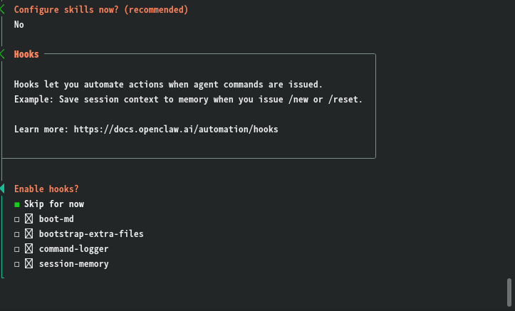

12. 跳过 hooks 配置后 openclaw 会自动安装 openclaw 网关服务，安装完毕后会显示服务安装路径和会话缓存路径，在 control ui 框有 openclaw 的 webui 访问网址链接，可通过网页访问 webui 界面对 openclaw 进行配置和使用

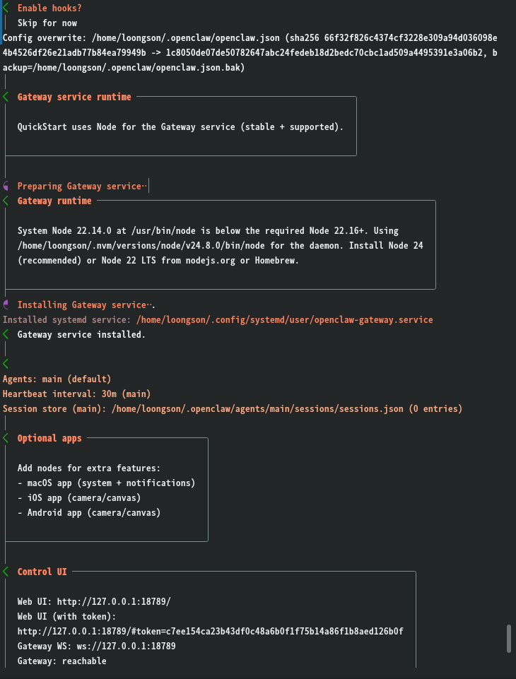

13. 安装完 openclaw 的网关服务后，可以选择 TUI 和 Web UI 来与 openclaw 进行交流

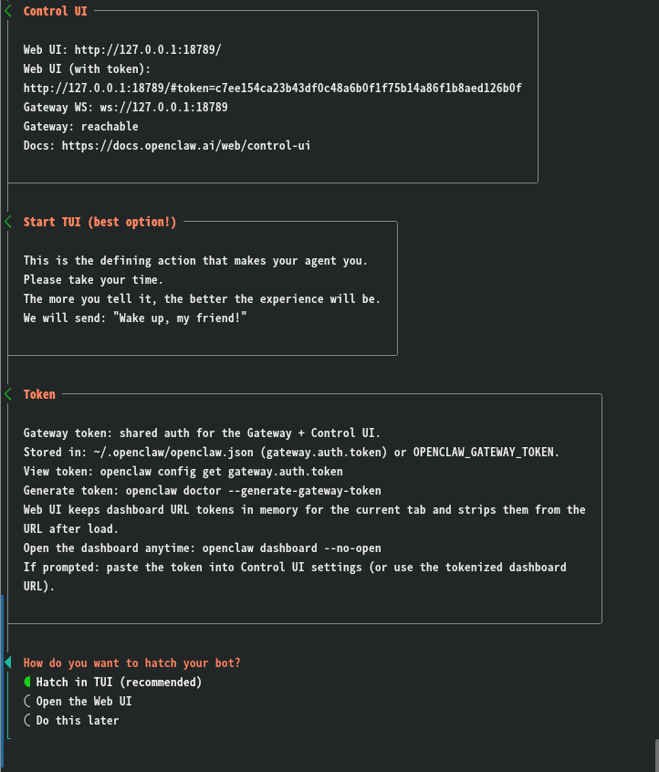

## 四、交互使用方式
网关部署完成，提供两种交互界面：TUI 终端界面、Web UI 网页界面。

1. TUI 终端界面

选择 TUI 的对话界面，光标输入框为交流对话框

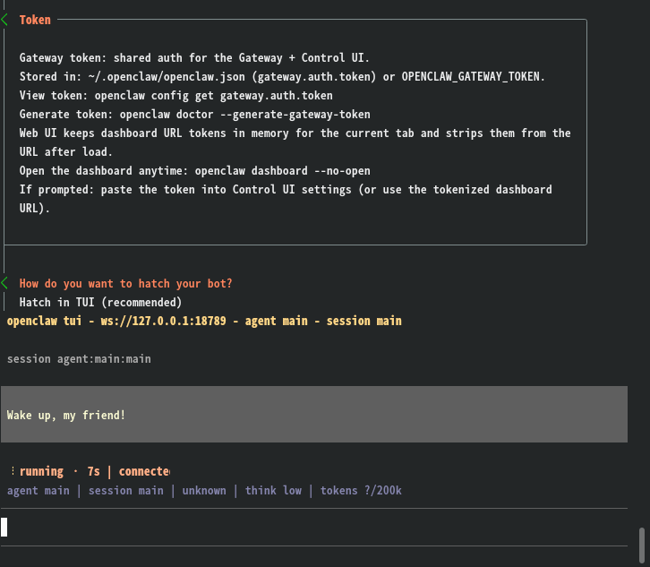

2. Web UI 网页界面

选择 Web UI 的画面，则在浏览器上打开 openclaw 的配置和聊天界面

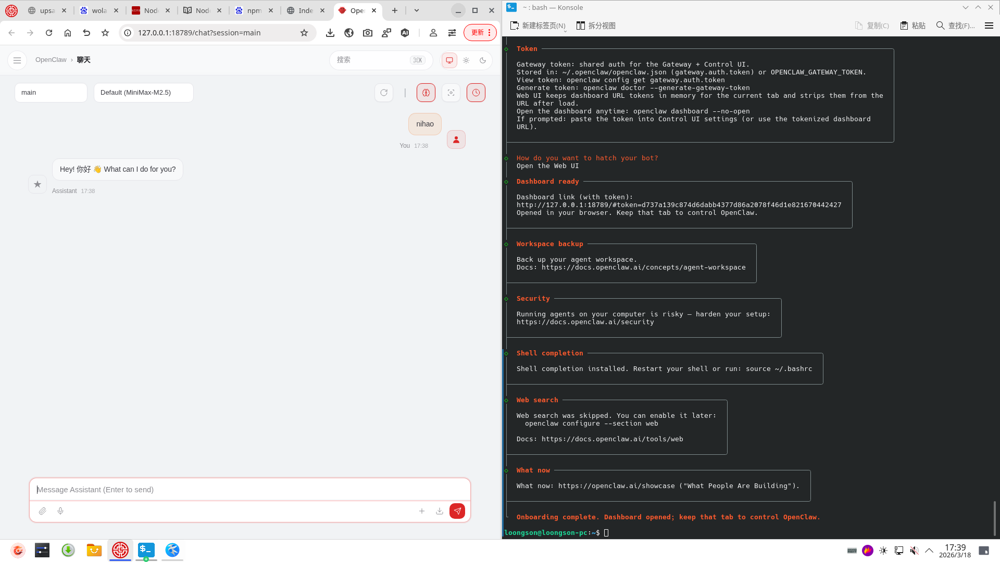

> openclaw 的 Web UI 的功能界面在左上角的功能栏，可以根据自己需求进行配置
>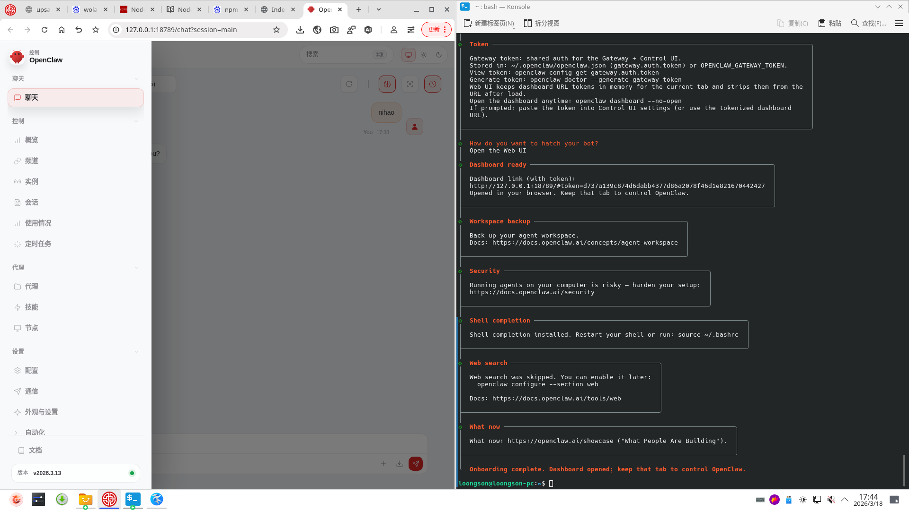

