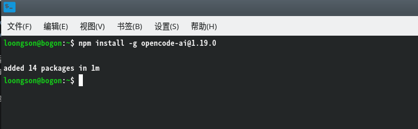
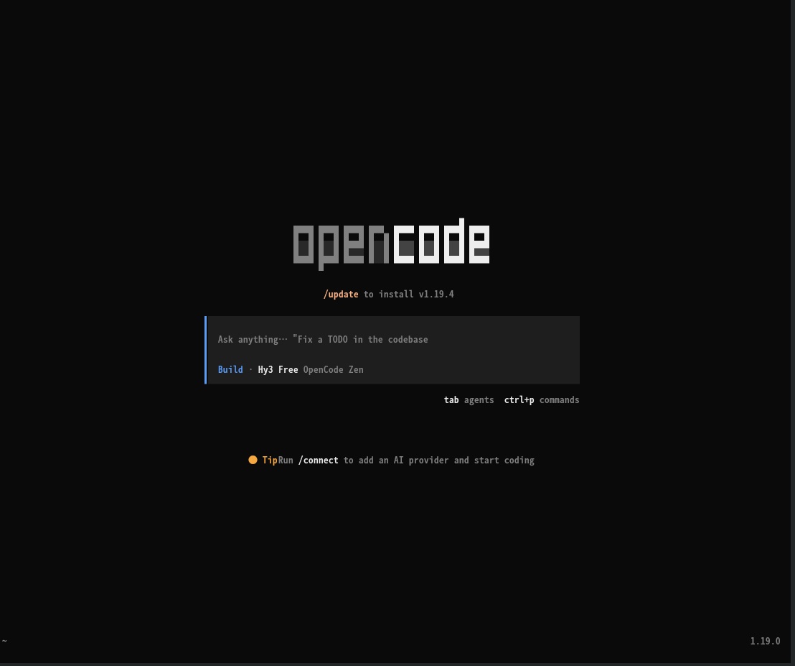
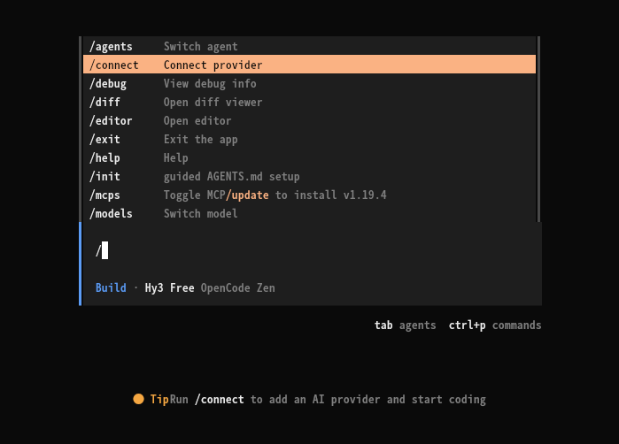
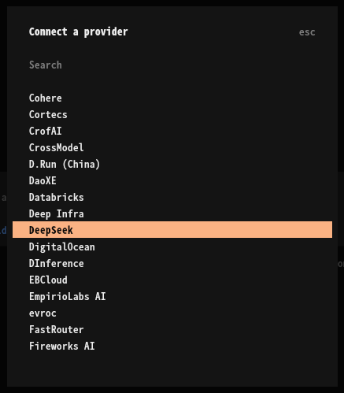
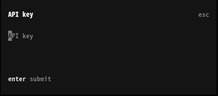
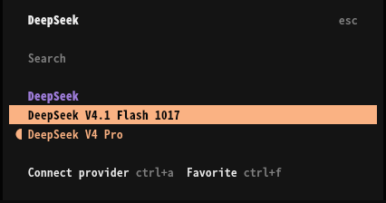
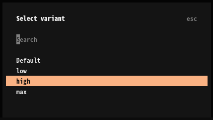
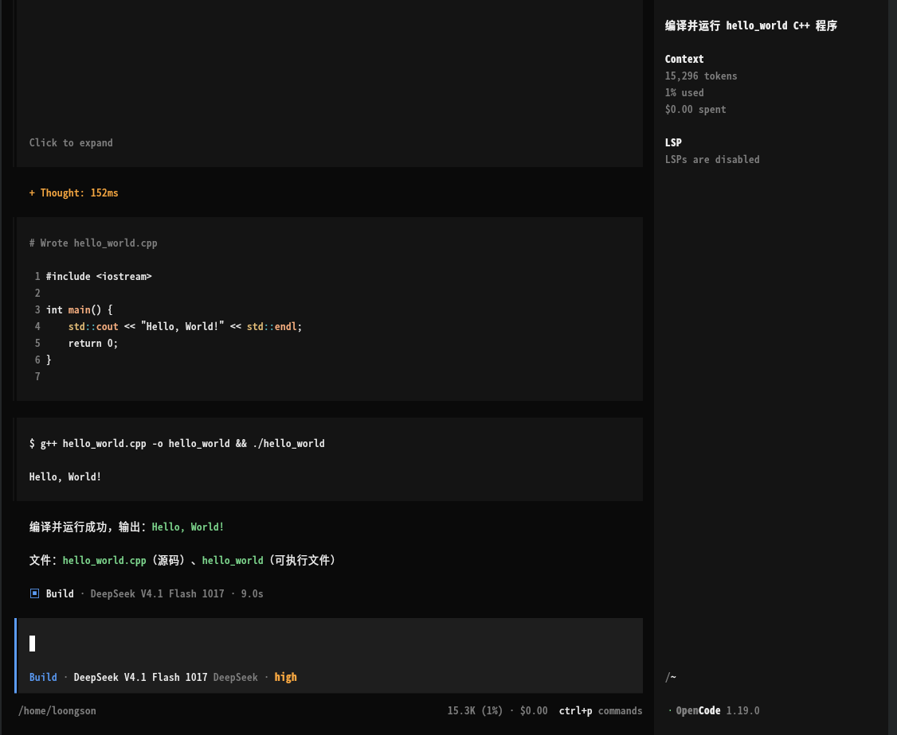
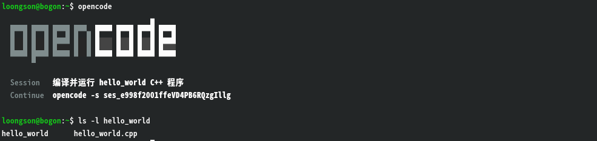

# LoongArch上opencode使用指南

OpenCode 是一款开源的终端 AI 编码智能体，可结合项目代码与上下文，通过自然语言完成代码理解、功能开发、问题排查、重构与测试等任务。它不绑定模型厂商，支持 Claude、GPT、DeepSeek、GLM 及本地模型，并具备 LSP 集成、多会话并行与会话分享能力，适用于日常开发与团队协作。

上游仓库：[https://github.com/anomalyco/opencode](https://github.com/anomalyco/opencode)

**版本说明：**

- **可用版本**：1.17.11、1.19.0
- **支持 ABI**：仅 ABI2.0

## 一、配置 LoongArch npm 仓库

OpenCode 目前仅提供 ABI2.0 版本，请在 ABI2.0 系统上配置对应的 npm 仓库：

```sh
$ npm set registry https://registry.loongnix.cn:5873
```

## 二、安装 OpenCode

执行以下命令全局安装（以 1.19.0 版本为例）：

```sh
$ npm install -g opencode-ai@1.19.0
```

安装成功后的界面如下：



## 三、启动 OpenCode

安装完成后，直接在终端中运行：

```sh
$ opencode
```

启动成功后会显示 OpenCode 的终端 UI 界面：



## 四、配置大模型

1. 在对话框输入框中输入 `/connect`，进入大模型配置流程：

   

2. 选择所使用的大模型供应商：

   

3. 输入该供应商提供的 API Key，回车确认：

   

4. 选择要使用的具体模型版本：

   

5. 选择思考等级：

   

配置完成后即可进入与大模型的交互区：



## 五、开始使用

在交互区中用自然语言描述任务（例如「解释这个函数的实现逻辑」「为当前模块补充单元测试」），OpenCode 会自动读取项目文件、规划执行步骤并给出结果。

大模型会在当前工作区中读取并生成相关文件：


