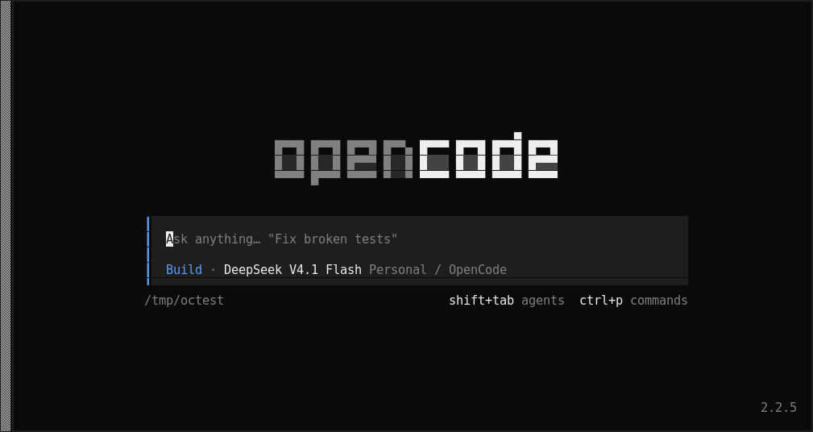
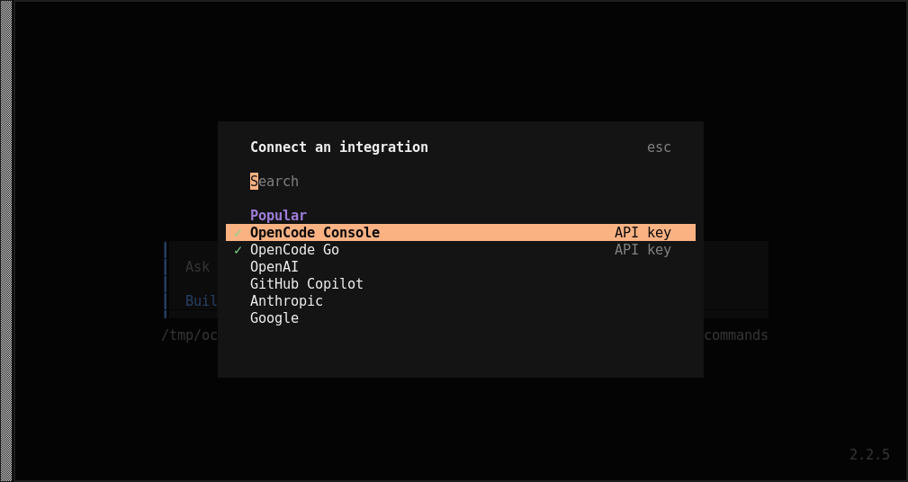
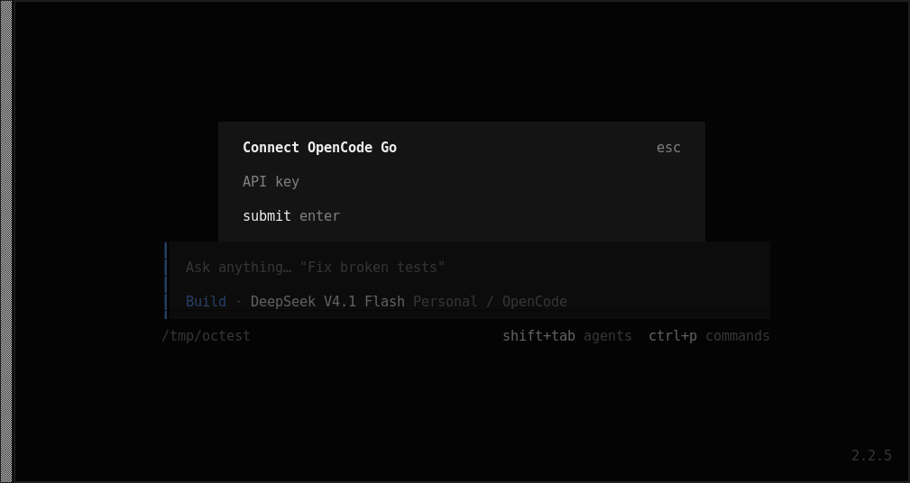
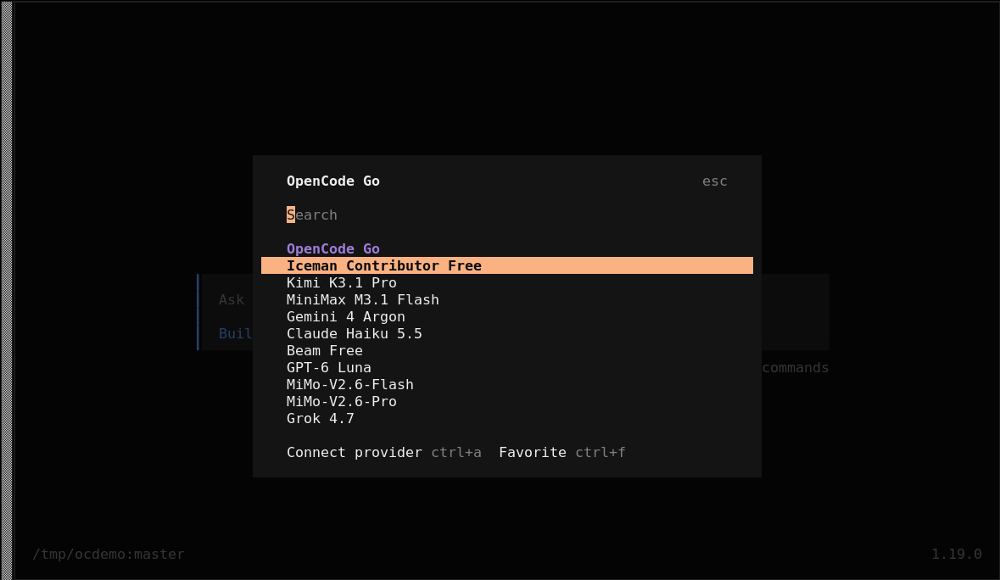
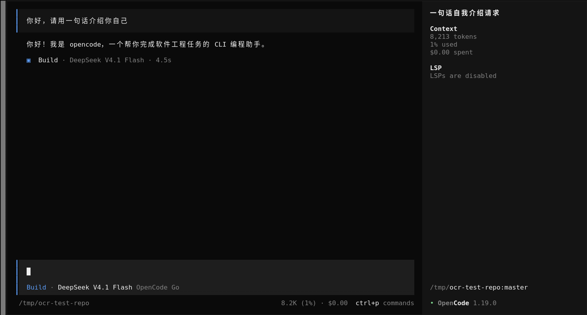

# LoongArch上opencode使用指南

OpenCode 是一款开源终端 AI 编码智能体，可结合项目代码上下文，通过自然语言指令完成代码理解、功能开发、问题排查、重构与测试等工作。它不绑定模型厂商，支持 Claude、GPT、DeepSeek、GLM 以及本地模型；内置 LSP 集成、多会话并行、会话分享能力，适用于日常开发与团队协作。

上游仓库：[https://github.com/anomalyco/opencode](https://github.com/anomalyco/opencode)

官方文档：[https://opencode.ai/docs](https://opencode.ai/docs)

**版本说明：**

- **可用版本**：1.17.11、1.19.0、2.2.5
- **Node.js 版本要求**：≥ 18
- **支持 ABI**：仅 ABI2.0

## 一、配置 LoongArch npm 仓库

OpenCode 目前仅提供 ABI2.0 版本，请在 ABI2.0 系统上配置对应的 npm 仓库：

```sh
$ npm set registry https://registry.loongnix.cn:5873
```

## 二、安装 opencode

配置好对应源后全局安装：

```sh
$ npm install -g @opencode/cli@2.2.5
```

安装完成后用 `opencode --version` 确认版本：

```
$ opencode --version
opencode v2.2.5
```
> 注意：2.x之后包名改为 `@opencode/cli`；1.17.11、1.19.0 旧版本包名是 `opencode-ai`，使用 `npm install -g opencode-ai@版本号` 安装。

## 三、启动 opencode

在项目目录下直接运行，进入 TUI 交互界面：

```sh
$ opencode
```

主界面由三部分组成：中间的 logo 与输入框、输入框下方的当前 agent 与模型，右下角显示当前版本：



## 四、配置大模型

1. 在输入框输入 `/connect` 并回车，打开供应商列表：

列表顶部是常用供应商（OpenCode、OpenCode Go、OpenAI、GitHub Copilot、Anthropic、Google 等），下面是完整供应商清单，右侧标注接入方式（如 `API key`），可直接输入关键字搜索：



2. 以 OpenCode Go 订阅为例，选中后进入密钥输入界面，粘贴 API Key 回车提交：



3. 连接成功后，输入 `/models` 选择要使用的模型：

面板分 `Recent`（最近使用）与完整列表；底部 `ctrl+a` 可继续连接集成、`ctrl+f` 收藏常用模型。选中即生效：



## 五、开始使用

1. 一个简单的对话示例如下：



2. 常用入口

| 操作 | 说明 |
| --- | --- |
| `/` | 打开斜杠命令面板（`/init`、`/models`、`/connect`、`/diff`、`/editor`、`/mcps`、`/help`、`/exit` 等） |
| `Shift+Tab` | 切换 agent（Build / Plan 等） |
| `Ctrl+P` | 打开命令面板，可搜索全部动作与命令（面板内 `ctrl+x m` 切模型、`ctrl+x l` 切会话、`ctrl+x n` 新会话） |
| `Esc` | 关闭当前弹窗 |
| `Enter` | 发送消息（`Shift+Enter` 换行） |

3. 会话管理

opencode 把会话保存在本地，可以继续、分叉或导出：

```sh
$ opencode run -c                        # 继续最近一次会话
$ opencode run -s <sessionID>            # 指定会话继续
$ opencode run -s <sessionID> --fork     # 分叉出一条新分支
$ opencode session list                  # 列出历史会话
$ opencode session delete <sessionID>    # 删除会话
$ opencode session export                # 导出会话为 JSON
$ opencode session import <文件或URL>    # 导入会话
```
