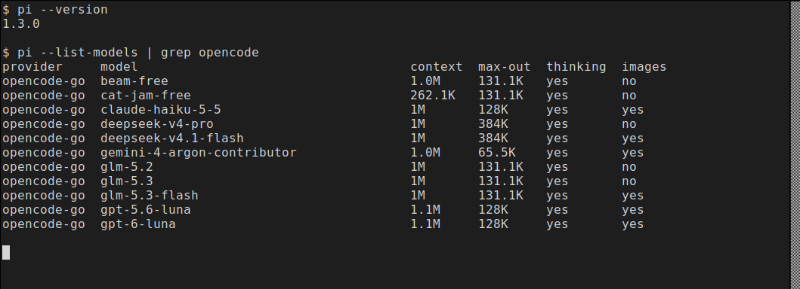
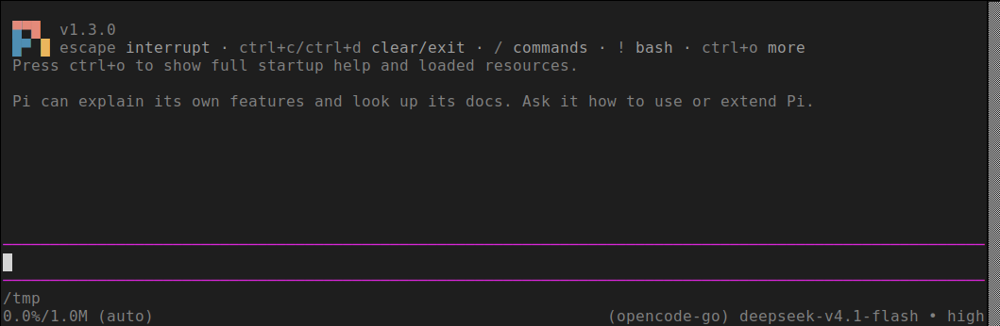
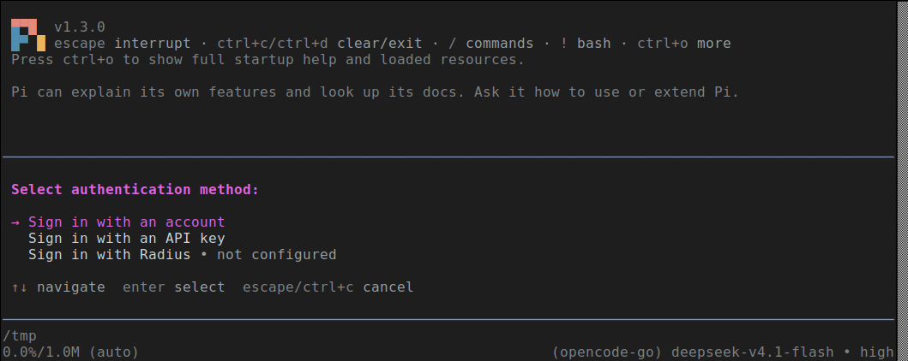
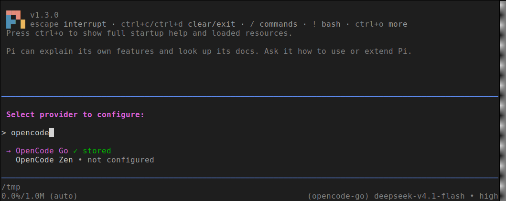
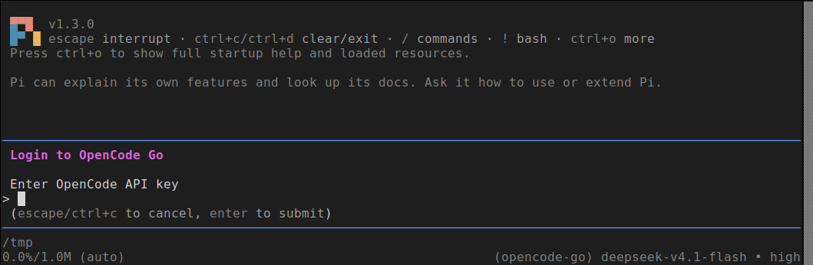
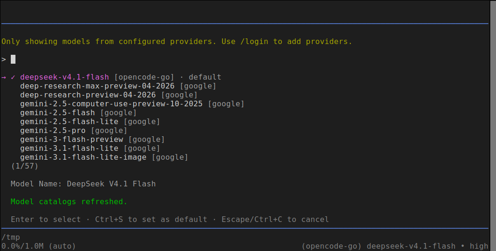
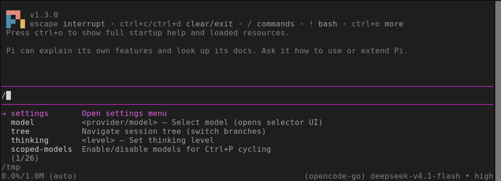
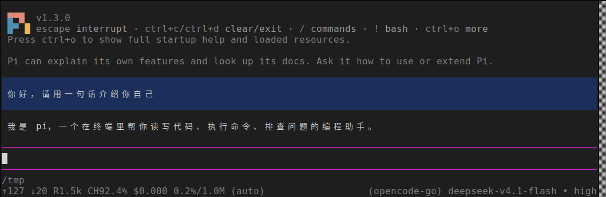
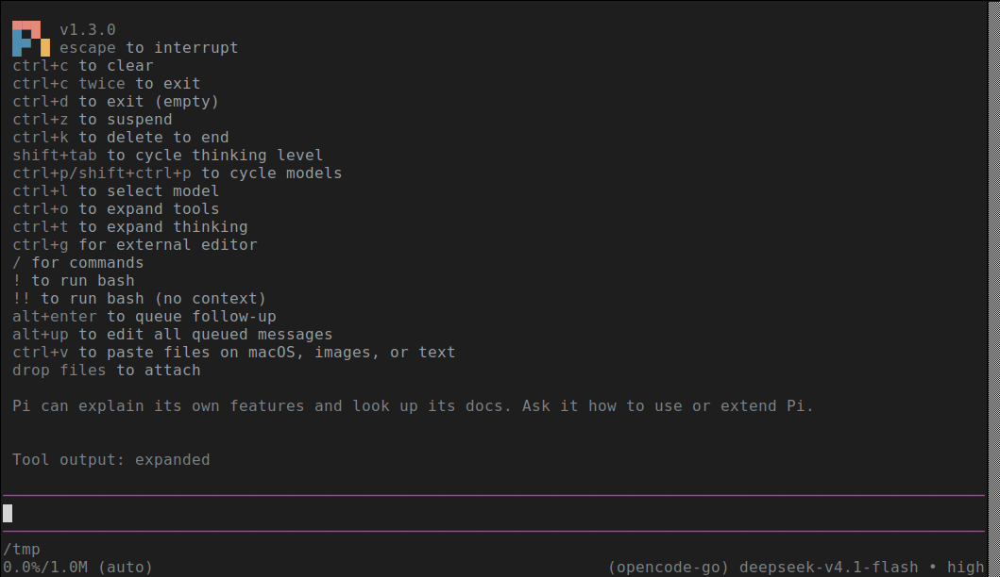

# LoongArch上pi使用指南

Pi 是一个极简、可扩展的 AI 智能体运行框架（agent harness），理念是让 Pi 适配你的工作流，而不是反过来。默认开箱即用但不内置子代理、计划模式等特性，可用扩展、技能、提示词模板、主题自行定制，并打包成 Pi 包通过 npm 或 git 分发；它支持多种模型接入方式：账号登录、API Key、本地模型；使用形式也不局限于终端交互，同时支持 JSON 自动化输出、RPC 远程调用、TypeScript SDK 开发集成。

上游仓库：[https://github.com/earendil-works/pi](https://github.com/earendil-works/pi)

官方文档：[https://pi.dev/docs/latest/quickstart](https://pi.dev/docs/latest/quickstart)

**版本说明：**

- **可用版本**：1.3.0
- **Node.js 版本要求**：≥ 22.19.0
- **支持 ABI**：支持 ABI1.0 | ABI2.0

## 一、配置 LoongArch npm 仓库

LoongArch分为 **ABI1.0 / ABI2.0** 两套 ABI，两套仓库互相不兼容，对应独立的 npm 镜像源，请先确认系统 ABI 版本，再配置匹配的源。ABI 查看方式详见：[设置 npm 镜像源方法](../../README.md)。

### ABI1.0 环境配置

```sh
$ npm set registry https://registry.loongnix.cn:4873
```

### ABI2.0 环境配置

```sh
$ npm set registry https://registry.loongnix.cn:5873
```

## 二、安装 pi

ABI1.0 与 ABI2.0 使用同一条安装命令，配置好对应源后全局安装：

```sh
$ npm install -g --ignore-scripts @earendil-works/pi-coding-agent
```

安装完成后，可用 `pi --version` 确认版本：

```sh
$ pi --version
1.3.0
```
可用 `pi --list-models` 查看当前可供选择的模型（含供应商、上下文长度、最大输出、是否支持思考与图片）：

```sh
$ pi --list-models | grep opencode
```



## 三、启动 pi

在任意项目目录下执行：

```sh
$ pi
```

首次启动会显示 pi 的启动界面，界面底部依次是：输入提示符、工作目录与上下文占用、当前供应商/模型/思考等级：



## 四、配置大模型

1. 在输入框中输入 `/login` 并回车，进入登录流程，先选择登录方式（账号登录、API Key 登录等）：

   

2. 选择 `Sign in with an API key` 后进入供应商列表，可直接输入关键字过滤（示例中过滤 `opencode`）：

   

3. 选中供应商后输入该供应商提供的 API Key，回车提交：

   

4. 输入 `/model` 选择要使用的具体模型；列表中带 `✓` 的是当前模型，回车切换，`Ctrl+S` 设为默认：

   

配置完成后，状态栏右侧会显示当前供应商、模型与思考等级（例如 `(opencode-go) deepseek-v4.1-flash · high`）。思考等级可以随时用 `Shift+Tab` 循环切换。

## 五、开始使用

在输入框中直接描述任务即可，pi 会自动读取项目文件、调用工具（读文件、执行命令、改代码）并给出结果。以 `/` 开头可以唤出命令面板，其中包含 `/model`、`/login`、`/settings`、`/tree`、`/thinking` 等命令：



一个简单的对话示例如下：



常用输入方式：

- `/命令`：打开命令面板或执行 pi 内置命令
- `!命令`：直接在会话中执行 shell 命令（输出会进入上下文）
- `@文件路径`：把指定文件加入本次对话的上下文
- `Alt+Enter`：在 pi 工作期间排队发送后续消息

## 六、常用快捷键

在 pi 中按 `Ctrl+O` 可展开完整的启动帮助与已加载资源，其中列出全部快捷键：



常用的几个：

| 快捷键 | 作用 |
| --- | --- |
| `Esc` | 打断当前输出 |
| `Ctrl+C` | 清空当前输入（连按两次为退出） |
| `Ctrl+D` | 退出 pi（输入框为空时） |
| `Shift+Tab` | 循环切换思考等级 |
| `Ctrl+P` | 循环切换模型（可用 `--models` 指定循环范围） |
| `Ctrl+L` | 打开模型选择器 |
| `Ctrl+O` | 展开工具输出/启动帮助 |
| `Ctrl+T` | 展开思考过程 |
| `Ctrl+G` | 用外部编辑器编写提示词 |
| `Ctrl+Z` | 挂起（`fg` 恢复） |

## 七、会话管理

pi 会自动把会话记录保存在项目对应的会话目录中，中断或退出后可以继续：

```sh
$ pi --continue            # 继续当前项目最近一次会话
$ pi --resume              # 交互式选择要恢复的会话
$ pi --session <id|路径>   # 恢复到指定会话
```

会话 ID 会在退出时打印（`To resume this session: pi --session ...`），也可用 `pi --name <名称>` 给会话起一个易识别的名字。非交互场景可以用 `pi -p "你的问题"` 一次性执行并输出结果。
