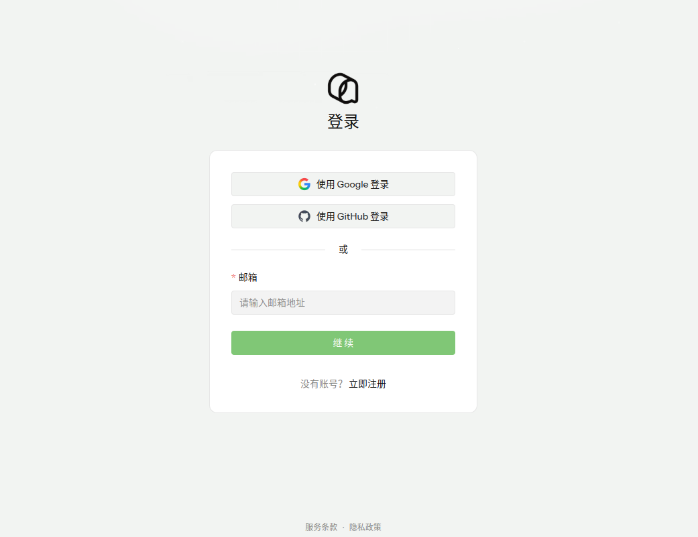
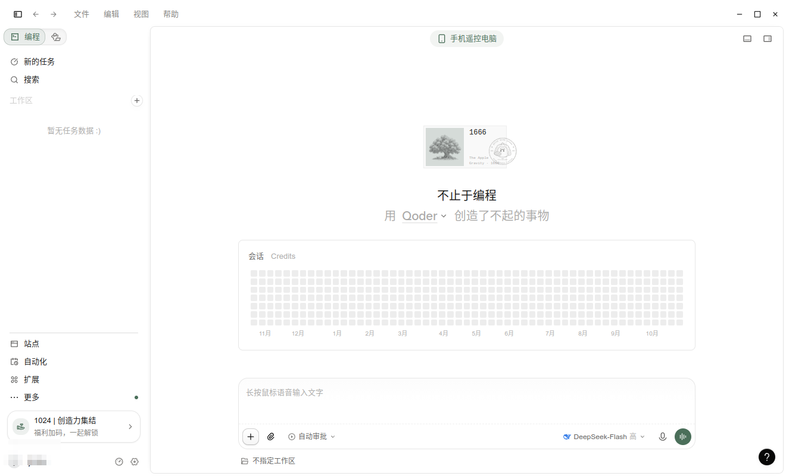
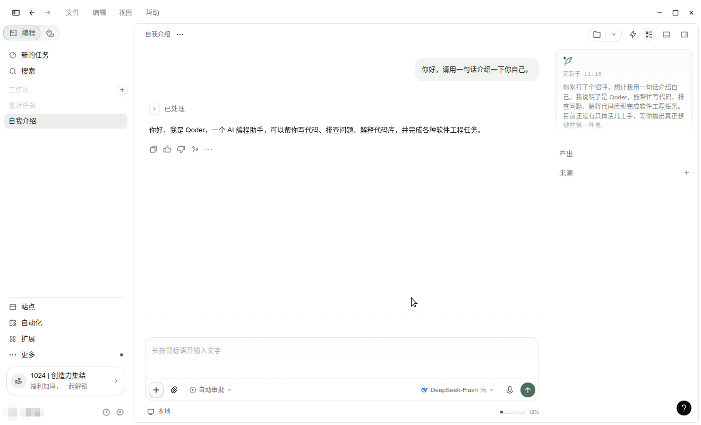
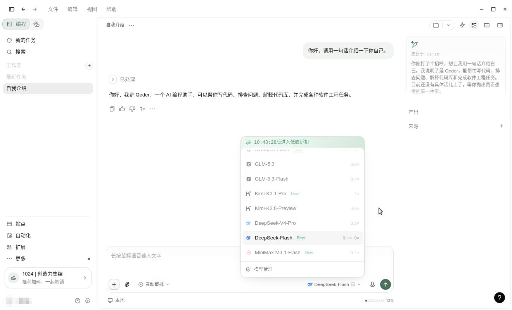
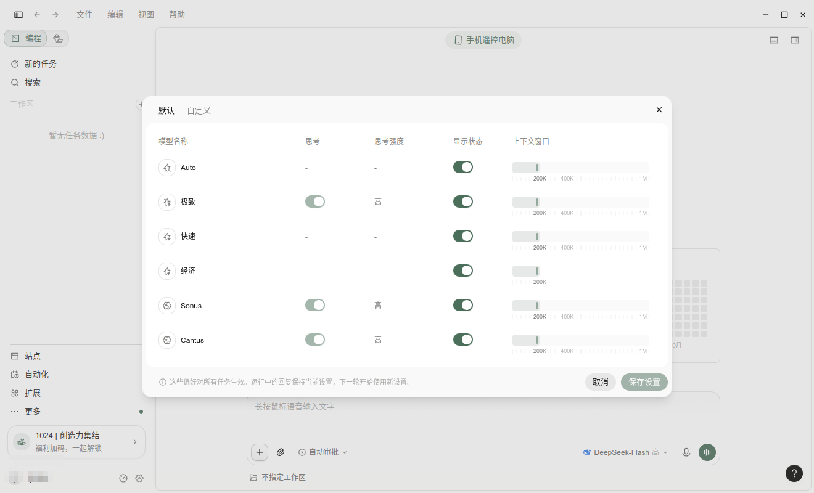
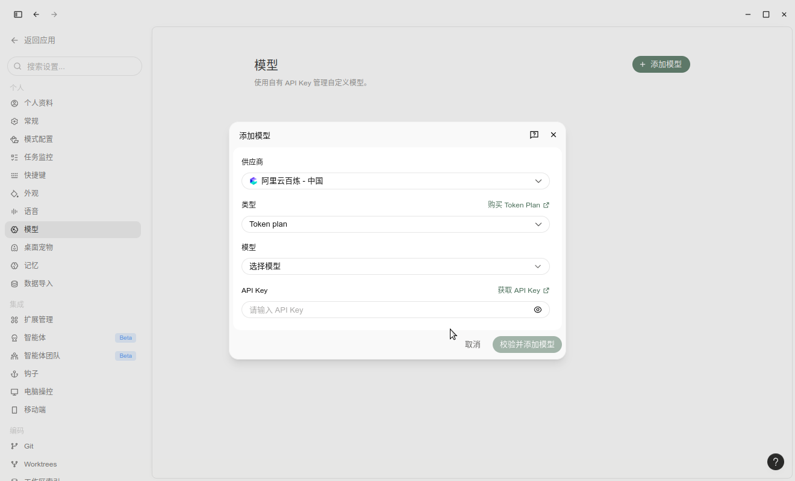

# LoongArch上Qoder使用指南

Qoder 是面向真实软件开发的 Agentic 编码平台：智能体围绕「理解上下文 → 制定计划 → 调用工具执行 → 验证并迭代」的任务闭环推进，直到交付结果。桌面版 Qoder IDE 提供 NEXT 代码补全、行间会话与 Ask / Agent 智能会话，并支持知识中心、代码库索引、MCP 等能力。

官方文档：[https://docs.qoder.com/zh](https://docs.qoder.com/zh)

LoongArch 官方 deb 包：[Qoder-linux-loongarch64.deb](https://download.qoder.com.cn/qoder-app/releases/latest/Qoder-linux-loongarch64.deb)

**版本说明：**

- **可用版本**：`1:0.4.11`
- **支持 ABI**：**仅 ABI1.0**

## 一、安装 Qoder

1. 下载 LoongArch 安装包【也可以到[下载页](https://qoder.com/zh/download)手动下载】：

```sh
$ wget -c https://download.qoder.com.cn/qoder-app/releases/latest/Qoder-linux-loongarch64.deb 
```

2. 安装：

```sh
$ sudo dpkg -i Qoder-linux-loongarch64.deb
```

3. 验证安装结果：

```sh
$ dpkg -l qoder | tail -1
ii  qoder   1:0.4.11   loongarch64   Qoder Desktop

$ which qoder
/usr/bin/qoder
```

## 二、启动 Qoder

```sh
$ qoder
```
首次启动会弹出登录窗口，界面语言可在窗口中切换（默认跟随系统）：


## 三、登录与配置

1. 点击「立即登录」，IDE 会拉起浏览器打开 Qoder 账号登录页。支持 **Google 登录**、**GitHub 登录**，或直接用**邮箱**登陆；没有账号可点「立即注册」：



2. 浏览器里登录成功后会自动跳回 IDE，左下角显示当前账号，至此登陆成功。

## 四、开始使用

登录后进入 Qoder IDE 主界面：



### 对话实例

在底部输入框里输入问题并回车，即可开始对话：



## 五、选择模型与模型管理

### 1. 选择模型

点击输入框右下角的模型名（示例中为 `DeepSeek-Flash`），会弹出模型列表，点击即可切换本次会话使用的模型：




### 2. 模型管理

在模型列表底部点击「模型管理」，可以对每个模型做配置：




### 3. 添加模型

如果要用自己的 API Key 接入模型，在「设置 → 模型」页面点击右上角「添加模型」：先选择供应商（示例为阿里云百炼），再选择类型与模型（模型支持多选，可一键全选），填入对应的 API Key 后点击「校验并添加模型」即可：



## 六、以 root 或在无 GPU 环境运行

Chromium 沙箱在 root 用户下会拒绝启动，需要加 `--no-sandbox`；普通用户直接 `qoder` 即可：

```sh
$ sudo qoder --no-sandbox              # 以 root 运行
$ qoder --no-sandbox --disable-gpu     # 无 GPU 环境（服务器/虚拟屏）
```

## 七、卸载

```sh
$ # 卸载
$ sudo dpkg -r qoder
```
