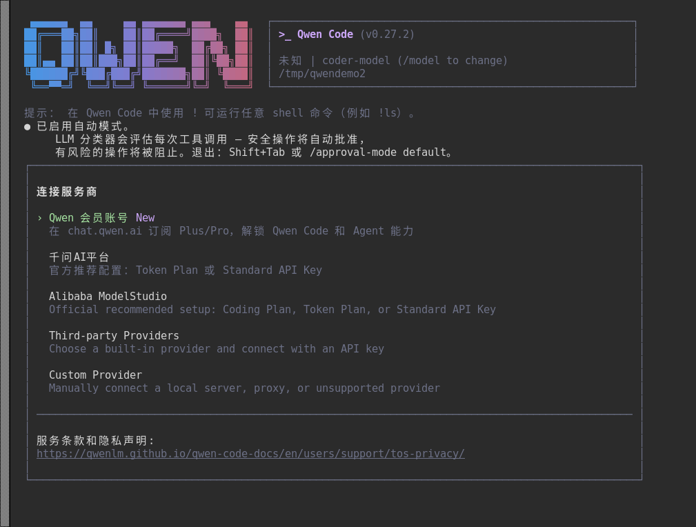
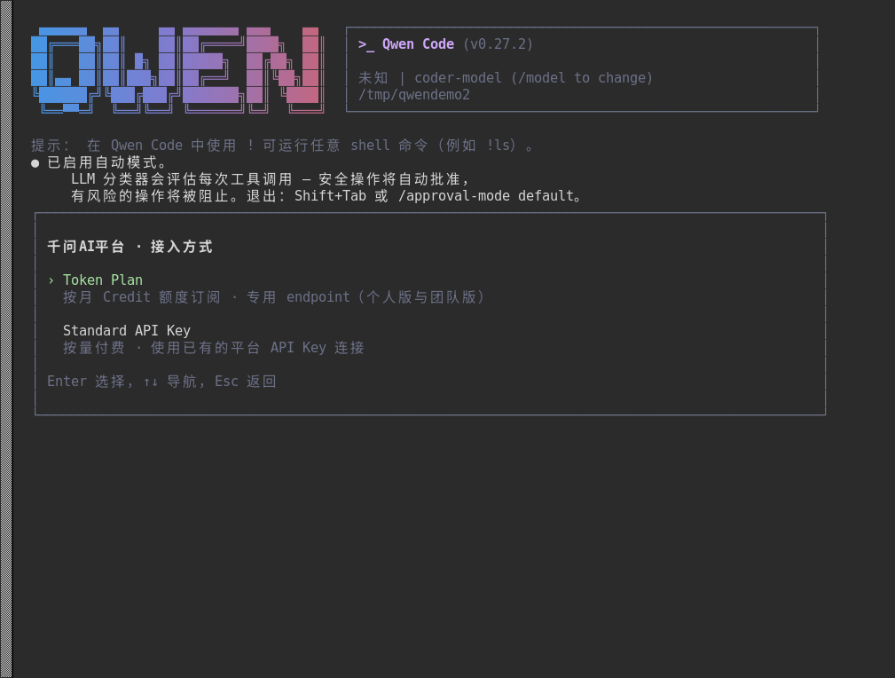
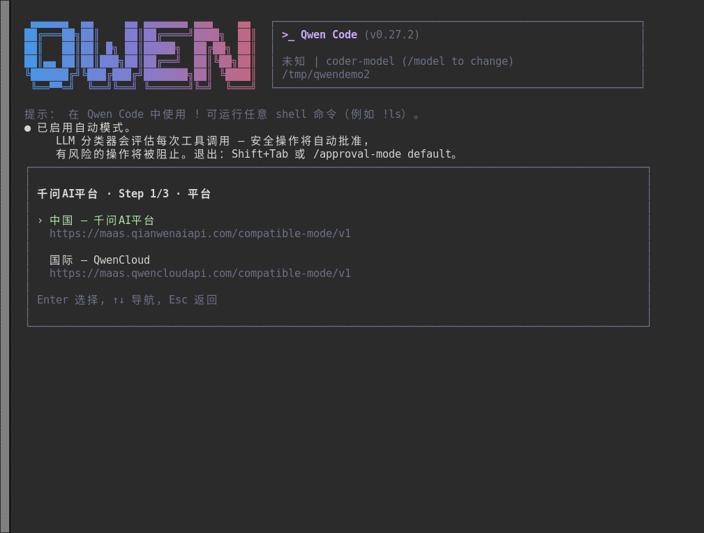
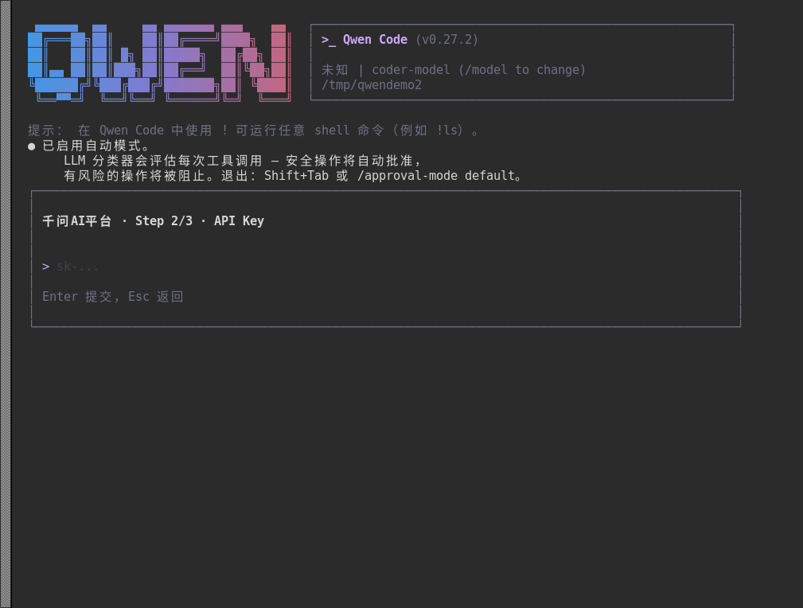
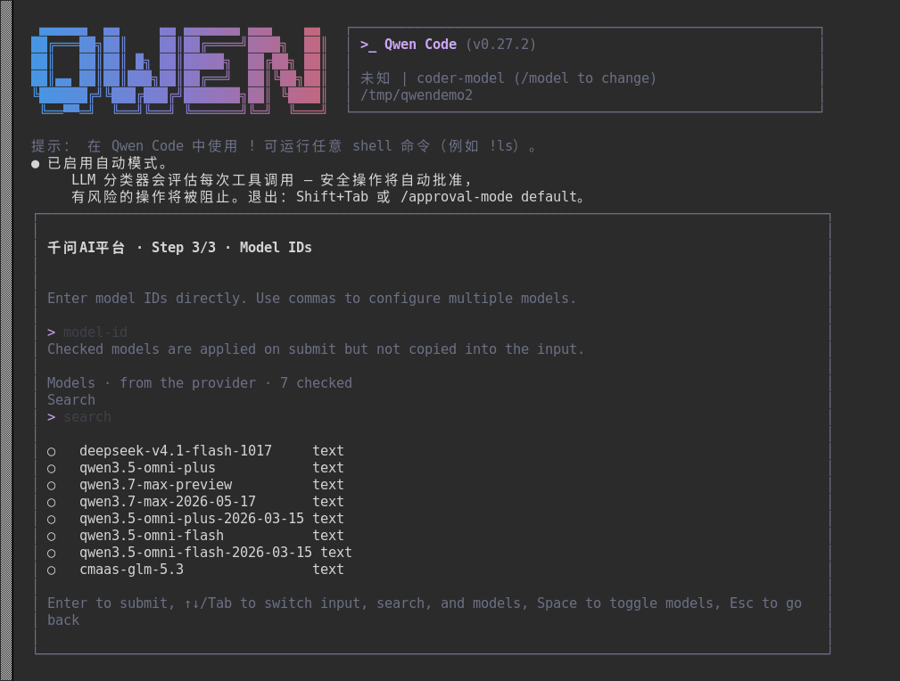
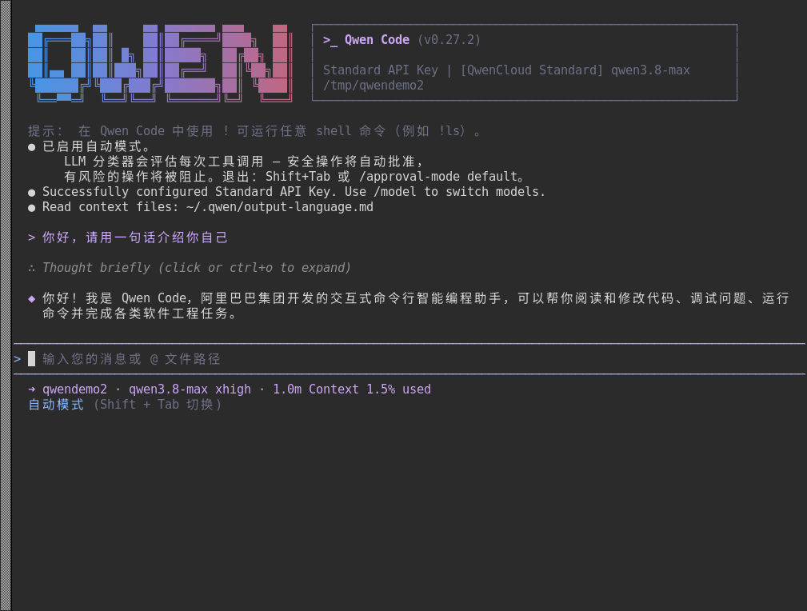

# LoongArch上qwen-code使用指南

Qwen Code 是阿里通义团队开源的终端 AI 编码智能体（基于 Gemini CLI 架构演进），支持 OpenAI、Anthropic、Gemini、Qwen 多种协议，可接千问AI平台的 API Key、订阅账号，也支持第三方中转与本地模型（Ollama / vLLM），并自带子代理、技能、MCP 与记忆等能力。

上游仓库：[https://github.com/QwenLM/qwen-code](https://github.com/QwenLM/qwen-code)

官方教程：[https://qwenlm.github.io/qwen-code-docs/zh/users/overview](https://qwenlm.github.io/qwen-code-docs/zh/users/overview)

**版本说明：**

- **可用版本**：0.27.1、0.27.2
- **Node.js 版本要求**：≥ 22
- **支持 ABI**：支持 ABI1.0 | ABI2.0


## 一、配置 LoongArch npm 仓库

LoongArch 分为 **ABI1.0 / ABI2.0** 两套 ABI，两套仓库互相不兼容，请先确认系统 ABI 版本，再配置匹配的源。ABI 查看方式详见：[查看系统 ABI 版本方法](../../README.md)。

### ABI1.0 环境配置

```sh
$ npm set registry https://registry.loongnix.cn:4873
```

### ABI2.0 环境配置

```sh
$ npm set registry https://registry.loongnix.cn:5873
```

## 二、安装
ABI1.0 与 ABI2.0 使用同一条安装命令，配置好对应源后全局安装：

```sh
$ npm install -g @qwen-code/qwen-code
```
安装完成后，可用 `qwen --version` 确认版本：
```
$ qwen --version
0.27.2
```

## 三、连接服务商

首次运行 `qwen` 会自动进入「连接服务商」引导，面板里有五种入口：



- Qwen 会员账号：已在 chat.qwen.ai 订阅 Plus / Pro，直接登录解锁
- 千问AI平台：用平台的 API Key（Token Plan 或 Standard API Key）
- Alibaba ModelStudio：用阿里云百炼的 Coding Plan / Token Plan / API Key
- Third-party Providers：内置的第三方供应商，填 API Key 即可
- Custom Provider：自建网关、本地模型或不支持的供应商，手工填 baseURL

### 3.1 Standard API Key 方式

**Step 1：选择接入方式**

选中「千问 AI 平台」后选择订阅方式：

- `Token Plan`：按月 Credit 额度订阅，走专用 endpoint（个人版 / 团队版）
- `Standard API Key`：按量付费，用平台上已有的 API Key 连接



**Step 2：选择平台区域**

- `中国 - 千问AI平台`：`https://maas.qianwenai.com/compatible-mode/v1`
- `国际 - QwenCloud`：`https://maas.qwencloudapi.com/compatible-mode/v1`

国内环境选第一个即可，两边的 Key 不通用。



**Step 3：粘贴 API Key**

把平台上创建的 Key（形如 `sk-...`）粘贴进去回车提交。



**Step 4：勾选模型**

提交后会列出该 Key 可用的模型，回车提交：



配置完成后，主界面右上角会显示认证方式与当前模型，例如 `Standard API Key | [QwenCloud Standard] qwen3.8-max`。想换模型随时输入 `/model`。

### 3.2 其它接入方式

**Qwen 会员账号**：在 chat.qwen.ai 订阅 Plus / Pro 后，选择第一项走浏览器登录，无需 API Key。

**阿里云百炼**：选择 `Alibaba ModelStudio`，或者直接用环境变量填写 API Key：

```sh
$ export DASHSCOPE_API_KEY="你的百炼 API Key"
```

**第三方中转 / 自建服务**：选择 `Third-party Providers / Custom Provider`，或者直接用环境变量接入标准 OpenAI 兼容接口：

```sh
$ export OPENAI_API_KEY="你的 API Key"
$ export OPENAI_BASE_URL="https://你的接口地址/v1"
$ export OPENAI_MODEL="你要用的模型名"
```

## 四、启动与使用

```sh
$ qwen
```
主界面顶部是 QWEN logo 与运行信息（版本、认证方式、当前模型、工作目录），中间是对话区，底部是输入框与状态栏（模型、思考等级、上下文占用）。

一个简单的对话示例如下：



1. 非交互模式：

```sh
$ qwen -p "总结一下这个模块的职责"
$ qwen "给我写一个解析 CSV 的函数" -i      # 执行后继续留在交互模式
```

2. 常用参数：

```sh
$ qwen -m qwen3.8-max               # 指定模型
$ qwen --approval-mode plan         # 只读/规划模式
$ qwen --approval-mode auto-edit    # 自动批准编辑类操作
$ qwen --continue                   # 继续上一次会话
$ qwen --resume                     # 选择历史会话恢复
```

3. 会话内的常用命令：

```sh
/model                  # 查看/切换模型
/auth                   # 重新配置认证（换 Key、换服务商）
/approval-mode          # 切换审批模式
```
