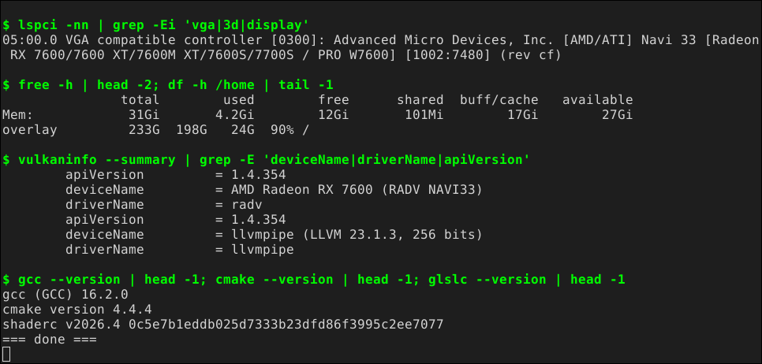
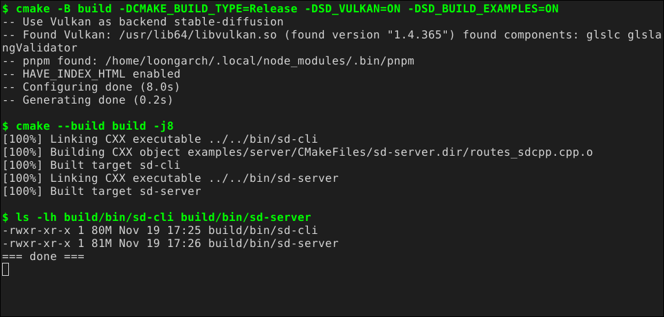
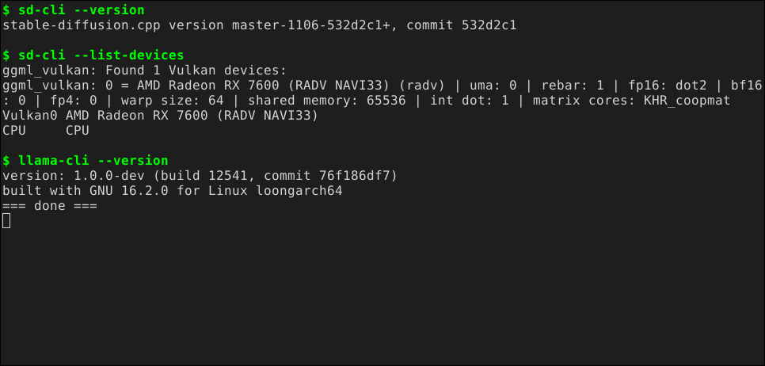
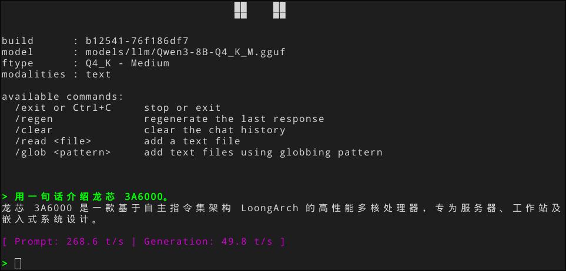
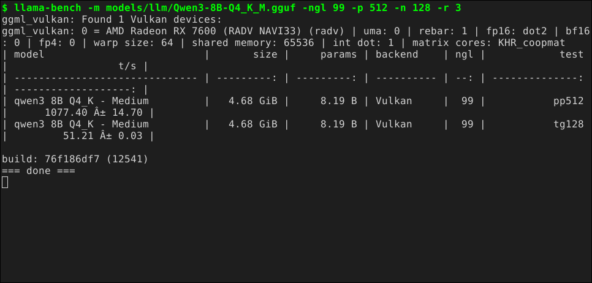
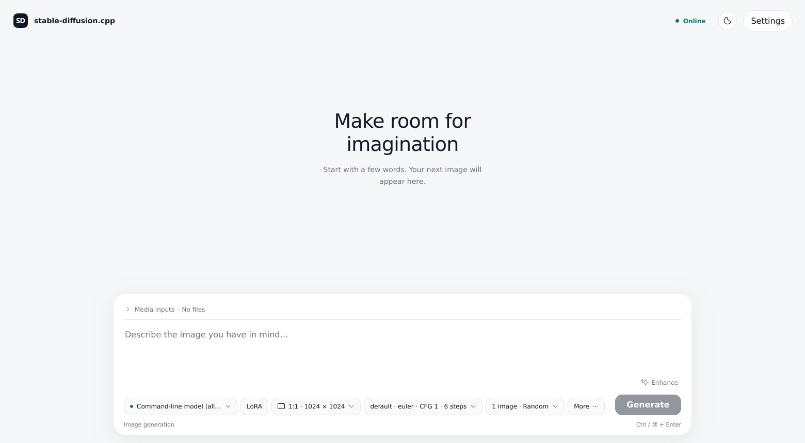
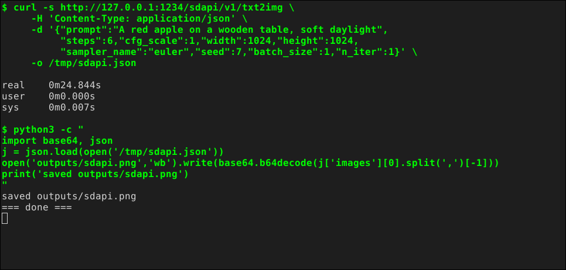
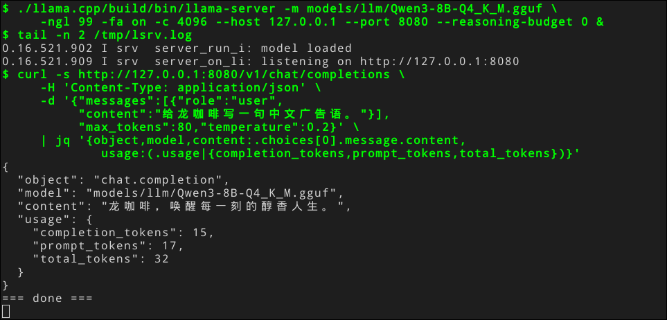

# LoongArch上本地AI图片与LLM模型使用指南

在 LoongArch64 桌面环境基于 GPU 运行本地模型，可采用 **Vulkan（Mesa RADV）+ ggml** 方案：由 `stable-diffusion.cpp` 实现图像生成与参考图编辑，`llama.cpp` 承载大语言模型推理。二者共用 Vulkan 后端，纯 C/C++ 实现，不依赖 ROCm、PyTorch 及 Python 环境，模型统一采用 GGUF 量化格式。

上游仓库：[stable-diffusion.cpp](https://github.com/leejet/stable-diffusion.cpp) ｜ [llama.cpp](https://github.com/ggml-org/llama.cpp)


**版本说明：**

- **使用的版本**：stable-diffusion.cpp `master-1106-532d2c1+`、llama.cpp `1.0.0-dev (build 12541)`
- **运行环境要求**：LoongArch64 + Vulkan 1.3 以上的显卡驱动，显存 ≥ 8GB 建议
- **编译依赖**：GCC ≥ 13、CMake ≥ 3.20、Vulkan loader、`glslc`
- **支持 ABI**：支持 ABI2.0


## 目录

- [一、环境检查](#一环境检查)
- [二、编译 sd.cpp 与 llama.cpp](#二编译-sdcpp-与-llamacpp)
- [三、下载与校验模型](#三下载与校验模型)
- [四、文生图](#四文生图)
- [五、参考图编辑](#五参考图编辑)
- [六、本地大语言模型](#六本地大语言模型)
- [七、服务化：WebUI 与 API](#七服务化webui-与-api)

## 一、环境检查

先确认系统架构、显卡驱动与编译工具满足条件，再开始编译：

```sh
$ uname -m; uname -r; getconf PAGE_SIZE
$ lspci -nn | grep -Ei 'vga|3d|display'
$ free -h | head -2; df -h /home | tail -1
$ vulkaninfo --summary 2>/dev/null | grep -E 'deviceName|driverName|apiVersion'
$ gcc --version | head -1; cmake --version | head -1; glslc --version | head -1
```

本次实测环境：



## 二、编译 sd.cpp 与 llama.cpp

### 2.1 获取源码

```sh
$ mkdir -p ~/ai && cd ~/ai
$ git clone --recursive https://github.com/leejet/stable-diffusion.cpp
$ git clone --recursive https://github.com/ggml-org/llama.cpp
```

### 2.2 禁用 glslc 不支持的 NV 着色器变体

系统自带的 `glslc`（shaderc v2026.4）能通过 CMake feature test，但编译 NVIDIA 专属着色器时报错：

```text
shaderc: internal error: compilation succeeded but failed to optimize:
Invalid capability operand: 5447
```

RADV 不需要这些 NV 变体，直接在两个仓库的 `ggml/src/ggml-vulkan/CMakeLists.txt` 中把对应 `test_shader_extension_support(...)` 调用替换为 `set(... OFF)`：

```sh
$ for repo in ~/ai/stable-diffusion.cpp ~/ai/llama.cpp; do
    cd "$repo"
    f=ggml/src/ggml-vulkan/CMakeLists.txt
    perl -0777 -pi -e 's/test_shader_extension_support\(\s*"GL_NV_cooperative_matrix2".*?"GGML_VULKAN_COOPMAT2_GLSLC_SUPPORT"\s*\)/set(GGML_VULKAN_COOPMAT2_GLSLC_SUPPORT OFF)/s' "$f"
    perl -0777 -pi -e 's/test_shader_extension_support\(\s*"GL_NV_cooperative_matrix_decode_vector".*?"GGML_VULKAN_COOPMAT2_DECODE_VECTOR_GLSLC_SUPPORT"\s*\)/set(GGML_VULKAN_COOPMAT2_DECODE_VECTOR_GLSLC_SUPPORT OFF)/s' "$f"
    perl -0777 -pi -e 's/test_shader_extension_support\(\s*"GL_EXT_float_e2m1".*?"GGML_VULKAN_FLOAT_E2M1_GLSLC_SUPPORT"\s*\)/set(GGML_VULKAN_FLOAT_E2M1_GLSLC_SUPPORT OFF)/s' "$f"
    perl -0777 -pi -e 's/test_shader_extension_support\(\s*"GL_EXT_float_e4m3".*?"GGML_VULKAN_FLOAT_E4M3_GLSLC_SUPPORT"\s*\)/set(GGML_VULKAN_FLOAT_E4M3_GLSLC_SUPPORT OFF)/s' "$f"
  done
```

每个仓库改完后都应出现 4 行 `GLSLC_SUPPORT OFF`：

```sh
$ grep -n "GLSLC_SUPPORT OFF" ggml/src/ggml-vulkan/CMakeLists.txt

87:    set(GGML_VULKAN_COOPMAT2_GLSLC_SUPPORT OFF)
89:    set(GGML_VULKAN_COOPMAT2_DECODE_VECTOR_GLSLC_SUPPORT OFF)
103:    set(GGML_VULKAN_FLOAT_E2M1_GLSLC_SUPPORT OFF)
105:    set(GGML_VULKAN_FLOAT_E4M3_GLSLC_SUPPORT OFF)
```

### 2.3 编译 sd.cpp（含内置 WebUI）

`sd-server` 的网页界面在编译期嵌入二进制，需要 `pnpm` 构建前端：

```sh
$ npm install --prefix "$HOME/.local" pnpm@10.15.1
$ export PATH="$HOME/.local/node_modules/.bin:$PATH"
$ pnpm --version

$ cd ~/ai/stable-diffusion.cpp
$ cmake -B build -DCMAKE_BUILD_TYPE=Release -DSD_VULKAN=ON -DSD_BUILD_EXAMPLES=ON
$ cmake --build build -j8
```

配置阶段出现下面两行，说明前端会被编进 `sd-server`：

```text
-- pnpm found: /home/loongarch/.local/node_modules/.bin/pnpm
-- HAVE_INDEX_HTML enabled
```



产物为 `build/bin/sd-cli`（命令行）和 `build/bin/sd-server`（HTTP 服务 + 内置 WebUI + API）。

### 2.4 编译 llama.cpp

```sh
$ cd ~/ai/llama.cpp
$ cmake -B build -DCMAKE_BUILD_TYPE=Release -DGGML_VULKAN=ON
$ cmake --build build -j8
```

> 若再次出现 `Invalid capability operand`，说明 2.2 的修改没生效：删掉 `build/` 重新配置。

产物在 `build/bin/` 下：`llama-cli`、`llama-server`、`llama-bench`（2.5 与第六、七节会用到）。

### 2.5 验证设备

`--list-devices` 同时看到 `Vulkan0` 和 `CPU`，即 Vulkan 后端已生效；顺带确认两个二进制的版本：

```sh
$ ~/ai/stable-diffusion.cpp/build/bin/sd-cli --list-devices
$ ~/ai/stable-diffusion.cpp/build/bin/sd-cli --version
$ ~/ai/llama.cpp/build/bin/llama-cli --version
```

```text
Vulkan0	AMD Radeon RX 7600 (RADV NAVI33)
CPU	CPU
```



## 三、下载与校验模型

MiniMax-H3-Image 是蒸馏模型，只需 **DiT + 文本编码器 + Image VAE** 三个文件，放在同一目录：

```sh
$ mkdir -p ~/ai/models/minimax-h3-image && cd ~/ai/models/minimax-h3-image

$ curl -L --retry 3 -C - -O \
  "https://hf-mirror.com/AtomicChat/MiniMax-H3-Image-GGUF/resolve/main/MiniMax-H3-Image-AD-Q2_K.gguf"
$ curl -L --retry 3 -C - -O \
  "https://hf-mirror.com/PrunaAI/P-H3-Image-Comfy/resolve/main/text_encoders/p-h3-image_text_encoder_int8_convrot.safetensors"
$ curl -L --retry 3 -C - -O \
  "https://hf-mirror.com/Comfy-Org/MiniMax-H3-Image/resolve/main/vae/minimax_h3_image_vae_fp16.safetensors"
```

下载后校验 SHA256：

```sh
$ sha256sum MiniMax-H3-Image-AD-Q2_K.gguf \
            p-h3-image_text_encoder_int8_convrot.safetensors \
            minimax_h3_image_vae_fp16.safetensors

7e94438c704c2520ccddf664b3c8f59da49af76c30f7a052560f68c19f355d92  MiniMax-H3-Image-AD-Q2_K.gguf
fb42c9ff0597e61729475d0b48b69b591ffe06d0b442a79dde22b14fadbe1c0f  p-h3-image_text_encoder_int8_convrot.safetensors
d80e9c2e5cfc9844869961ff5a58c9a9e52182df6bfb30b26018dd7f348721af  minimax_h3_image_vae_fp16.safetensors
```

## 四、文生图

H3-Image 是 6 步蒸馏模型，`--cfg-scale 1.0 --steps 6 --sampling-method euler --sigmas minimax-h3-image` 四项为固定组合。

```sh
$ mkdir -p ~/ai/outputs && cd ~/ai
$ ./stable-diffusion.cpp/build/bin/sd-cli \
    --diffusion-model models/minimax-h3-image/MiniMax-H3-Image-AD-Q2_K.gguf \
    --vae  models/minimax-h3-image/minimax_h3_image_vae_fp16.safetensors \
    --llm  models/minimax-h3-image/p-h3-image_text_encoder_int8_convrot.safetensors \
    -p "A silver tabby kitten holding a sign reading 'LOONGSON', natural daylight, detailed fur, realistic photo" \
    --cfg-scale 1.0 --steps 6 --sampling-method euler --sigmas minimax-h3-image \
    -W 1024 -H 1024 --max-vram 6 --vae-tiling --seed 42 \
    -o outputs/t2i.png
```

整张图 **57.5 秒**（其中 VAE 解码 6.3 秒）：


参数介绍：

| 参数 | 作用 | 建议值 |
|---|---|---|
| `--diffusion-model` / `--llm` / `--vae` | DiT / 文本编码器 / 24 通道 Image VAE | `AD-Q2_K` / P-H3 4B INT8 / 不要用视频 VAE |
| `--cfg-scale` / `--steps` | 蒸馏模型固定值 | `1.0` / `6` |
| `--sampling-method` / `--sigmas` | 采样器与 sigma 预设 | `euler` / `minimax-h3-image` |
| `-W` / `-H` | 分辨率，32 的倍数 | `1024 × 1024` |
| `--max-vram` | GPU 预算（GiB） | `6`，OOM 时降到 `5` |
| `--vae-tiling` / `--seed` | VAE 分块解码降显存峰值 / 随机种子 | 常开 / 固定值便于复现 |

## 五、参考图编辑

把 `-p` 换成「原图 + 编辑指令」，用 `-r` 指定参考图（可重复，最多 16 张），参考图在提示词里用占位符引用，编号按 `-r` 在命令行出现的顺序：第一张是 `<Picture 1>`，第二张是 `<Picture 2>`。单图时可以不写，多图时必须明确指代，例如：

```sh
$ ... -r inputs/cat.png -r inputs/scarf.png \
    -p "Edit <Picture 1>. Give the cat the scarf from <Picture 2>, preserving its face and the background."
```

单图编辑示例：

```sh
$ cd ~/ai
$ ./stable-diffusion.cpp/build/bin/sd-cli \
    --diffusion-model models/minimax-h3-image/MiniMax-H3-Image-AD-Q2_K.gguf \
    --vae  models/minimax-h3-image/minimax_h3_image_vae_fp16.safetensors \
    --llm  models/minimax-h3-image/p-h3-image_text_encoder_int8_convrot.safetensors \
    -r outputs/t2i.png \
    -p "Give the cat a red knitted beanie. Keep everything else exactly the same." \
    --cfg-scale 1.0 --steps 6 --sampling-method euler --sigmas minimax-h3-image \
    -W 1024 -H 1024 --max-vram 6 --vae-tiling --seed 43 \
    -o outputs/edit-beanie.png
```

整张 **115.0 秒**（其中 VAE 解码 6.0 秒），比文生图慢，因为要先编码参考图：


## 六、本地大语言模型

前五节介绍出图，本节面向对话、编码场景：复用已有 Vulkan 后端运行 Qwen3-8B，支持离线本地问答、以 OpenAI 兼容接口接入 Continue/Cline、Chatbox、Open WebUI，同时可作为硬件推理速度基准。

> ⚠️ 请勿和 sd.cpp 的 `--llm` 混淆：该参数加载的是 P-H3 配套的 Qwen3-VL 图文编码器，只做提示词、参考图编码，无法对话；本节的 Qwen3-8B 是独立聊天模型。

### 6.1 下载模型

```sh
$ mkdir -p ~/ai/models/llm && cd ~/ai/models/llm
$ curl -L --retry 3 -C - -O \
  "https://hf-mirror.com/unsloth/Qwen3-8B-GGUF/resolve/main/Qwen3-8B-Q4_K_M.gguf"
$ curl -L --retry 3 -C - -O \
  "https://hf-mirror.com/unsloth/Qwen3-0.6B-GGUF/resolve/main/Qwen3-0.6B-Q4_K_M.gguf"
```

### 6.2 交互式问答

提示符 `>` 后直接提问，历史自动保留在上下文里（`/exit` 退出、`/regen` 重答、`/clear` 清历史、`/read <file>` 读文件）：

```sh
$ cd ~/ai
$ ./llama.cpp/build/bin/llama-cli -m models/llm/Qwen3-8B-Q4_K_M.gguf \
    -ngl 99 -fa on -c 4096 -n 256 --reasoning-budget 0
```



| 参数 | 说明 |
|---|---|
| `-ngl 99` | 所有层尽量放 GPU，8B Q4 可全量 |
| `-fa on` | 开启 Flash Attention；Vulkan 后端可能提示 KV 行不支持并自动回退，不影响使用 |
| `-c 4096` | 上下文长度，32GB 内存下建议 4K–16K |
| `-n 256` | 单次回答最多生成的 token 数；加 `-st` 则变成单轮模式，答完即退出 |
| `--reasoning-budget 0` | 关闭 Qwen3 thinking，设为 `-1` 可恢复 |

### 6.3 性能实测

```sh
$ ./llama.cpp/build/bin/llama-bench -m models/llm/Qwen3-8B-Q4_K_M.gguf -ngl 99 -p 512 -n 128 -r 3
```



Qwen3-8B-Q4_K_M，`-ngl 99`，Vulkan 后端：

| 测试项 | 速度 |
|---|---|
| pp512（预填充） | **1077.4 ± 14.7 t/s** |
| tg128（生成） | **51.2 ± 0.0 t/s** |


## 七、服务化：WebUI 与 API

### 7.1 启动 sd-server（图片服务 + 内置 WebUI）

```sh
$ cd ~/ai
$ ./stable-diffusion.cpp/build/bin/sd-server \
    --diffusion-model models/minimax-h3-image/MiniMax-H3-Image-AD-Q2_K.gguf \
    --vae models/minimax-h3-image/minimax_h3_image_vae_fp16.safetensors \
    --llm models/minimax-h3-image/p-h3-image_text_encoder_int8_convrot.safetensors \
    --steps 6 --cfg-scale 1.0 --sampling-method euler --sigmas minimax-h3-image \
    -W 1024 -H 1024 --max-vram 6 --vae-tiling --listen-port 1234
```

看到 `listening on: http://127.0.0.1:1234` 即启动成功，浏览器打开 `http://127.0.0.1:1234/` 即为内置 WebUI，可直接填提示词、改分辨率、点 Generate；需要其他机器访问时加 `--listen-ip 0.0.0.0`：



### 7.2 文生图 API 调用（兼容 SD WebUI 格式）

示例调用标准 SD WebUI 文生图接口 `/sdapi/v1/txt2img`，通过 curl 提交出图参数，返回 base64 格式图片，再用 Python 解码保存为本地 PNG。



示例：
```sh
$ cd ~/ai
$ curl -s http://127.0.0.1:1234/sdapi/v1/txt2img \
    -H 'Content-Type: application/json' \
    -d '{"prompt":"A red apple on a wooden table, soft daylight",
         "steps":6,"cfg_scale":1,"width":1024,"height":1024,
         "sampler_name":"euler","seed":7,"batch_size":1,"n_iter":1}' \
    -o /tmp/sdapi.json

$ python3 -c "
import base64, json
j = json.load(open('/tmp/sdapi.json'))
open('outputs/sdapi.png','wb').write(base64.b64decode(j['images'][0].split(',')[-1]))
print('saved outputs/sdapi.png')
"
```

### 7.3 启动 llama-server（OpenAI 兼容大模型对话接口）

llama-server 会把模型常驻在内存中，对外提供 OpenAI 标准对话接口 `/v1/chat/completions`。
优势：模型只需要加载一次，浏览器、编辑器、脚本可以同时接入调用；对比 `llama-cli`，后者每次运行都要重新读取 4.7GB 的模型权重，速度慢很多。

```sh
$ cd ~/ai
# 后台启动 llama-server 服务，日志输出到 /tmp/lsrv.log
$ ./llama.cpp/build/bin/llama-server -m models/llm/Qwen3-8B-Q4_K_M.gguf \
    -ngl 99 -fa on -c 4096 --host 127.0.0.1 --port 8080 --reasoning-budget 0 &

# 查看日志，出现下面两行，代表服务就绪    
$ tail -n 2 /tmp/lsrv.log   

... I srv  server_run_i: model loaded
... I srv  server_on_li: listening on http://127.0.0.1:8080
```

服务就绪后，用 OpenAI 规范的格式发起中文对话请求，`messages` 是标准对话消息结构：

```sh
$ curl -s http://127.0.0.1:8080/v1/chat/completions \
    -H 'Content-Type: application/json' \
    -d '{"messages":[{"role":"user",
         "content":"给龙咖啡写一句中文广告语。"}],
         "max_tokens":80,"temperature":0.2}' \
    | jq '{object,model,content:.choices[0].message.content,
           usage:(.usage|{completion_tokens,prompt_tokens,total_tokens})}'
```



截图从上到下四段：后台启动服务 → `tail` 确认 `model loaded` / `listening` → curl 请求 → 响应。原始响应是完整的 OpenAI JSON，这里用 `jq` 只摘了关键字段：

| 字段 | 含义 |
|---|---|
| `object: "chat.completion"` | 标准 OpenAI 响应类型 |
| `model` | 实际加载的权重路径 |
| `content` | 即 `choices[0].message.content`，回答正文 |
| `usage` | prompt / completion / total token 数，可用来算吞吐 |

配合任意 OpenAI 兼容客户端（Open WebUI、Chatbox、LobeChat、Continue 等）即可当本地模型使用：

- Base URL：`http://<本机IP>:8080/v1`
- API Key：任意（默认不鉴权）
- 模型名：任意，或填 `local`
